# Gap Analysis: PRD v3 vs. Autonomous Factory Success Factors

**Date:** 2026-03-15
**Analyst:** Claude (commissioned by Steve)
**Scope:** Systematic comparison of PRD v3 capabilities against the 8-category success factors framework, identifying gaps, partial coverage, and areas for improvement.

---

## Methodology

Each success factor is evaluated against the PRD v3 functional requirements, non-functional requirements, and architectural decisions. Coverage is classified as:

- **Full:** PRD explicitly addresses the factor with acceptance criteria and implementation path
- **Partial:** PRD touches the area but lacks specificity, measurability, or is deferred beyond Growth
- **Gap:** PRD does not address the factor, or addresses a related but distinct concern
- **Structural Gap:** The PRD's architecture would need modification (not just feature addition) to support the factor

---

## 1. Correctness Signals

### 1.1 Spec Fidelity vs. Spec Interpretation

| Success Factor | PRD Coverage | Assessment |
|---|---|---|
| Spec completeness scoring before intake | FR91 (story spec schema validation at intake) | **Partial** |
| Disambiguation dialogue as first-class phase | Not present as a distinct pipeline phase | **Gap** |
| Track ambiguity-caused rework separately | Not present | **Gap** |

**Analysis:** FR91 validates story specs against a *structural schema* — it catches malformed specs, not underspecified ones. The success factors document identifies a qualitatively different problem: specs that parse correctly but contain ambiguous requirements. The PRD has no mechanism for an intake agent to score spec completeness against domain heuristics (e.g., "this story references a database table but doesn't specify migration strategy"), no disambiguation dialogue phase before development begins, and no taxonomy distinguishing ambiguity-caused rework from skill-caused rework.

This is the single largest gap. The success factors document identifies ambiguous specs as "the largest source of wrong code," yet the PRD's intake phase (FR1, FR91) performs structural validation only. The factory will accept a spec that says "add webhook retry logic" without specifying max retries, backoff strategy, idempotency guarantees, or error surfacing — and the first signal that something was underspecified will be a BMAD finding in a later phase, after development tokens have already been spent.

**Recommendations:**

1. **Add a Disambiguation Phase between Intake and Develop.** This is a new pipeline phase (or a mandatory sub-phase of Intake) where an economy-tier agent reviews the story spec against the codebase and generates a spec completeness score. Stories below a configurable threshold trigger a disambiguation questionnaire surfaced to the developer via dashboard/Telegram before development begins. This does not require architectural redesign — the composable pipeline engine (FR5) already supports phase composition by work type.

2. **Add a rework taxonomy to learning records.** Extend FR164's learning record schema with a `rework_cause` field: `ambiguity | skill_gap | pattern_miss | scope_creep | external_change`. The daily observer (FR77) should track ambiguity-caused rework as a distinct dimension. This feeds directly into spec completeness scoring calibration — over time, the factory learns which types of specs produce ambiguity-caused rework.

3. **Spec completeness scoring model.** Define a heuristic checklist per work type (Story, Task) covering: explicit acceptance criteria, file scope declared, migration strategy (if DB changes), error handling specified, test strategy explicit, dependency interaction described. Score = fraction of applicable items present. Threshold for auto-proceed vs. disambiguation should be configurable (default: 80%).

### 1.2 Edge Case and Error Handling Completeness

| Success Factor | PRD Coverage | Assessment |
|---|---|---|
| Systematically generate adversarial inputs | FR12 (QA swarm), QA scouts hunt edge cases | **Partial** |
| Empty input, null, network timeout, partial write, concurrent access, malformed data | Not specified as a mandatory checklist | **Partial** |

**Analysis:** The QA swarm (FR12, FR13) is designed for adversarial edge-case hunting, and the 5-wave structure provides depth. However, the success factors document calls for *systematic* generation of adversarial inputs — a specific, enumerable checklist of input categories that every QA wave must exercise. The PRD leaves adversarial input generation to the QA scout agents' judgment. This is an overlay/prompt concern rather than an architectural gap.

**Recommendation:**

4. **Codify an adversarial input taxonomy in the QA overlay.** Add a structured adversarial-input checklist to the QA scout overlay (via Superpowers skill or Mulch entry) that agents must systematically exercise: null/undefined inputs, empty collections, boundary values, malformed data, timeout simulation, concurrent access patterns, partial write scenarios. QA scouts should report coverage of the taxonomy in their wave results, and uncovered categories should be escalated as coverage gaps in the PR evidence body.

### 1.3 Integration Coverage, Not Just Unit Coverage

| Success Factor | PRD Coverage | Assessment |
|---|---|---|
| Tests at the right layer, not just the easiest | TDD enforcement (Layer 2 post-edit hooks), but no integration test mandate | **Partial** |
| Integration test exercises new code path | No explicit integration test requirement in hook enforcement | **Gap** |

**Analysis:** The PRD's 6-layer enforcement includes TDD file-pair checking (Layer 2) and test runner execution (Layer 3), but these enforce *existence* of tests, not *quality* or *layer appropriateness*. A story that adds 20 unit tests and zero integration tests will pass all hooks. The success factors document specifically identifies "unit tests as the sole coverage signal" as a failure mode.

**Recommendation:**

5. **Add an integration test coverage check to QA swarm acceptance criteria.** The QA swarm (FR12) should include, in its stopping criteria, a check that at least one integration-level test exercises the new code path. Define "integration-level" pragmatically for the target codebase: a test that crosses module boundaries, hits a real (`:memory:`) database, or exercises an API endpoint. This is enforceable as a BMAD review criterion (Layer 5) rather than a mechanical hook, since layer classification requires judgment.

---

## 2. Trust Calibration

### 2.1 Self-Assessment Accuracy

| Success Factor | PRD Coverage | Assessment |
|---|---|---|
| Factory predicts which PRs pass human review | FR131 (confidence calibration at phase boundaries) | **Partial** |
| Predicted-pass vs. actual-pass rate as dashboard metric | Not tracked at the PR level | **Gap** |
| Self-assessment accuracy from day one | FR131 is MVP, but calibration is per-phase, not per-PR | **Partial** |

**Analysis:** FR131 provides confidence calibration at *phase boundaries* using Brier scores, which is a strong foundation. However, the success factors document calls for a higher-order metric: can the factory predict at PR creation time whether this PR will pass human review without comments? This is a PR-level prediction, not a phase-level one. The PRD's confidence declarations are per-agent-per-phase, and there is no aggregation into a PR-level predicted-pass signal.

**Recommendations:**

6. **Add a PR-level confidence score.** At PR creation (FR52), Factory Core should compute a composite PR confidence score from: phase boundary confidence declarations, BMAD finding severity distribution, QA wave results, and blast radius of changed files. This score is included in the PR evidence body and tracked in `pipeline.db`. Over time, the factory correlates PR confidence scores with actual human review outcomes (comments, change requests, approvals).

7. **Track predicted-pass vs. actual-pass.** When a developer merges a factory PR with zero comments, record `actual_pass = true`. When a developer leaves comments or requests changes, record `actual_pass = false` and categorize the comment (using the defect taxonomy from Section 5). Self-assessment accuracy = predicted-pass rate agreement with actual-pass rate. Display on dashboard from day one. The PR-to-Seeds integration (FR90) already captures human comments — extend it to track this metric.

### 2.2 Trust Trajectory by Domain

| Success Factor | PRD Coverage | Assessment |
|---|---|---|
| Per-domain reliability scores | FR133 (ELO domain ratings) — Growth | **Partial (deferred)** |
| Auto-merge gated by domain reliability | Not present | **Gap** |
| Incremental trust (utility → feature → business logic → infrastructure) | Not present as an explicit progression model | **Gap** |

**Analysis:** The PRD's ELO domain rating system (FR133, Growth) provides the *data infrastructure* for per-domain reliability tracking, but the success factors document calls for a *governance model* — auto-merge permissions gated by per-domain reliability scores. The PRD's confidence-gated autonomy concept is absent. The three-mode model (Autonomous / Assisted / Supervised) from the success factors document is not represented in the PRD.

**Recommendations:**

8. **Define a confidence-gated merge policy (Growth).** Extend the configurable merge policy concept (Growth feature, mentioned in Growth scope) with the three-mode governance model from the success factors document. Map each mode to concrete conditions: Autonomous requires high ELO + low blast radius + N successful PRs in the domain; Assisted requires medium confidence and auto-merges after configurable delay with no objections; Supervised requires human review. This is already architecturally compatible with the Growth scope — it needs explicit FR definition.

9. **Define domain trust progression explicitly.** Create a domain risk taxonomy in `factory.yaml`: `low_risk` (utility/formatting), `medium_risk` (feature code in tested modules), `high_risk` (business logic), `critical` (auth, payments, infrastructure). Map each risk level to a minimum ELO threshold for each merge mode. This makes the trust trajectory inspectable and configurable.

### 2.3 Regression Risk Awareness

| Success Factor | PRD Coverage | Assessment |
|---|---|---|
| Blast radius scoring before story execution | FR92 (file contention detection), but not blast radius scoring | **Partial** |
| Git history + dependency fan-out + test density + age as risk signals | Not computed | **Gap** |
| Higher scrutiny for high-risk areas | Configurable BMAD review profiles (FR102) | **Partial** |

**Analysis:** FR92 detects file contention between concurrent stories (declaration-based), which is a related but different concern from blast radius. The success factors document describes a pre-execution risk scoring system using git history, dependency analysis, test coverage density, and code age. The PRD does not compute these signals. FR102 allows configurable BMAD review profiles, but the selection is manual, not data-driven.

**Recommendation:**

10. **Add a blast radius scorer (Growth).** Before story execution, compute: number of downstream importers of modified files, test coverage of modified files, git churn frequency × defect rate for modified paths, and code age. Output a blast radius score (low/medium/high). High scores trigger: additional BMAD waves, mandatory integration tests, and (with Recommendation 8) Supervised merge mode. This scorer reads from `pipeline.db` historical data and git metadata — no new infrastructure required.

---

## 3. Production-Readiness Signals

### 3.1 Observability Completeness

| Success Factor | PRD Coverage | Assessment |
|---|---|---|
| Structured logging for new code paths | Not enforced by any hook or BMAD criterion | **Gap** |
| Metrics (how often, how long, error rates) | Not enforced | **Gap** |
| Error context (input state on failure) | Not enforced | **Gap** |
| Observability as first-class acceptance criterion | Not present | **Gap** |

**Analysis:** The PRD extensively addresses the factory's own observability (NFR26 structured logs, FR48 SSE event stream, FR44 agent windows, attribution chains). However, it does not address the observability of *the code the factory produces*. There is no requirement that factory-generated code includes structured logging, metrics instrumentation, or error context. This is a significant gap: the factory can produce functionally correct code that is operationally opaque.

**Recommendations:**

11. **Add observability to BMAD review criteria.** Extend BMAD review profiles (FR102) with an observability checklist: does the new code include structured logging for key operations, error context in catch blocks, and (where applicable) metrics instrumentation? This is a judgment-based check (Layer 5), not a mechanical hook. Add it to the BMAD spec reviewer's overlay as a required review dimension.

12. **Add observability to the Superpowers overlay for builders.** Include a Superpowers skill or Mulch entry that instructs builder agents to add structured logging to new code paths, include error context in exception handlers, and consider metrics instrumentation for operations that will be called in production. This is self-policing (Layer 5) but compounds with BMAD enforcement.

### 3.2 Rollback Safety

| Success Factor | PRD Coverage | Assessment |
|---|---|---|
| Feature flags for high-risk changes | Not present | **Gap** |
| Graceful degradation of dependencies | Not present as a code-generation requirement | **Gap** |
| Backward-compatible schema changes | Not present as a code-generation requirement | **Gap** |
| 5-minute revert guarantee | Not present | **Gap** |

**Analysis:** The PRD addresses rollback safety for the factory's own operations (meta-optimization revert, NFR20; worktree cleanup, NFR21) but does not address rollback safety of the *code the factory produces*. Feature flags, backward-compatible migrations, and graceful degradation are production-readiness concerns for the target codebase, not the factory infrastructure. The success factors document argues that a PR that cannot be safely reverted should not be autonomously merged.

**Recommendation:**

13. **Add rollback safety assessment to the PR confidence score (Recommendation 6).** When computing the PR-level confidence score, include a rollback risk assessment: does the PR include schema changes? Are they backward-compatible? Does the PR introduce new dependencies? Could the change be feature-flagged? PRs with high rollback risk should receive a lower confidence score, pushing them toward Supervised merge mode (Recommendation 8). This is a BMAD judgment criterion, not a mechanical check.

### 3.3 Dependency Hygiene

| Success Factor | PRD Coverage | Assessment |
|---|---|---|
| CVE scanning (NIST NVD, GitHub Advisory) | Mentioned in Executive Summary (OWASP scans), but no FR | **Gap** |
| License compliance | Not present | **Gap** |
| Bundle size impact | Not present | **Gap** |
| Maintenance status of new dependencies | Not present | **Gap** |

**Analysis:** The PRD mentions "OWASP security scans" and "dependency audits for known CVEs" in the executive summary's cron scanning description, but these are Growth-phase cron features (Tentacle 2). There is no MVP FR requiring dependency scanning of factory-generated PRs. A factory PR could introduce a dependency with known CVEs and no hook or BMAD check would catch it.

**Recommendation:**

14. **Add a dependency hygiene check to the post-task hook layer or phase boundary.** At phase boundary (Layer 4), run a lightweight dependency audit: check `package-lock.json` diff for new dependencies, verify no known CVEs via `npm audit` or equivalent, flag abandoned packages (last publish > 2 years). This is a mechanical check suitable for hook enforcement. For MVP, `npm audit` at phase boundary is sufficient; Growth adds license compliance and bundle impact analysis.

### 3.4 Security Posture

| Success Factor | PRD Coverage | Assessment |
|---|---|---|
| SAST as enforcement layer | NFR-SEC-04 (content sanitization), but no SAST on generated code | **Partial** |
| Secret scanning | NFR10 (credential scanning on factory outputs) | **Full** (for factory outputs) |
| OWASP top-10 pattern detection | Mentioned in executive summary, no FR | **Gap** |
| Security gates must block, not warn | Hook enforcement severity model supports blocking | **Partial** |

**Analysis:** The PRD's security NFRs (NFR-SEC-01 through NFR-SEC-10) comprehensively address security of the factory itself (credential isolation, filesystem sandboxing, manifest integrity). However, security scanning of the code the factory generates is deferred to Growth cron scanning. A factory PR could introduce SQL injection, XSS, or command injection vulnerabilities and pass all MVP quality gates.

**Recommendation:**

15. **Add SAST to the phase boundary or QA swarm.** Run a lightweight SAST scanner (e.g., `semgrep` with OWASP rules) at phase boundary (Layer 4) on modified files. Block the phase transition if critical SAST findings are detected. This is a mechanical check with well-defined tooling. The cost is a few seconds of scan time per phase boundary — well within NFR3's 60-second ceiling.

---

## 4. Codebase Coherence

### 4.1 Pattern Adherence Beyond Linting

| Success Factor | PRD Coverage | Assessment |
|---|---|---|
| Naming conventions | Mulch expertise priming, Factory Learnings | **Partial** |
| Abstraction level consistency | Not enforced | **Gap** |
| Error propagation patterns | Not enforced | **Gap** |
| Separation of concerns | Not enforced | **Gap** |

**Analysis:** The PRD's Mulch system and Factory Learnings (FR165, pattern knowledge accumulation) provide the mechanism for encoding codebase-specific patterns. However, the success factors document calls for *semantic coherence* — does the new code look like it was written by the same team? — which goes beyond what Mulch currently captures. Mulch is human-curated and Factory Learnings are struggle-derived; neither systematically profiles the codebase's semantic conventions (abstraction layering, error propagation, concern separation).

**Recommendation:**

16. **Add a codebase style profile to Mulch.** Create a structured Mulch entry (human-curated initially, auto-detected in Growth) that codifies: error handling strategy per layer, naming conventions with examples, abstraction level expectations per directory, and concern separation rules. BMAD reviewers receive this in their overlay and are explicitly asked to check new code against the style profile. This is the "learning system as pattern encoder" that the success factors document identifies as "one of the most high-value targets for the learning loops."

### 4.2 Scope Discipline

| Success Factor | PRD Coverage | Assessment |
|---|---|---|
| Only change what was asked | FR92 (file contention), post-edit file scope hooks (Layer 2) | **Full** |
| Track unintended file modifications | Layer 2 scope violation → hard stop | **Full** |

**Analysis:** The PRD's Layer 2 enforcement (file scope violation → block) and Layer 1 runtime restrictions directly address scope discipline. This is one of the best-covered success factors.

### 4.3 Architecture Compliance

| Success Factor | PRD Coverage | Assessment |
|---|---|---|
| Does code belong in the correct layer? | Not enforced | **Gap** |
| Circular dependency detection | Not present | **Gap** |
| Module boundary violation detection | Not present | **Gap** |

**Analysis:** The PRD does not include architecture compliance checking — either as a mechanical check (e.g., `madge` for circular dependency detection) or as a BMAD review dimension. The success factors document identifies architecture violations as "among the hardest defects to find in review and the most expensive to fix later."

**Recommendation:**

17. **Add architecture compliance to BMAD review criteria.** Add a BMAD review dimension for architecture compliance: does the new code respect module boundaries? Does it introduce circular dependencies? Is the code placed in the correct architectural layer? For MVP, this is a BMAD judgment check. For Growth, add `madge` or equivalent as a mechanical hook at phase boundary to detect circular dependencies automatically.

---

## 5. Learning Loop Completeness

### 5.1 PR Review Feedback as Training Signal

| Success Factor | PRD Coverage | Assessment |
|---|---|---|
| Capture *why* factory was wrong, not just *that* | FR90 (PR-to-Seeds auto-creation from human comments) | **Partial** |
| Defect taxonomy (7 categories) | Not present in PR feedback capture | **Gap** |

**Analysis:** FR90 creates Seeds issues from human PR comments, closing the feedback loop mechanistically. However, the success factors document calls for *categorized* feedback — a defect taxonomy that distinguishes spec interpretation error from codebase pattern miss from test gap from scope violation, etc. The PRD's learning records (FR164) include categories (`preventable | unforeseeable | systemic`), but these apply to maintenance fixes, not PR review feedback.

**Recommendation:**

18. **Extend PR-to-Seeds with a defect taxonomy.** When a human comment on a factory PR is converted to a Seeds issue, classify the feedback using the 7-category taxonomy from the success factors document: spec interpretation error, codebase pattern miss, test gap, scope violation, architecture violation, observability gap, security issue. This classification feeds into the daily observer (FR77) and enables tracking of which defect categories are decreasing over time (the primary signal that the learning system is working).

### 5.2 CI/CD Failure Attribution

| Success Factor | PRD Coverage | Assessment |
|---|---|---|
| Trace CI failure back to specific factory decision | CI is observe-only in MVP (FR364 line) | **Gap (MVP)** |
| CI failures feed learning records | Growth: cron loop dispatches CI fixes | **Partial (Growth)** |

**Analysis:** MVP treats CI as observe-only. The success factors document identifies CI failures as "real-world ground truth" that should feed the learning system. This is architecturally compatible — the Growth cron loop can perform CI failure attribution — but the PRD doesn't explicitly define the attribution mechanism.

**Recommendation:**

19. **Define CI failure attribution in Growth scope.** When the cron self-healing loop (Growth) monitors CI results on factory PRs, it should attribute failures to specific factory decisions: which phase produced the failing code, which agent wrote it, what the root cause category was. This feeds into the same learning record system as BMAD findings (FR164, FR165).

### 5.3 Defect Escape Rate

| Success Factor | PRD Coverage | Assessment |
|---|---|---|
| Track production bugs from factory PRs | FR99 (manual "caused production issue" tag) | **Partial** |
| Lagging indicator validates leading indicators | FR99 feeds learning system and meta-optimization | **Partial** |

**Analysis:** FR99 provides the mechanism (manual tagging), but the success factors document calls for *systematic tracking* of defect escape rate as a factory-level metric — not just individual PR tagging. The PRD does not define a defect escape rate dashboard metric.

**Recommendation:**

20. **Add defect escape rate as a dashboard metric.** Track: total factory PRs merged ÷ PRs later tagged with "caused production issue." Display as a rolling rate on the Factory Overview dashboard. This is the ultimate lagging indicator — if leading indicators (BMAD catch rate, QA wave results) are strong but defect escape rate is high, there's a systematic blind spot. Implementation is trivial given FR99 already exists.

### 5.4 Domain Knowledge Accumulation

| Success Factor | PRD Coverage | Assessment |
|---|---|---|
| Business domain understanding | Mulch (human-curated domain knowledge) | **Partial** |
| Entity invariants, idempotency, fragile integrations | Not systematically captured | **Gap** |

**Analysis:** Mulch captures human-curated conventions and Factory Learnings capture agent-discovered gotchas, but neither systematically captures *business domain knowledge*: what entities mean, what invariants must hold, which operations are idempotent. The success factors document identifies this as what separates "syntactically correct code from semantically correct code."

**Recommendation:**

21. **Add a domain knowledge section to Mulch.** Extend Mulch with a `domain/` directory containing structured entries for: entity definitions and invariants, idempotency annotations for operations, fragile integration notes, and business rule assertions. Builder agents receive domain-relevant Mulch entries in their overlay (already supported by FR35's file-path scoping). BMAD reviewers check new code against domain invariants. This is a human-curation task initially but is the highest-leverage Mulch investment.

---

## 6. Efficiency Beyond Token Count

### 6.1 Cycle Time

| Success Factor | PRD Coverage | Assessment |
|---|---|---|
| Time from spec to merged PR | Attribution chain tracks phases but not wall-clock cycle time | **Partial** |
| Track per complexity band | FR132 composites, but not cycle time specifically | **Gap** |

**Recommendation:**

22. **Track story cycle time as a first-class metric.** Record wall-clock time from story intake (FR1) to PR creation (FR52). Display on dashboard. Normalize by complexity band (file count). Include in daily observer (FR77) analysis dimensions. This is a simple timestamp delta — no new infrastructure required.

### 6.2 Rework Rate

| Success Factor | PRD Coverage | Assessment |
|---|---|---|
| First-attempt success rate | Journey 5 mentions it as Growth metric | **Partial** |
| Rework as hidden cost multiplier | Not tracked as a distinct metric | **Gap** |

**Recommendation:**

23. **Track rework rate as a daily observer dimension.** Define rework rate = stories requiring fix loop iterations ÷ total stories. Track separately: BMAD-caused rework vs. QA-caused rework vs. hook-caused rework. This is available from existing pipeline data and feeds into the daily observer (FR77) as a 10th analysis dimension.

### 6.3 Parallelization Yield

| Success Factor | PRD Coverage | Assessment |
|---|---|---|
| Parallel vs. serially blocked work | FR4a/FR4b (worktree isolation), FR2 (dependency detection) | **Partial** |
| Unrealized capacity from contention | Not tracked | **Gap** |

**Analysis:** The PRD supports multi-story parallelism but doesn't measure *how much parallelism is actually achieved* vs. theoretical maximum. The success factors document identifies this as "the factory's value multiplier."

**Recommendation:**

24. **Track parallelization yield.** Define: actual concurrent story count over time vs. submitted story count. Track time spent waiting for dependencies, file contention resolution, or resource constraints. Display as a utilization percentage on the dashboard.

### 6.4 PR Decomposition Quality

| Success Factor | PRD Coverage | Assessment |
|---|---|---|
| Prefer smaller PRs over large batched PRs | Not present | **Gap** |
| Factory decomposes work into reviewable units | FR2 (epic decomposition) but at story level, not PR level | **Partial** |

**Analysis:** The PRD decomposes epics into stories (FR2) but each story produces one PR. The success factors document suggests that a 500-line PR should be decomposed into three 150-line PRs. This is a different decomposition granularity.

**Recommendation:**

25. **Add PR size awareness to the factory.** Track PR size (lines changed) in `pipeline.db`. When a story produces a PR exceeding a configurable threshold (default: 300 lines changed), log a warning in the daily observer. For Growth, consider story decomposition at the PR level — splitting large stories into sequential sub-PRs. This is a significant architectural consideration that should be evaluated after MVP data shows actual PR size distribution.

---

## 7. Systematic Risk Management

### 7.1 Change Blast Radius Scoring

| Success Factor | PRD Coverage | Assessment |
|---|---|---|
| Pre-execution blast radius scoring | Not present (see Recommendation 10) | **Gap** |
| Auto-elevate scrutiny for high blast radius | FR102 (configurable review profiles) — manual selection | **Partial** |

Covered by Recommendation 10.

### 7.2 Confidence-Gated Autonomy

| Success Factor | PRD Coverage | Assessment |
|---|---|---|
| Three-mode governance (Autonomous/Assisted/Supervised) | Configurable merge policy mentioned in Growth scope | **Gap (MVP)** |
| Thresholds tighten over time | Not present | **Gap** |

Covered by Recommendations 8 and 9.

### 7.3 Spec Completeness as a Gate

| Success Factor | PRD Coverage | Assessment |
|---|---|---|
| Refuse underspecified specs | FR91 (structural validation only) | **Partial** |
| Automated spec completeness scoring | Not present | **Gap** |

Covered by Recommendations 1, 2, and 3.

---

## 8. The Compounding Advantage (Meta-Analysis)

### PRD Strengths Relative to Success Factors

The PRD is exceptionally strong in areas the success factors document identifies as "immediately paying off":

1. **CI pass rate / test coverage:** 6-layer hook enforcement, TDD mandate, phase boundary gates — all MVP.
2. **Codebase pattern adherence:** Mulch + Factory Learnings + overlay injection — all MVP.
3. **Scope discipline:** Layer 2 file scope enforcement — MVP.
4. **Token efficiency tracking:** Attribution chains, composite scores, bounded step function — MVP.
5. **Meta-optimization:** 9-dimension daily observer, weekly optimizer, safety-netted auto-apply — MVP.

The PRD is also strong in the meta-optimization and self-learning areas (FR77-FR89, FR164-FR168) that correspond to the success factors' Section 5 (Learning Loop Completeness) and Section 8 (Compounding Advantage). The factory's learning infrastructure is designed to compound from day one.

### PRD Weaknesses Relative to Success Factors

The gaps cluster in two areas:

**A. Production-readiness of generated code (Sections 3.1–3.4).** The PRD comprehensively addresses the factory's own operational quality but is largely silent on the production-readiness of the *code the factory produces*. Observability, rollback safety, dependency hygiene, SAST, and architecture compliance are either absent or deferred to Growth cron scanning. This is the most systematic blind spot: the factory can produce code that passes all quality gates but is operationally hazardous.

**B. Trust calibration for autonomous operation (Section 2).** The success factors document's central thesis is that autonomous operation requires the factory to *know when it's uncertain*. The PRD has the data infrastructure (FR131 confidence calibration, FR133 ELO ratings) but not the governance model (confidence-gated merge modes, per-domain trust trajectories, PR-level self-assessment tracking). Without this governance layer, the factory can never safely auto-merge — it has no framework for deciding *when* auto-merge is appropriate.

---

## Summary of Recommendations

### High Priority (address before or during MVP)

| # | Recommendation | Effort | Impact |
|---|---|---|---|
| 1 | Disambiguation phase between Intake and Develop | Medium (new pipeline sub-phase) | Highest — prevents the #1 source of wrong code |
| 4 | Adversarial input taxonomy in QA overlay | Low (overlay content) | High — systematic edge case coverage |
| 5 | Integration test coverage in QA acceptance criteria | Low (BMAD review criterion) | High — prevents unit-test-only coverage |
| 11 | Observability in BMAD review criteria | Low (BMAD review dimension) | High — production-readiness of generated code |
| 14 | Dependency hygiene check at phase boundary | Medium (new hook) | High — prevents vulnerable dependency introduction |
| 15 | SAST at phase boundary | Medium (new hook, `semgrep` integration) | High — prevents security vulnerabilities in generated code |
| 22 | Story cycle time as first-class metric | Low (timestamp delta) | Medium — core velocity metric |

### Medium Priority (address in Growth)

| # | Recommendation | Effort | Impact |
|---|---|---|---|
| 2 | Rework taxonomy in learning records | Low (schema extension) | High — enables targeted improvement |
| 3 | Spec completeness scoring model | Medium (heuristic model) | High — compounds with Recommendation 1 |
| 6 | PR-level confidence score | Medium (composite aggregation) | High — prerequisite for auto-merge |
| 7 | Predicted-pass vs. actual-pass tracking | Low (event recording) | High — trust calibration metric |
| 8 | Confidence-gated merge policy | Medium (governance model) | High — path to autonomous operation |
| 10 | Blast radius scorer | Medium (multi-signal computation) | High — risk-proportional scrutiny |
| 17 | Architecture compliance in BMAD review | Low (BMAD review dimension) | Medium — catches expensive defects |
| 18 | PR-to-Seeds defect taxonomy | Low (classification extension) | High — closes learning loop |
| 20 | Defect escape rate as dashboard metric | Low (ratio computation) | Medium — ultimate lagging indicator |
| 23 | Rework rate as daily observer dimension | Low (ratio computation) | Medium — leading indicator for self-assessment |

### Lower Priority (Vision or ongoing refinement)

| # | Recommendation | Effort | Impact |
|---|---|---|---|
| 9 | Domain trust progression taxonomy | Low (configuration) | Medium — makes trust trajectory inspectable |
| 12 | Observability in builder Superpowers overlay | Low (overlay content) | Medium — self-policing layer |
| 13 | Rollback safety in PR confidence score | Low (scoring factor) | Medium — risk-aware merge |
| 16 | Codebase style profile in Mulch | Medium (human curation) | Medium — semantic coherence |
| 19 | CI failure attribution in Growth | Medium (attribution logic) | Medium — real-world ground truth |
| 21 | Domain knowledge section in Mulch | Medium (human curation) | High — semantic correctness |
| 24 | Parallelization yield tracking | Low (utilization metric) | Low — capacity optimization |
| 25 | PR size awareness | Low (tracking) / High (decomposition) | Medium — review quality |

---

## Structural Observations

### What the Success Factors Document Gets Right That the PRD Doesn't Address

The success factors document's most incisive observation is the distinction between **outcome metrics** (CI pass rate, merge rate, defect rate) and **meta-accuracy metrics** (self-assessment accuracy, spec disambiguation catch rate). The PRD is heavily weighted toward outcome metrics. The meta-accuracy metrics — which the success factors document argues "differentiate a factory that gets lucky from one that can be trusted" — are either absent (PR-level self-assessment) or implicit (spec disambiguation is structural validation only).

The factory's path to autonomous operation runs through meta-accuracy. A factory with 95% CI pass rate and 30% self-assessment accuracy is dangerous — it ships confidently and is wrong 70% of the time. The PRD should treat self-assessment accuracy as a primary success criterion alongside CI pass rate.

### What the PRD Gets Right That the Success Factors Document Underweights

The PRD's meta-optimization system (FR77-FR89) is more sophisticated than anything the success factors document describes. The daily observer → weekly optimizer → effectiveness window → auto-revert pipeline is a genuine closed-loop self-improvement mechanism with safety nets. The success factors document treats learning loops as data collection + injection; the PRD adds *active optimization* of factory parameters based on that data. This is a significant advantage.

The PRD's economic governance (attribution chains, budget circuit breakers, tier-based model routing) is also more developed than the success factors document's Section 6 analysis suggests is necessary. The PRD treats cost as a first-class engineering constraint, not an afterthought.

### The Two Documents Are Complementary

The success factors document defines *what the factory should optimize for*. The PRD defines *how the factory is built*. The gaps identified in this analysis are primarily cases where the PRD's "how" doesn't yet reach all of the success factors' "what" — but the PRD's architecture (composable pipeline, 6-layer enforcement, overlay composition, learning system) is structurally capable of supporting every recommendation in this document without architectural redesign. The gaps are features to add, not foundations to rebuild.

---

## Appendix: PRD Strength Deep-Dives

The following sections provide detailed architectural analysis of the four areas where the PRD exceeds or fully satisfies the success factors requirements, with visual representations of the system interactions.

---

### A. Six-Layer Hook Enforcement — Defense in Depth

The success factors document (Section 1) calls for correctness signals — spec fidelity, edge case completeness, and integration coverage. The PRD doesn't address these with a single check. It implements a **progressive defense-in-depth architecture** where each layer is purpose-built for a different class of defect.

The key architectural insight is the **separation of mechanical from judgmental verification**. Layers 1-4 handle binary, automatable checks. Layers 5-6 handle subjective, judgment-requiring analysis. This means BMAD reviewers (Layer 5) never waste context tokens on "tests don't pass" or "lint errors" — those are already caught and fixed before BMAD ever sees the code.

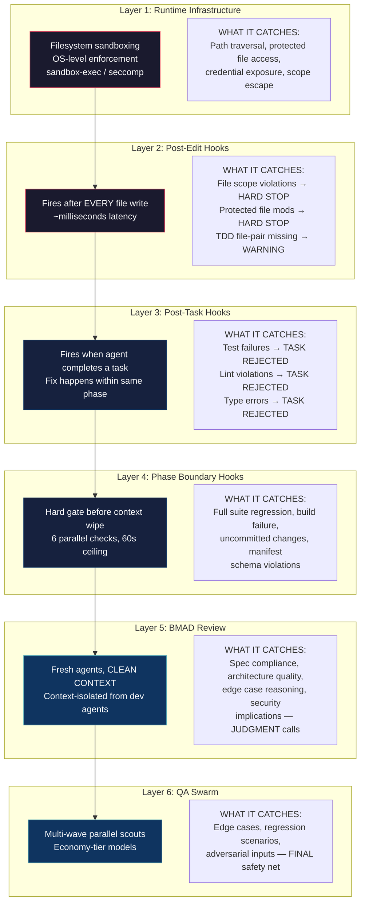

**Why this is best-in-class:** Most AI coding tools have *one* quality layer — self-review (which the PRD correctly identifies as worthless due to sunk-cost bias). The PRD's architecture makes three critical design choices that no competitor replicates:

1. **Context isolation is non-negotiable.** Dev agents and review agents never share context. This is the Phase Boundary Protocol's core guarantee. The agent that wrote the code is structurally prevented from reviewing it.

2. **Mechanical checks free judgment layers for judgment.** By the time BMAD sees code, it's already lint-clean, type-safe, test-passing, and scope-compliant. BMAD's entire context window focuses on "is this the *right* code?" — not "does this code compile?"

3. **The hook-learning reinforcement loop.** Phase boundary gate failures and their resolutions feed into the learning system. A pattern like "tests failed → missing mock → added mock → tests passed" becomes a Factory Learning injected into future agents in the same scope. The enforcement system *teaches* the factory:

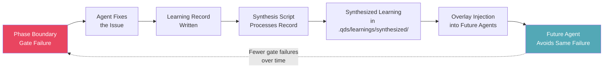

**TDD enforcement specifically** deserves attention. The post-edit hook (Layer 2) doesn't just check if tests exist — it checks for **file-pair correspondence**. Edit `webhook.ts` without editing `webhook.test.ts` and you get an immediate warning. This is a *convention* enforcement at the frequency of individual file writes, not a batch check at task completion. It trains agents to write tests alongside code, not after.

---

### B. Meta-Optimization (FR77-FR89) — Autonomous Self-Improvement

The success factors document (Section 5) calls for learning loop completeness — the factory should get better over time. The PRD goes *significantly further* than the success factors require. The success factors describe a data collection → injection loop. The PRD implements a full **closed-loop autonomous optimization system** with safety nets.

The complete meta-optimization lifecycle:

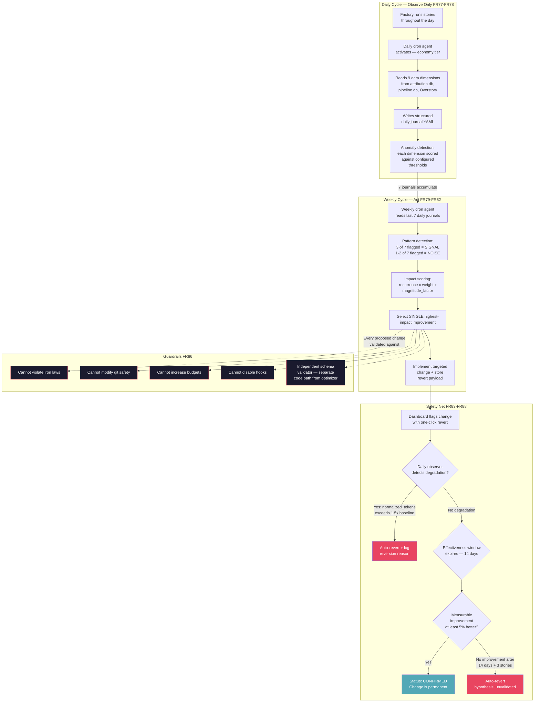

**The 9 analysis dimensions** the daily observer tracks cover the full operational surface:

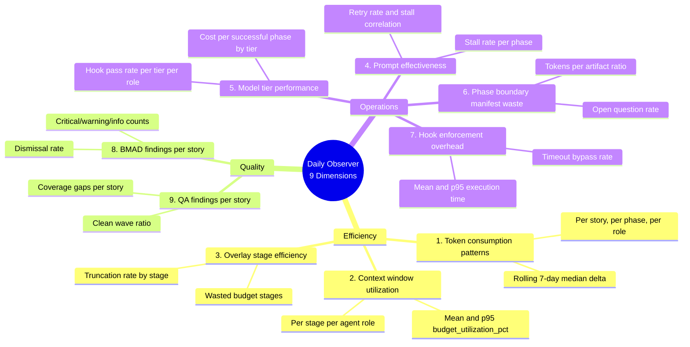

**Why this exceeds the success factors:** The success factors document (Section 5) describes learning loops as: collect data → synthesize → inject into future agents. The PRD adds three critical capabilities:

1. **Active parameter optimization.** The weekly optimizer doesn't just collect learnings — it *changes factory configuration*. Overlay composition weights, context budget allocation, prompt template parameters, and phase timeout multipliers are all adjustable. The factory tunes itself.

2. **Scientific rigor in evaluation.** Changes are evaluated using normalized metrics (FR84: `normalized_tokens_per_file = total_phase_tokens / count(files where line_delta > 10)`) with like-for-like classification (same work type, same complexity bucket). This prevents the optimizer from claiming credit for a good result that was actually caused by a simpler story.

3. **Multi-layered safety net.** The PRD defines four revert triggers plus drift monitoring:
   - Manual one-click revert via dashboard (FR83)
   - CLI revert fallback when dashboard is down (FR101)
   - Auto-revert on detected degradation (FR84: 1.5x baseline)
   - Auto-revert on effectiveness window expiry (FR88: 14 days, no >=5% improvement)
   - Cumulative drift monitoring (FR100: alert at 5+ parameter changes)

The success factors document asks "does the factory get better over time?" The PRD answers with a system that *autonomously optimizes itself while proving that each change made things better, and auto-reverting when it can't prove that*.

---

### C. Factory Learning System (FR164-FR168) — Compounding Intelligence

The success factors document's Section 8 ("The Compounding Advantage") describes time horizons from Sprint 1 to 12 months. The PRD's self-learning system (FR164-FR168) maps directly to this compounding vision, and the architecture is designed so that data collected on day one is still useful at month 12.

The system operates across three layers that compound on each other:

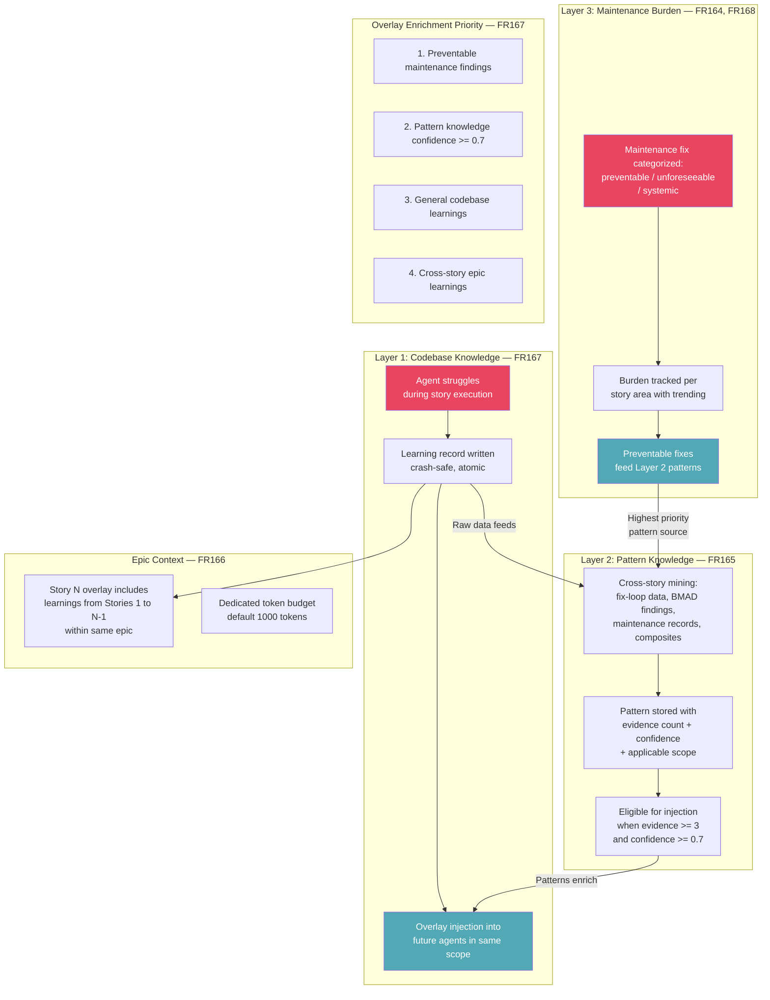

**The compounding mechanism** mapped against the success factors' time horizons:

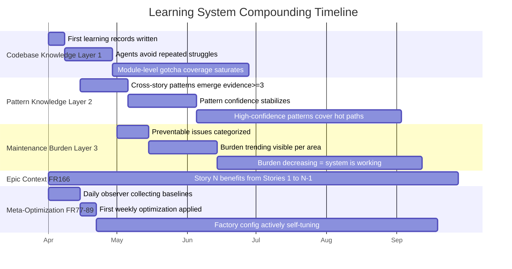

**Alignment with success factors time horizons:**

| Success Factor Horizon | PRD Mechanism | How It Compounds |
|---|---|---|
| Sprint 1: CI pass rate | Hook enforcement + learning records from gate failures | Gate failure patterns become learnings → fewer failures |
| 2-4 weeks: Pattern adherence | FR165 pattern knowledge with evidence >= 3 threshold | 3 stories confirming a pattern → auto-injection |
| 4-8 weeks: Self-assessment accuracy | FR131 confidence calibration with Brier score | Calibration accuracy improves as N phase transitions grow |
| 2-3 months: Trust trajectory | FR133 ELO ratings (Growth) per domain | Domain-specific ratings stabilize with story count |
| 3-6 months: Defect escape rate | FR168 maintenance burden tracking | Burden trending down = learning system is working |
| 6-12 months: Domain knowledge | FR165 + FR164 + Mulch promotion pathway | Accumulated patterns + promoted conventions |

The critical design choice is **evidence-gated injection** (FR165: `evidence_count >= 3 AND confidence >= 0.7`). The factory doesn't inject a learning after seeing it once — it requires multiple independent confirmations before it trusts a pattern enough to inject it. This prevents single-event noise from corrupting the overlay and means that injected patterns have been validated across stories.

---

### D. Economic Governance — Cost as Engineering Constraint

The success factors document (Section 6) discusses efficiency in terms of cycle time, rework rate, and parallelization yield. The PRD goes much deeper — it treats economics as a **first-class engineering constraint** with a complete attribution chain, multi-level circuit breakers, and tier-based model routing that makes the quality pipeline "economically negligible."

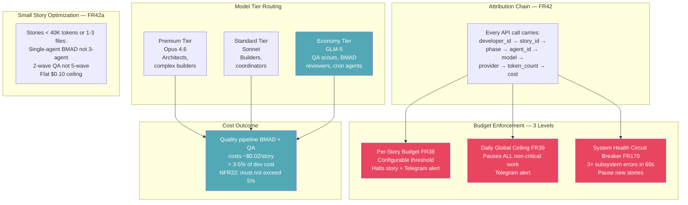

Key properties of the economic governance system:

**Complete cost visibility at every granularity.** The attribution chain (FR42) means you can answer: "How much did the BMAD review phase of Story WH-042 cost, broken down by agent and model?" This isn't a bolt-on metric — it's a structural requirement. No API call can be made without a complete chain (FR96: blocked, not silently executed).

**Tier routing makes quality free.** By routing QA scouts and BMAD reviewers to economy-tier models (GLM-5), the entire quality pipeline — 3-agent adversarial review + 5-wave QA swarm — costs under $0.05 per story. The quality pipeline is economically invisible:

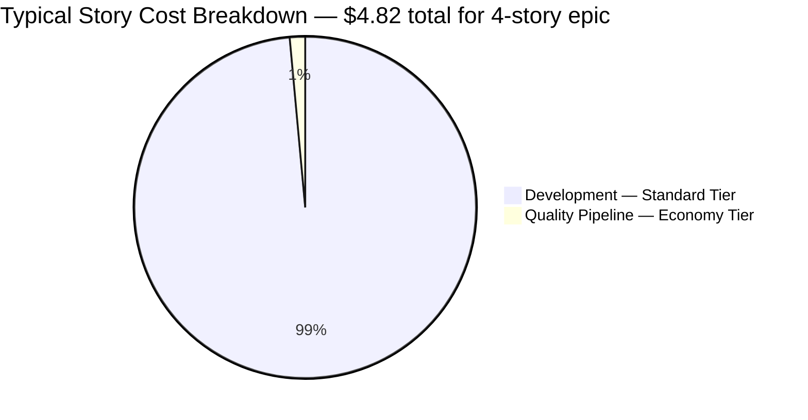

**Budget circuit breakers are proportional.** The three-level enforcement model (per-story → daily global → system health) means that a runaway story doesn't kill the factory — it halts *that story*. A bad day of spending halts *non-critical work*. A cascading system failure halts *new story starts* but lets in-progress work continue:

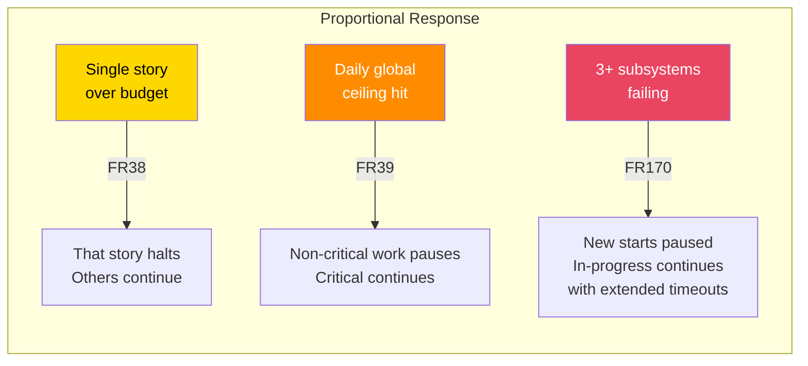

**FR42a (small story optimization)** solves a subtle mathematical problem. Without it, the 5% quality cost ceiling (NFR22) creates a perverse incentive: on a tiny task that costs $0.50 in dev tokens, 5% = $0.025, which is below the minimum cost of *one* economy-tier LLM call. The factory would either skip quality on small stories or violate the NFR by design. FR42a solves this with a flat $0.10 ceiling and a reduced pipeline (1-agent BMAD, 2-wave QA) for small stories — preserving quality coverage without mathematical impossibility.

**The meta-optimization system is itself cost-governed.** The daily cron observer must complete within 10 minutes at <=$0.50 (NFR6). The weekly optimizer must complete within 30 minutes at <=$2.00 (NFR7). Economy-tier models for all cron agents (FR77). The factory's self-improvement system is explicitly budgeted to not become a cost center itself.

---

### E. The Compound Effect — Systems Reinforcing Systems

These four systems are individually strong, but they are designed to **reinforce each other**:

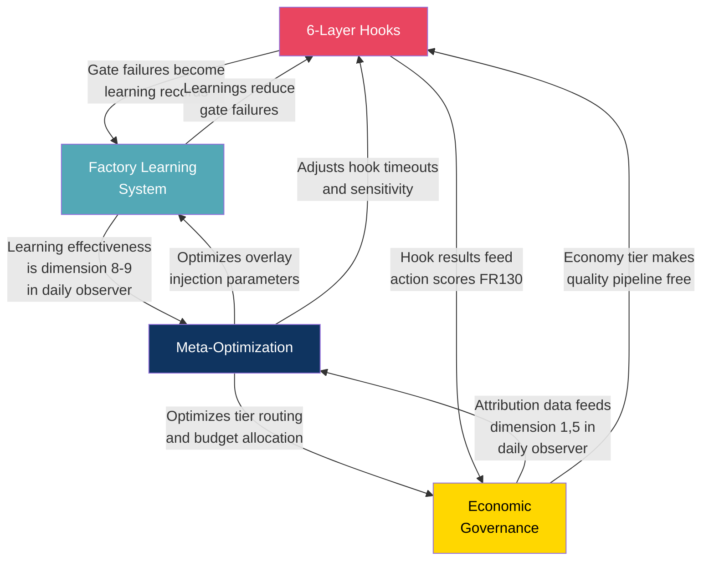

The factory doesn't just *have* these systems — they form a closed loop where each system produces data the others consume, and each system's output makes the others more effective. This is what the success factors document means by "the compounding advantage" — and the PRD's architecture is explicitly designed to produce it from day one.

---

## Appendix F: LSP + Knowledge Graph + claude-mem Evaluation

**Date:** 2026-03-15
**Methodology:** Five parallel research tracks analyzed from independent perspectives (LSP integration, knowledge graph architecture, claude-mem redundancy, systems architecture, competitive implications), then synthesized. Each track applied PhD-level rigor with explicit grounding — no assumed capabilities.

---

### F.1 The Semantic Gap in the Current Architecture

The factory's current codebase understanding operates at three levels, none of which capture the compiler's own structural knowledge:

1. **File-level** — FR152 (Lightweight Continuous Verification) checks file existence and regex-matched patterns. It answers "does `src/payments/handler.ts` contain an export named `processPayment`?" It cannot answer "what does `processPayment` accept as arguments, and what calls it?"

2. **Pattern-level** — FR165 (Pattern Knowledge Accumulation) stores correlational assertions like "stories modifying `src/payments/` require updates to `src/webhooks/event-handlers.ts`." These are mined from historical fix-loop data. The pattern may be true *because* `event-handlers.ts` imports from `payments/`, but the factory does not know this — it learned the correlation from repeated failures.

3. **Historical/statistical** — FR77's daily observer analyzes token consumption, stall rates, and BMAD finding rates. FR168 tracks maintenance burden by story area. None involves understanding the code's actual dependency graph.

**What is missing is the layer between "files exist" and "humans noticed a pattern": the compiler's own understanding of the codebase.** LSP provides this layer. A knowledge graph provides the structure to store, traverse, and reason over it.

---

### F.2 What LSP Provides — Mapped to Factory Gaps

LSP (Language Server Protocol) servers expose the compiler's semantic understanding via a standardized JSON-RPC API. Key operations and their factory relevance:

| LSP Operation | What It Returns | Factory Gap It Fills |
|---|---|---|
| `findReferences` | Every location referencing a symbol | **Blast radius scoring** — count downstream consumers of modified symbols. Currently no FR computes this. |
| `goToDefinition` | Resolves a reference to its definition site | **Import integrity** — verify all imports resolve after refactoring. Currently relies on `tsc --noEmit` (coarse). |
| `incomingCalls` / `outgoingCalls` | Call hierarchy traversal | **Function-level dependency graphs** — not just file-level. No current mechanism. |
| `goToImplementation` | Concrete implementations of interfaces | **Architecture compliance** — verify all implementations satisfy interface contracts. Currently BMAD judgment only. |
| `documentSymbol` / `workspaceSymbol` | All symbols in file/workspace | **Structural codebase map** — semantic precision vs. FR152's regex matching. |
| `hover` | Resolved type information | **Type compatibility checking** — queryable structured data vs. pass/fail type check. |

**Highest-impact integration points (ordered):**

1. **Blast radius scoring as pre-story risk gate.** `findReferences` on all exports in story scope → fan-out count = blast radius. Directly enables the confidence-gated autonomy model from the success factors document. (~300 LOC)

2. **Pre-BMAD structural briefing in Phase Boundary manifest.** Offload mechanical structural analysis from BMAD's context window. Include: modified symbol reference counts, new cross-module dependencies, interface implementation changes, circular dependency detection. (~200 LOC)

3. **Circular dependency detection as Layer 4 phase boundary gate.** Iterative `goToDefinition` cycle detection. Deterministic, zero-judgment, mechanically enforceable. (~150 LOC)

4. **Structurally-scoped learning injection.** Replace file-path matching (FR61) with dependency-graph matching. A learning about module A is injected for agents working on module B if B imports A — via `outgoingCalls`, not path prefix heuristic. (~200 LOC)

5. **Daily observer structural dimension (10th dimension).** Post-story LSP analysis: reference fan-out of modified symbols, unused symbol introduction, import graph depth changes. Objective, computable, no LLM required. (~250 LOC)

**What LSP does NOT solve:**
- Business domain knowledge (what entities mean, invariants, idempotency)
- Spec interpretation (whether code satisfies requirements)
- Historical pattern knowledge (what tends to go wrong over time)
- Cross-session learning (LSP has no persistence — each instance starts fresh)
- Non-code quality (test meaningfulness, observability, security, performance, naming)

LSP is a snapshot tool. The learning system is longitudinal. They are complementary, not overlapping.

---

### F.3 Knowledge Graph Evaluation — When Graph Structure Adds Value

#### F.3.1 The Honest Assessment

A knowledge graph is **premature for MVP and likely unnecessary for early Growth**. The factory's data relationships are structurally simpler than they appear, and the queries that seem to demand graph traversal can be efficiently served by SQLite with recursive CTEs and normalized junction tables.

**Current schema analysis:** The entity types are ~8 (Stories, Learning Records, Pattern Knowledge, Files, Agents, BMAD Findings, Epics, Overlay Effectiveness). The relationship types are ~13. The current schema stores relationships as JSON arrays inside columns (`files_affected`, `evidence_stories`, `learning_ids_injected`) — the classic anti-pattern that graph databases solve, but also solvable with junction tables.

#### F.3.2 Use Case Value Assessment

| Use Case | Graph DB Value | SQLite Alternative | Verdict |
|---|---|---|---|
| Blast radius via dependency fan-out | Medium (cleaner syntax) | Recursive CTE on adjacency table | **SQLite** — hard part is building the dep graph (static analysis), not querying it |
| Learning relevance by code proximity | Medium (natural traversal) | Recursive CTE with depth tracking, <10ms at factory scale | **SQLite** — graph advantage is syntactic, not functional |
| Pattern propagation to dependent modules | Low (variant of relevance) | Same recursive CTE | **SQLite** |
| Defect taxonomy correlation | None (analytical GROUP BY) | Standard SQL aggregation | **SQLite** |
| Epic context assembly | None (flat story-to-epic relationship) | SELECT + ORDER BY | **SQLite** |
| Architecture compliance | None (linter problem, not DB problem) | Static analysis tooling | **Not a DB concern** |
| **Cross-project learning transfer** | **High** (heterogeneous schema, entity types vary per project) | Awkward with fixed schema | **Evaluate when multi-project is real** |

**Key insight:** The only use case where a graph database provides genuine value over SQLite is cross-project learning transfer — a Vision-phase feature (not MVP, not Growth). At factory scale (<10K files, <100K learning records), SQLite recursive CTEs handle graph queries in <10ms.

#### F.3.3 Technology Recommendation

**Phase 1 (MVP): Normalize the JSON arrays. No knowledge graph.**

Replace JSON-array columns with proper junction tables:

```sql
CREATE TABLE learning_file_associations (
  learning_id INTEGER NOT NULL REFERENCES learning_records(id),
  file_path TEXT NOT NULL,
  PRIMARY KEY (learning_id, file_path)
);

CREATE TABLE pattern_evidence (
  pattern_id INTEGER NOT NULL REFERENCES pattern_knowledge(id),
  story_id TEXT NOT NULL,
  PRIMARY KEY (pattern_id, story_id)
);
```

This eliminates `json_each()` in queries, enables proper foreign keys, and makes the schema ready for JOIN-based graph queries.

**Phase 2 (Growth): Add a codebase dependency adjacency table.**

```sql
CREATE TABLE codebase_dependencies (
  source_file TEXT NOT NULL,
  target_file TEXT NOT NULL,
  dependency_type TEXT NOT NULL CHECK(dependency_type IN ('import','require','type_import')),
  PRIMARY KEY (source_file, target_file, dependency_type)
);
```

Populated by LSP static analysis. Refreshed on story completion. Enables recursive CTE-based blast radius and proximity queries.

**Phase 3 (Post-Growth, if empirically justified): Evaluate Kuzu embedded graph.**

Only if: codebase dependency graph exceeds 10K files with 50K+ import edges, recursive CTE queries exceed 50ms (profiled, not estimated), team has expanded beyond 2 developers, and multi-project learning transfer creates genuinely heterogeneous graph structures.

---

### F.4 claude-mem: What Survives a Knowledge Graph

claude-mem is currently a PATTERN SOURCE (not runtime dependency). Based on source code analysis, its core capabilities are:

- **Observation capture pipeline** with AI-powered compression (10K → 500 tokens)
- **Triple-redundancy storage** (SQLite + FTS5 + ChromaDB)
- **Progressive disclosure** — 3-layer retrieval (compact index → filtered context → full details), achieving ~10x token savings
- **Content-hash deduplication** (SHA-256 at insertion)
- **Fail-open context injection** — empty context rather than blocking if memory isn't ready
- **Smart Explore** — structural code understanding at 6-12x lower token cost

#### F.4.1 What a Knowledge Graph Subsumes

| claude-mem Pattern | Status with Knowledge Graph |
|---|---|
| Observation storage & categorization | **RETIRED** — graph entities with typed edges replace flat tables |
| Concept tagging | **RETIRED** — concepts become first-class graph entities with relationship edges |
| Hybrid search (FTS5 + Chroma) | **RETIRED** — graph traversal is a third search modality |
| Session/timeline organization | **RETIRED** — temporal edges + session nodes |
| File-observation linkage | **RETIRED** — first-class edges replace denormalized columns |

#### F.4.2 What Remains Independently Valuable

| claude-mem Pattern | Why It Survives | Factory Relevance |
|---|---|---|
| **Progressive disclosure (3-layer retrieval)** | Retrieval *strategy*, not storage concern. A graph gives richer data but makes budget-aware retrieval *harder*, not easier. | Directly applicable to overlay composition's per-stage token budgets. The graph surfaces more connected context — progressive disclosure is what prevents it from blowing through budgets. |
| **AI-powered compression** | Pre-graph processing. The graph needs compressed, structured input; it doesn't produce compression. | Factory needs this for learning record extraction from agent sessions. |
| **Content-hash deduplication** | Content-level dedup at ingestion (O(1), deterministic) vs. graph entity resolution (expensive, probabilistic). Different problems, both needed. | Prevents identical learnings; entity resolution handles semantic duplicates ("auth module" = "authentication service"). |
| **Fail-open context injection** | Architectural resilience pattern, storage-agnostic. | Critical — stuck memory system must not halt the pipeline. |

#### F.4.3 Verdict

**Partially retire claude-mem as pattern source.** Keep 4 patterns (progressive disclosure, AI compression, content-hash dedup, fail-open injection). Retire 5 patterns (storage, tagging, hybrid search, timeline, file linkage). The surviving patterns are retrieval/processing patterns, not storage patterns — which makes sense since the knowledge graph is fundamentally a storage upgrade.

**The synthesis: Knowledge Graph + claude-mem's progressive disclosure > either alone.** A knowledge graph gives richer, more connected data. Progressive disclosure is the retrieval strategy that makes that richness practical within token-constrained overlay composition. Without it, graph queries blow through token budgets by returning too much connected context.

---

### F.5 Systems Architecture Recommendation

#### F.5.1 Recommended Architecture: Option B — "Graph as Enrichment Cache"

**Core principle:** `pipeline.db` remains the source of truth for all learning data. The knowledge graph is a materialized, rebuildable view that combines `pipeline.db` learning records with LSP structural data. It is never on the critical path.

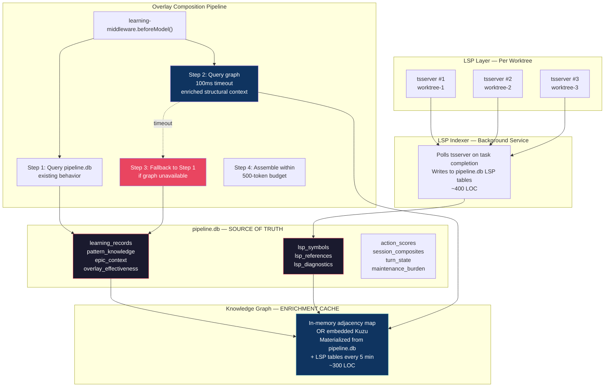

#### F.5.2 Why This Architecture

1. **Zero new failure modes on the critical path.** Delete the graph and every LSP server — the factory runs exactly as currently designed.

2. **Incremental value delivery.** Each phase delivers independently:

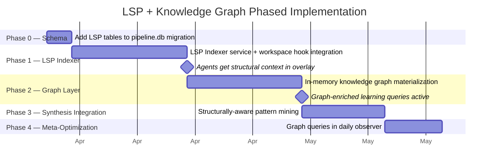

3. **Resource budget is manageable:**

| Component | Memory | Impact on 16GB Budget |
|---|---|---|
| 3 demand-managed tsserver instances | ~1.5 GB | 9.4% of total |
| In-memory knowledge graph | ~150 MB | 0.9% of total |
| LSP symbol cache (SQLite tables) | ~20 MB | negligible |
| **Total additional overhead** | **~1.7 GB** | **10.6%** |

On 8GB degraded mode: LSP must be disabled entirely. Configurable via `factory.yaml`.

4. **Worktree isolation is clean.** Each worktree gets its own tsserver instance with its own LSP cache partition (`story_id` column). Graph merges cross-story data at materialization time only.

#### F.5.3 Failure Modes

| Failure | Impact | Recovery |
|---|---|---|
| LSP server crash | Overlay loses structural context. Pipeline.db direct queries used instead. | Auto-restart (supervised, 3 retries). Dashboard shows amber. |
| Graph query timeout (>100ms) | Middleware falls back to direct pipeline.db. Overlay still within 500ms. | Metric logged. 3 consecutive timeouts → graph bypassed until next materialization. |
| Graph corruption | Rebuildable from pipeline.db + LSP cache. Zero data loss. | Automatic rebuild on next materialization cycle. |
| All LSP servers down | Factory continues with text-based learning only. No stall. | Same behavior as pre-LSP factory. |

#### F.5.4 Configuration

```yaml
# factory.yaml additions
lsp:
  enabled: true                     # false disables all LSP features
  max_concurrent_instances: 3       # demand-managed ceiling
  index_refresh: "on_task_complete" # or "on_file_save" or "manual"
  startup_timeout_ms: 30000         # kill tsserver if no response
  disabled_on_8gb: true             # auto-disable in degraded mode

knowledge_graph:
  enabled: true                     # false = middleware queries pipeline.db only
  materialization_interval_s: 300   # rebuild every 5 minutes
  query_timeout_ms: 100             # hard timeout in middleware
  storage: "memory"                 # "memory" or "kuzu"
```

Both features disabled = factory behaves exactly as currently designed. This is the escape hatch.

---

### F.6 Competitive Impact Assessment

#### F.6.1 Effect on Competitive Matrix

| Dimension | Current Score | With LSP + KG | Analysis |
|---|---|---|---|
| D8 (Learning System) | 1.0 | 1.0 (deepened moat) | Score unchanged — already full. Moat durability extends from 24-36 months to **36-48 months**. |
| D6 (Context Management) | 1.0 | 1.0 (enriched) | Overlay Stage 4 becomes structurally aware. Denser, more relevant context within same token budgets. |
| D2 (Adversarial Review) | 1.0 | 1.0 (indirect) | BMAD receives structural briefing in manifest — catches ripple-effect bugs text review misses. |

No new dimension is created. This is strategically correct — it avoids inflating the dimension count (already flagged as brittle) and deepens existing dimensions.

#### F.6.2 The Structural Learning Advantage

**Current (text-based):** "Stories modifying `src/payments/` require updates to `src/webhooks/event-handlers.ts`." — A string assertion matched by file path prefix.

**With knowledge graph (structural):** "`PaymentService.complete()` --calls--> `WebhookDispatcher.emit()` --requires--> `EventSchema.PaymentCompleted`." — An entity-relationship chain that survives file renames, explains *why* the relationship exists, and enables transitive inference.

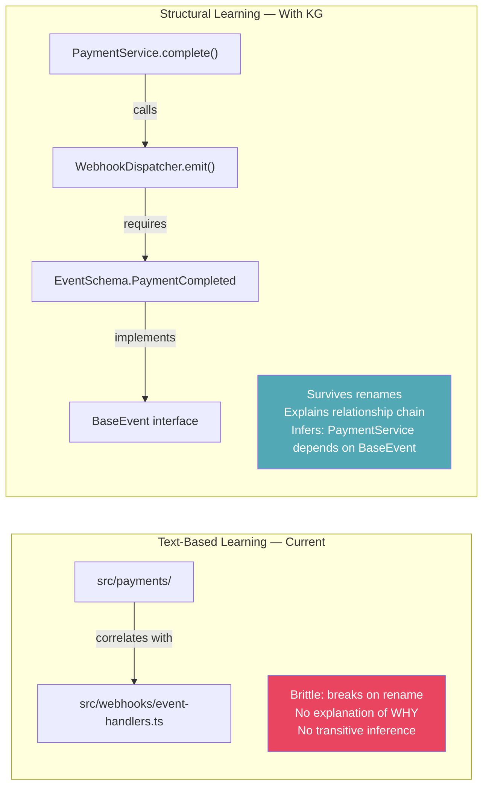

**Compounding difference:** Text learning compounds linearly — each record adds one assertion. Structural learning compounds super-linearly — each new entity creates potential relationships with all existing entities. After 100 stories, text has ~100 pattern assertions. A knowledge graph might have 500 entities with 2000+ relationships, many inferred from graph structure rather than directly observed.

#### F.6.3 Competitor Replication Analysis

| Competitor | Can They Add KG? | Can They Add Learning Loop? | Timeline to Full Replication |
|---|---|---|---|
| **Cursor** | Yes (already has codebase indexing) | Hard — requires agent-generated, outcome-weighted records | 12-18 months. KG without learning loop = better code index, not learning system. |
| **Claude Code** | Yes (3-6 months, Anthropic has capacity) | Hard — session-oriented, no cross-session persistence | 12-18 months. KG improves single-session understanding, not learning flywheel. |
| **GitHub Copilot** | Yes (repository-level understanding exists) | Hard — same structural limitation | 12-18 months. |

**Key insight:** The learning loop (FR55-FR63, FR164-FR168) is the moat. The knowledge graph is a moat deepener. A competitor who builds a KG without the underlying learning loop gets a better code index, not a learning system. The correct strategic sequence is: learning loop first (MVP) → KG amplification second (Growth).

#### F.6.4 Moat Durability

| Configuration | D8 Moat Estimate | Rationale |
|---|---|---|
| Text-based learning only (current) | 24-36 months | Data flywheel from outcome-weighted records |
| + LSP structural metadata | 30-40 months | Structurally-enriched patterns harder to replicate |
| + Full knowledge graph | 36-48 months | Transitive inference + 3-5x implementation surface + graph data compounds super-linearly |

---

### F.7 Unified Recommendation

#### F.7.1 Decision Matrix

| Question | Answer |
|---|---|
| Add LSP + Knowledge Graph to MVP? | **No.** Ship text-based learning loop first. The loop is the moat. |
| Add to Growth? | **Yes.** Phased: LSP metadata enrichment first, graph materialization second. |
| Knowledge Graph technology? | **In-memory TypeScript adjacency map** serialized to SQLite. Not Neo4j, not Memgraph. Evaluate Kuzu at post-Growth scale. |
| Does claude-mem survive? | **Partially.** Keep progressive disclosure, AI compression, content-hash dedup, fail-open injection. Retire storage/search patterns. |
| Does this delay MVP? | **No.** All LSP/KG work is Growth-phase. MVP ships unchanged. |
| Total estimated LOC? | **~1,050 LOC** across 4 phases (schema: 50, LSP indexer: 400, graph: 300, synthesis integration: 200, meta-opt queries: 100). |

#### F.7.2 Implementation Sequence

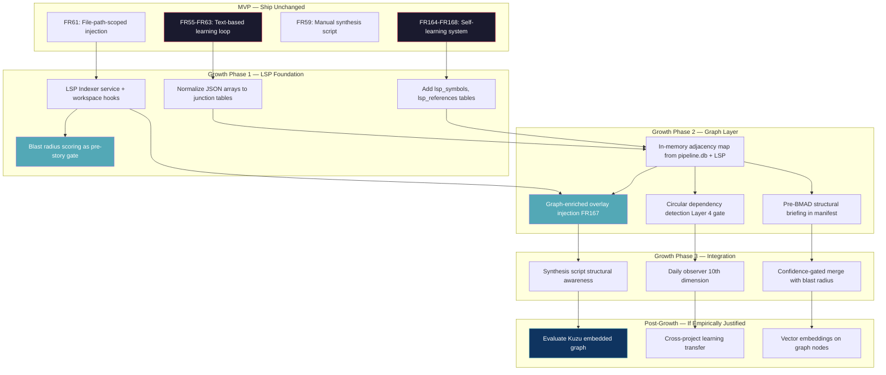

#### F.7.3 What NOT to Do

- **Do NOT add a server-mode graph DB** (Neo4j, Memgraph). Operational overhead is unjustifiable for 2 developers on dev laptops.
- **Do NOT start one LSP instance per agent.** One per worktree, shared by all agents in that worktree.
- **Do NOT make the graph a required dependency** for overlay composition. It must always be skippable with graceful degradation.
- **Do NOT attempt a unified graph that replaces pipeline.db.** Replaces a proven storage layer with an immature one. Single point of failure. Non-starter for a 2-person team.
- **Do NOT delay MVP for any LSP/KG work.** The learning loop must exist before the knowledge graph can amplify it.

#### F.7.4 ADR Recommendation

Add to `_bmad-output/planning-artifacts/architecture-v2-session10-amendments.md`:

> **ADR-026: LSP Integration and Knowledge Graph Strategy**
>
> **Decision (REVISED — see Appendix G):** Knowledge graph is an MVP foundation, not a Growth-phase addition. The code entity graph provides structural codebase understanding from day one (before any learning records exist) and serves as the storage backbone for learning records keyed to code entities rather than file paths. LSP or GitNexus provides the indexing layer. Embedded graph engine (Kuzu/LadybugDB) stores the graph alongside `pipeline.db` (which retains relational/transactional data).
>
> **Rationale:** The previous conclusion ("SQLite recursive CTEs are sufficient") was challenged on five grounds — see Appendix G for the full counter-argument. The revised position: the knowledge graph is a data model decision with 6-month consequences, not an optimization. Learning records keyed to file paths silently rot on refactoring; records keyed to code entities survive. Starting with entity-based storage means every record is graph-ready from day one.
>
> **claude-mem pattern source:** Partially retired. Progressive disclosure, AI compression, content-hash dedup, and fail-open injection patterns retained. Storage and search patterns retired (subsumed by graph layer).

---

## Appendix G: Revised Knowledge Graph Analysis — The Case for MVP Inclusion

**Date:** 2026-03-15
**Context:** The initial analysis (Appendix F) concluded that a knowledge graph was "premature for MVP." This appendix presents the counter-argument, informed by deeper analysis of query complexity, the dual-use case, GitNexus as a reference implementation, and the economic impact of graph-informed agents.

---

### G.1 Why the Initial "Not Needed for MVP" Conclusion Was Wrong

The initial analysis made five errors that, taken together, reversed the recommendation.

#### Error 1: Evaluated the Schema, Not the Query Patterns

The initial analysis looked at the factory's data and saw "~8 node types and ~13 edge types" and concluded "this is a small graph schema." But data model fitness is determined by **query patterns**, not schema size.

The factory's own specifications require these queries at runtime (within the 500ms overlay assembly budget):

1. **Dependency-aware learning injection (FR61, FR167):** "Find all learning records whose `files_affected` contains any file that imports or is imported by `handler.ts`, shares a type dependency, is in the same call chain, or is tested by a common test file." In SQLite, this requires four separate recursive CTEs joined through JSON array extraction (`json_each(lr.files_affected)`).

2. **Blast radius scoring (gap analysis rec. 10):** Fan-out computation from a set of files through transitive import chains. SQLite has no built-in shortest-path function — you must implement BFS in a recursive CTE with cycle detection.

3. **Circular dependency detection (gap analysis rec. 17):** Literally cycle detection in a directed graph. Recursive CTEs can detect cycles, but the standard approach requires tracking visited paths and does not report *which* cycle was detected.

4. **Pattern knowledge propagation (FR165):** "What directories does `src/payments/` transitively co-require?" Requires NLP extraction from text-stored pattern descriptions, then recursive application of extracted relationships.

In Cypher (Kuzu/LadybugDB), the dependency-aware learning injection query is:

```cypher
MATCH (f:File {path: 'src/payments/handler.ts'})-[:IMPORTS|:CALLS|:USES_TYPE*1..5]-(related:File)
MATCH (lr:LearningRecord)-[:AFFECTS]->(related)
RETURN lr ORDER BY lr.confidence DESC LIMIT 10
```

In SQLite, the same query requires ~30 lines of nested recursive CTEs with JSON extraction. The claim that "SQLite recursive CTEs handle graph queries at factory scale" confused "technically possible" with "practically maintainable."

#### Error 2: Assumed the Alternative Was a Graph Server

The analysis argued against Neo4j's operational complexity. But the real alternative is an **embedded graph library** — Kuzu or LadybugDB. These are to graph data what SQLite is to relational data: in-process, zero-config, file-based. Adding Kuzu is operationally equivalent to adding another SQLite database. The team already manages 6 SQLite databases.

#### Error 3: Measured Complexity by Component Count, Not Cognitive Load

The factory already has: 6 SQLite databases, 6-layer enforcement, 6-stage overlay composition, 7-middleware chain, 9-dimension meta-optimization observer, 3-layer learning architecture. Adding one embedded graph library is less total complexity than writing and maintaining 8+ recursive CTEs with JSON extraction and cycle detection.

Cypher is learned in an afternoon. Recursive CTEs with cycle detection in SQLite take a week of careful study to write correctly. The graph **reduces** cognitive load per query.

#### Error 4: Treated Data Model as Optimization, Not Foundation

The `learning_records` schema stores `domain TEXT` (file path prefix) and `files_affected TEXT` (JSON array of file paths). FR61 matches learnings by string prefix on paths.

**The file-path lock-in problem:** If the factory accumulates 6 months of records keyed to `src/payments/handler.ts`, and then that file is refactored to `src/billing/payment-handler.ts`, every learning record with matching paths becomes orphaned. No error is thrown. The learning system silently degrades.

With entity-based storage in a graph, the learning record is attached to the `PaymentService.charge()` node, not to a file path. When the file moves, a re-indexing pass updates the file path property. The learning's edge to the entity remains intact. This is not optimization — it is the difference between a learning system that survives refactoring and one that silently rots.

#### Error 5: Did Not Consider the Dual-Use Case

The factory builds code for TARGET projects. A code entity graph of the target codebase provides value **before a single learning record exists**:

- **Import graph:** Dependency-aware task scoping, blast radius scoring, circular dependency detection
- **Function/class graph:** Entity-level learning attachment, call-chain-aware overlay injection
- **Test coverage graph:** Test coverage gap analysis, integration test verification

The success factors document explicitly calls for "a structural model of the codebase — not just content familiarity." A code entity graph closes this gap from day one.

---

### G.2 GitNexus as Reference Implementation

[GitNexus](https://github.com/abhigyanpatwari/GitNexus) (13.7K stars, actively developed) is a code intelligence engine that indexes repositories into a knowledge graph and exposes it via MCP tools. It validates the feasibility of every architectural choice the factory needs.

#### G.2.1 What GitNexus Proves Is Feasible

| Capability | GitNexus Implementation | Factory Relevance |
|---|---|---|
| **Multi-language code parsing** | Tree-sitter native bindings for 12+ languages (TS, Python, Go, Rust, Java, etc.) | Factory targets TypeScript primarily; Tree-sitter handles this |
| **Embedded graph storage** | LadybugDB (Kuzu fork/successor), file-based, Cypher queries, N-API Node.js bindings | Validates embedded graph on dev machines |
| **Blast radius analysis** | `impact` MCP tool with configurable depth (d=1 direct, d=2 likely, d=3 transitive) | Directly implements gap analysis recommendation 10 |
| **Structural context for agents** | `context` MCP tool: 360-degree symbol view (callers, callees, inheritance, processes) | Directly implements overlay enrichment |
| **Change impact detection** | `detect_changes` maps git diffs to affected symbols and execution flows | Powers pre-BMAD structural briefing |
| **Community detection** | Leiden algorithm on call/inheritance graph — identifies functional clusters | Enables module-aware learning injection |
| **Memory management** | 20MB chunk processing, limits peak to ~200-400MB per chunk | Fits 16GB constraint |
| **Worker parallelism** | Up to 8 Tree-sitter workers for parsing | Uses available CPU cores efficiently |

#### G.2.2 GitNexus Architecture — What to Adopt vs. Build

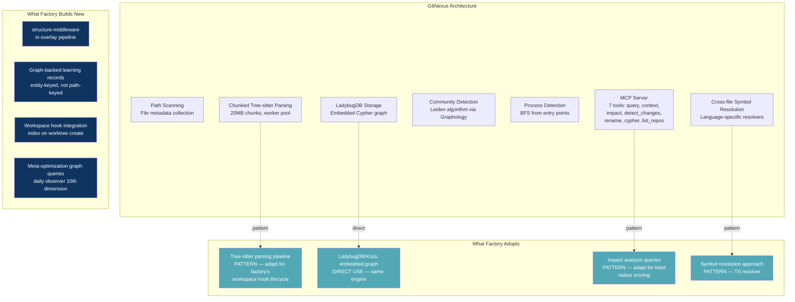

#### G.2.3 Licensing Consideration

GitNexus uses the **PolyForm Noncommercial 1.0.0** license, which restricts commercial use. The factory should:
- **Study GitNexus's architecture and query patterns** as design inspiration (same approach as ZeroClaw, claude-mem)
- **Use the same embedded graph engine** (LadybugDB/Kuzu — separately licensed, permissive)
- **Build the factory's own indexing pipeline** inspired by GitNexus's chunked Tree-sitter approach
- **NOT import GitNexus code directly** — it is a PATTERN SOURCE, like the other research repositories

This is consistent with the factory's existing approach to source projects: "study their patterns, take what fits, build what is right for our stack."

---

### G.3 The Economic Case: What Graph-Informed Agents Save

#### G.3.1 Token Waste from Discovery

Without structural codebase understanding, agents spend ~20,000-25,000 tokens per story on discovery: reading files to understand interfaces, finding sibling implementations, tracing imports, locating test patterns. This is 20-25% of a typical 100K-token session budget, consumed before a single line of code is written.

With a knowledge graph injecting ~200-400 tokens of pre-computed structural context into the overlay:
```
PaymentProvider interface (src/types.ts:L45): requires charge(), refund(), getStatus().
Implementations: StripeProvider, PayPalProvider.
Dependents: 7 modules import from src/payments/.
Error pattern: all providers use Result<T, PaymentError>.
Test pattern: __tests__/providers/{name}.test.ts, uses createMockPaymentContext().
```

This eliminates ~15,000-20,000 tokens of discovery (75-80% reduction). Across 10-15 stories per day at maturity, the aggregate savings is 150,000-300,000 tokens/day — equivalent to 2-3 full agent sessions recovered for productive work.

#### G.3.2 BMAD Finding Prevention

A knowledge graph prevents three defect categories by informing agents BEFORE they write code:

| Defect Category | Current % of Findings | Graph Prevention Rate | Findings Prevented per Story |
|---|---|---|---|
| Codebase pattern miss | ~30% | ~60-70% | 0.6-1.3 |
| Architecture violation | ~15% | ~70-80% | 0.4-0.75 |
| Scope violation | ~10% | ~40-50% | 0.1-0.3 |
| **Total** | | | **~1.1-2.3** |

Each prevented finding eliminates one fix-loop iteration at ~15,000-30,000 tokens (standard tier). Preventing 1-2 findings per story saves $0.10-0.40 in fix-loop costs.

#### G.3.3 Aggregate Per-Story Impact

| Metric | Without Graph | With Graph | Delta |
|---|---|---|---|
| Discovery tokens | ~20,000-25,000 | ~3,000-5,000 | **-75-80%** |
| BMAD findings | ~3-6 | ~2-4 | **-25-40%** |
| Fix-loop iterations | ~2-4 | ~1-2 | **-50%** |
| Development cost | ~$0.80-1.20 | ~$0.60-0.96 | **-18-25%** |
| Fix-loop cost | ~$0.20-0.80 | ~$0.10-0.40 | **-50%** |
| First-attempt L2-L4 pass rate | ~40-50% | ~60-70% | **+20 pp** |
| **Total per-story cost** | **~$1.05-2.05** | **~$0.73-1.40** | **-25-35%** |

The primary value is not cost reduction — it is **shifting error detection left**. Instead of catching architecture violations in BMAD review (Layer 5, after the development agent has spent its full session budget), the graph prevents them at overlay composition time (before a single token is spent on coding).

---

### G.4 Revised Architecture: Graph as MVP Foundation

#### G.4.1 The Two Graphs

The factory needs two distinct but connected graphs:

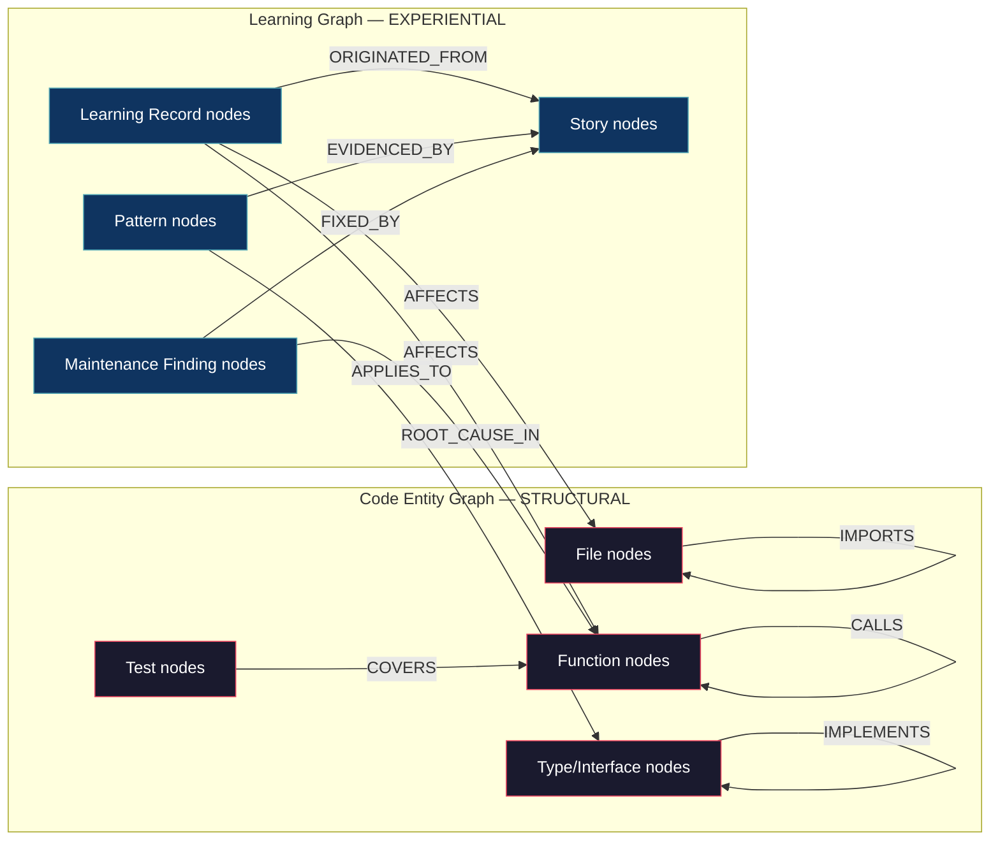

**Code Entity Graph (populated at story intake by Tree-sitter indexing):**
- Provides structural understanding from day one, before any learning records exist
- Refreshed on each `git pull` and after each story's code is merged
- Enables: blast radius scoring, architecture compliance, dependency-aware task scoping

**Learning Graph (populated as stories complete):**
- Learning records keyed to code entities, not file paths
- Survives refactoring because entity identity is structural, not path-based
- Compounds with every story — and compounds super-linearly because each new entity creates relationships with all existing entities

The bridge between them: learning records have `AFFECTS` edges to code entities. When the overlay composition pipeline queries "what learnings are relevant to this story?", it traverses from the story's file scope → code entities → learning records through the graph, not through path prefix matching.

#### G.4.2 Integration with Overlay Composition

A new `structure-middleware` component in the ADR-021 middleware chain (order 35, after learning-middleware at 30):

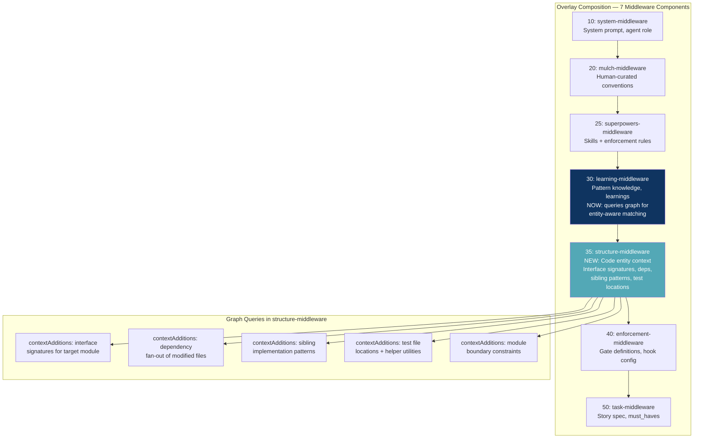

**Token budget:** ~200-500 tokens for structural context. Comparable to learning-middleware's ~500 token budget. Combined total stays within the overlay's context budget rule (FR155: 50% of model context for overlay).

#### G.4.3 GitNexus-Inspired Indexing Pipeline

Adapted for factory's workspace hook lifecycle:

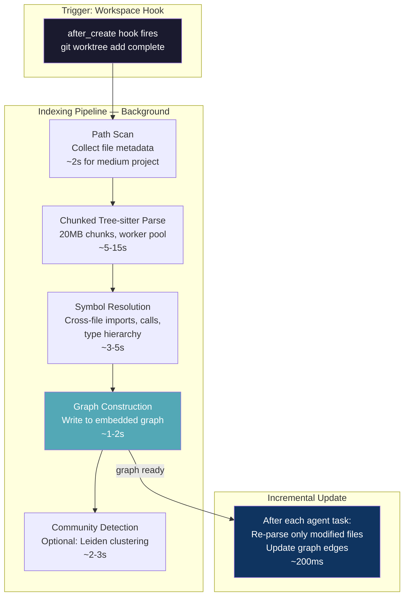

**Total cold-start indexing time:** ~15-30s for a medium TypeScript project. This runs in the background during worktree setup — the agent doesn't wait. If the graph isn't ready when the first agent spawns, `structure-middleware` returns empty `contextAdditions` (fail-open, claude-mem pattern).

#### G.4.4 Where Things Live

| Data | Store | Rationale |
|---|---|---|
| Code entities + relationships | Embedded graph (Kuzu/LadybugDB) | Graph-native queries, entity identity |
| Learning records | Embedded graph (nodes with `AFFECTS` edges to entities) | Entity-keyed, survives refactoring |
| Pipeline state (stories, phases, budget) | pipeline.db (SQLite) | Transactional, relational |
| Attribution chains | attribution.db (SQLite) | Append-only, relational |
| Agent lifecycle | sessions.db (SQLite, Overstory) | Existing system, no change |
| Mail | mail.db (SQLite, Overstory) | Existing system, no change |
| Performance scores | pipeline.db (SQLite) | Relational aggregation |

SQLite retains ownership of all transactional/relational data. The graph owns structural and learning data where relationship traversal is the primary access pattern.

---

### G.5 Revised Implementation Sequence

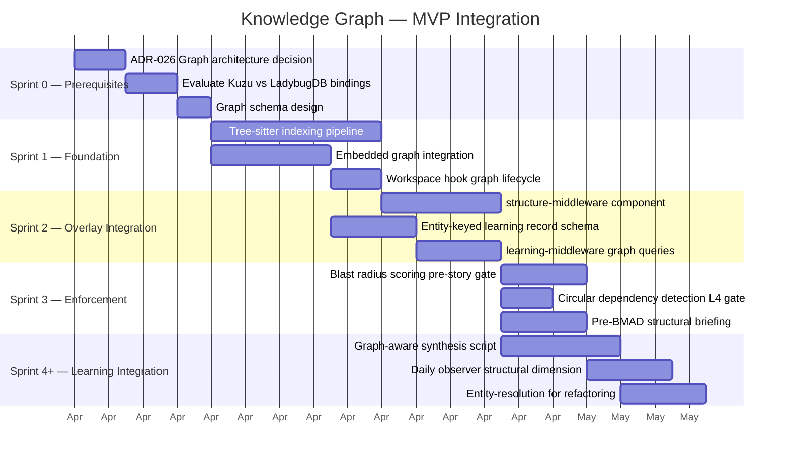

**Total estimated LOC:** ~1,800-2,200 (indexing pipeline: 600, graph integration: 300, structure-middleware: 300, entity-keyed learning schema: 200, blast radius + compliance gates: 300, synthesis integration: 200)

This is larger than the initial estimate (~1,050 LOC) but replaces the need for 6+ junction tables, 8+ recursive CTEs, JSON extraction logic, and bespoke cycle detection — which would have been ~800 LOC of worse code.

---

### G.6 Revised ADR-026

> **ADR-026: Knowledge Graph as MVP Foundation (REVISED)**
>
> **Decision:** The code entity graph is an MVP foundation, not a Growth addition. An embedded graph engine (Kuzu or LadybugDB) stores code structure and learning relationships alongside `pipeline.db` (which retains transactional/relational data). The graph is populated by Tree-sitter indexing at worktree creation and updated incrementally after each agent task. Learning records are keyed to code entities, not file paths.
>
> **Rationale:**
> 1. The factory's query patterns (dependency-aware learning injection, blast radius scoring, circular dependency detection, architecture compliance) are graph problems. Implementing them in SQLite requires 8+ recursive CTEs with JSON extraction — more code, worse readability, worse maintainability than Cypher queries against an embedded graph.
> 2. Learning records keyed to file paths silently rot on refactoring. Entity-keyed records survive. This is a data model decision with 6-month consequences — starting with entity-based storage means every record is graph-ready from day one.
> 3. The code entity graph provides structural codebase understanding before any learning records exist (dual-use case). Agents receive interface signatures, dependency graphs, and sibling implementation patterns at overlay composition time, reducing discovery token waste by 75-80%.
> 4. GitNexus (13.7K stars) validates feasibility: Tree-sitter parsing + embedded graph (LadybugDB) + MCP integration. The factory adopts patterns, not code (PolyForm Noncommercial license).
> 5. Kuzu/LadybugDB is an embedded library with equivalent operational complexity to SQLite — no server, no network, file-based, ACID transactions.
>
> **claude-mem pattern source:** Partially retired. Progressive disclosure (critical for graph-enriched retrieval within token budgets), AI compression, content-hash dedup, and fail-open injection patterns retained. Storage and search patterns retired.
>
> **Risk mitigation:** The graph is never a required dependency for overlay composition. `structure-middleware` and `learning-middleware` both implement fail-open: if the graph is unavailable, they return empty `contextAdditions` / fall back to `pipeline.db` direct queries. The factory degrades to its pre-graph behavior, not to failure.
