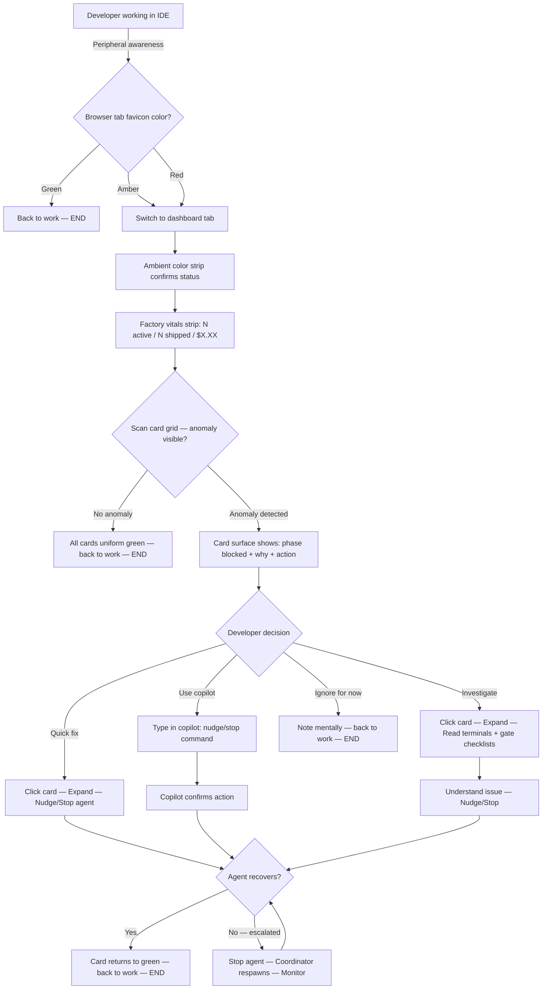
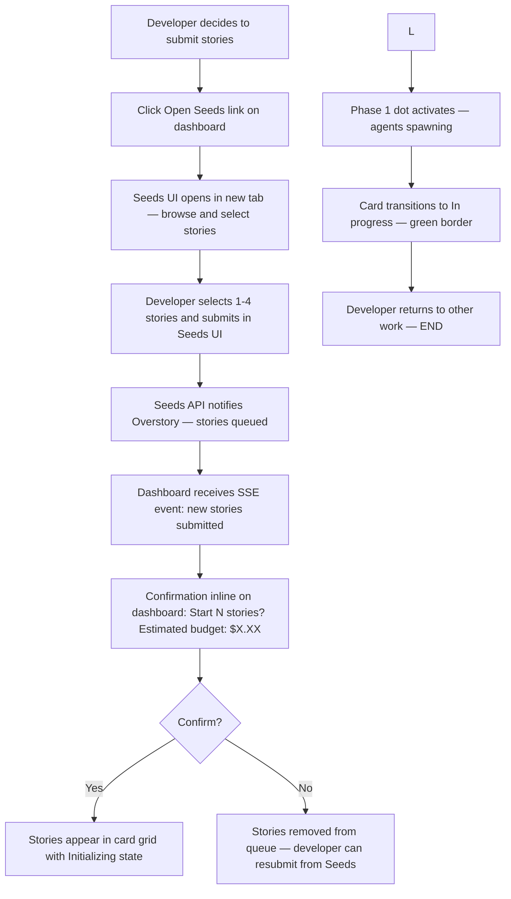
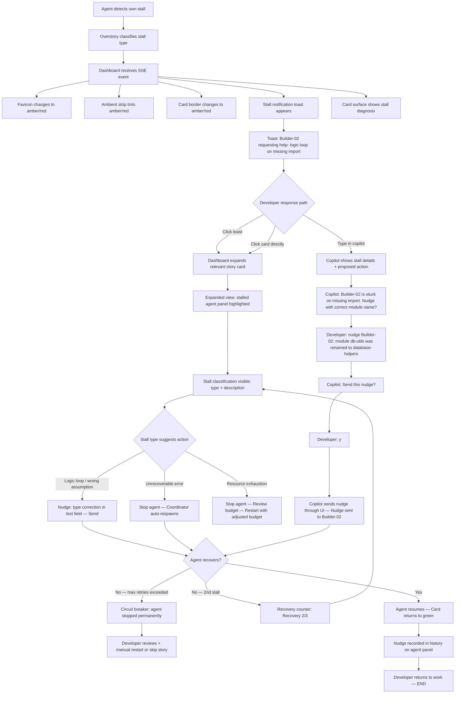
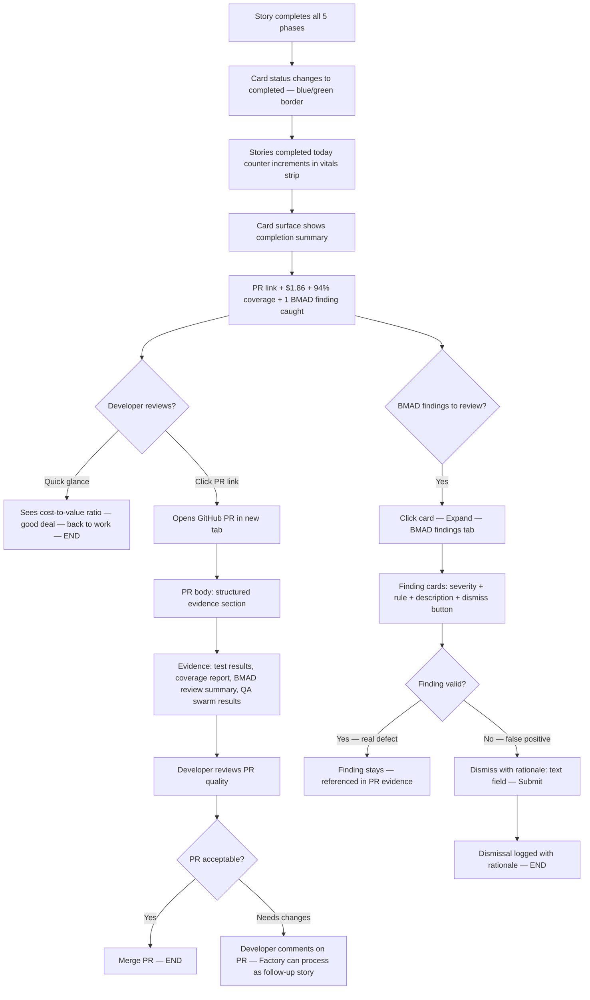
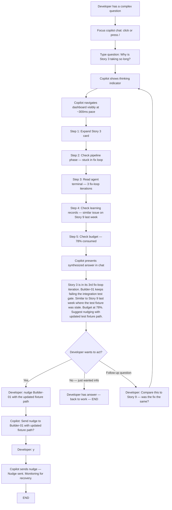

---
stepsCompleted:
  - step-01-init
  - step-02-discovery
  - step-03-core-experience
  - step-04-emotional-response
  - step-05-inspiration
  - step-06-design-system
  - step-07-defining-experience
  - step-08-visual-foundation
  - step-09-design-directions
  - step-10-user-journeys
  - step-11-component-strategy
  - step-12-ux-patterns
  - step-13-responsive-accessibility
  - step-14-complete
inputDocuments:
  - "_bmad-output/planning-artifacts/prd.md"
designSystem:
  framework: "React 19 + TypeScript + Vite"
  styling: "Tailwind CSS"
  theme: "Dark mode (dev-tools aesthetic)"
  scaffolding: "ZeroClaw fork (React + TS + Vite + Tailwind shell)"
  copilot: "CopilotKit + AG-UI"
---

# UX Design Specification QDS-Engineer-New

**Author:** Steve
**Date:** 2026-03-02

---

## Executive Summary

### Project Vision

QDS Engineer v2 is a developer operations control plane — a real-time dashboard that provides visibility, control, and trust over an autonomous multi-agent coding factory. The UX does not generate work; it observes, intervenes when needed, and builds confidence in factory output quality and economics. A conversational AI copilot provides natural language access to the entire dashboard, enabling investigation and control through conversation.

### Target Users

**MVP users:** Steve and Marcus — experienced developers with high technical literacy who need information density, fast controls, and zero-latency observation-to-action. They don't need tutorials or guided flows; they need power-user efficiency.

**Growth users (future):** Solo indie devs (simplicity + cost visibility), startup CTOs (throughput + multi-repo), agency leads (per-client isolation + attribution). UX must scale from power-user density to guided onboarding without dumbing down the power-user experience.

### Key Design Challenges

1. **Information density without overwhelm** — 12 concurrent agent panels, budget tickers, stall indicators, phase progression, hook results, all real-time. Must support both 30-second glance-check and 15-minute deep-dive debugging modes.
2. **Precise control over an autonomous system** — stop, nudge, inspect, dismiss findings on exactly the right agent/story without accidental cross-story impact.
3. **Phase boundary legibility** — 5-phase pipeline with gate checklists must be scannable at a glance per story: progressing, blocked at gate, in fix loop, completed.
4. **Economic transparency without anxiety** — cost visibility that builds confidence when on track and alerts only when warranted. Quality pipeline cost presented as nearly-free reinforcement.
5. **Meta-optimization trust** — showing AI self-modifications with enough transparency to build trust: what changed, why, did it work, one-click revert.
6. **Copilot as power multiplier, not crutch** — the conversational copilot must enhance expert users (faster investigation, hands-free control) without becoming a dependency that hides the dashboard's direct interface.

### Design Opportunities

1. **Two-mode dashboard (Overview + Detail)** — glance-check mode for "is everything OK?" and deep-dive mode for debugging. Solves density-without-overwhelm.
2. **Agent output as narrative** — hook result banners, stall classification overlays, and phase transition animations transform raw terminal output into a readable story of agent work.
3. **Pipeline-as-progress-bar** — horizontal phase progression with gate checkpoints. Green checkmarks = passed, red X = blocked, cycling indicator = fix loop. Instant visual status per story.
4. **Cost as confidence** — budget projection arcs (green/yellow/red), quality pipeline cost as footnote, model tier visibility as informational not anxious.
5. **Conversational access to everything** — natural language queries, investigations, and actions through the copilot eliminate the need to learn click paths, filter mechanisms, or navigation patterns. The developer just asks.

### Design System Foundations

- **Framework:** React 19 + TypeScript + Vite (ZeroClaw fork)
- **Styling:** Tailwind CSS
- **Theme:** Dark mode, dev-tools aesthetic (terminal-adjacent, high contrast for status indicators)
- **Copilot:** CopilotKit + AG-UI (bidirectional streaming, programmatic UI control)
- **Mock Generation:** Google Stitch with enterprise-grade prompts per design section

## Core User Experience

### Defining Experience

The core interaction pattern is the **glance-check loop**, operating across 6 progressive disclosure layers:

**Layer 0 — Browser Tab (0.0s, no tab switch):** Favicon changes color (green/yellow/red). Tab title shows status: `🟢 QDS 4/4` (all clear), `🟡 QDS 3/4 ⚠` (attention), `🔴 QDS STALL` (action needed). Developer checks factory status 50+ times/day without leaving their current tab.

**Layer 1 — Ambient Color Strip (0.0-0.3s after tab switch):** Full-width header bar with ambient color reflecting aggregate factory status. Dark green tint = all clear. Amber = attention. Red = action needed. Pre-attentive processing — the developer registers status before consciously reading anything.

**Layer 2 — Story Card Grid (0.3-0.8s):** Collapsed card grid is the default state. Each active story is a card with border color = status, pipeline progress bar (5 phases as dots), cost mini-bar, agent count, and task duration indicator. Visual uniformity in the success state — identical cards, identical colors, identical rhythms. Anomalies break the pattern and draw the eye via pop-out effect. No xterm.js rendering in this state — performance-friendly.

**Layer 3 — Story Card Surface (0.8-2.0s, only if anomaly detected):** The anomalous card shows which phase is blocked, why (1-line summary), and the primary action (Stop / Nudge / View). No clicking needed to get the diagnosis.

**Layer 4 — Expanded Story Detail (>2s, intentional click):** Click card → story expands in-place, taking most of the viewport. Agent panels render xterm.js instances lazily — only terminals visible in the viewport are active; off-screen terminals show a static last-line snapshot; scrolling into view activates the terminal with buffered output catch-up. Pipeline phase detail shows gate checklists. Budget projection shows the arc. Other story cards collapse to a sidebar/top strip showing just their status colors — **focus + context** pattern. The developer never loses aggregate awareness while drilling into one story. Controls are story-scoped — all visible controls apply only to the expanded story's agents. Collapse expanded story via: (1) close button (top-right of expanded view), (2) clicking any collapsed card in the sidebar (switches focus), (3) Escape key. All three return to the full card grid with the previously-expanded card scrolled into view.

**Layer 5 — Conversational Copilot (any time, natural language):** The chat bar provides natural language access to everything in Layers 0-4 plus data sources not directly visible in the UI (learning records, meta-optimization journals, Mulch expertise, attribution logs). The developer can ask, investigate, and act through conversation. The copilot navigates the dashboard visibly — the developer watches the UI respond to the copilot's actions. This layer transcends the visual hierarchy: it can answer questions that would require navigating multiple layers manually.

**Empty state (zero active stories):** Card grid area shows a centered message: "No active stories. Select stories from Seeds to start the factory." with a link/button to the Seeds backlog. Factory vitals strip shows "0 active / N shipped today / $X.XX today." Ambient color strip is neutral (dark gray, no status tint).

**Below the fold — Secondary Information (scroll-to-reveal):** Available on scroll, never competing with the primary story grid. Content is Growth — MVP ships with the primary story grid only. The below-the-fold area is reserved but empty in MVP. **Growth content:** Meta-optimization timeline (horizontal timeline of confirmed changes with before/after metrics, one row per change), monthly cost trajectory (line chart, daily cost as dots, 30-day rolling average as line), factory learning history (list of learned patterns with date, description, and impact metric). These will be specified in detail when Growth planning begins.

**Keyboard shortcuts (MVP):** `Esc` = collapse expanded story / close copilot, `/` = focus copilot chat input (quick-access, no modifier), `Ctrl+K` = focus copilot chat input (standard modifier shortcut), `Ctrl+Shift+A` = toggle copilot panel open/closed, `1-9` = expand story card by position. **Growth:** `Ctrl+K` evolves into a full command palette (copilot + action search).

### Factory Vitals Strip

Three primary numbers always visible in the header, adjacent to the ambient color strip — the "primary flight display" of the factory:

1. **Stories running** (e.g., "4 active")
2. **Stories completed today** (e.g., "2 shipped")
3. **Total cost today** (e.g., "$6.42")

Plus conditional indicators:
- **Active Experiment** — when a meta-optimization change is within its effectiveness window: "Week 1/2: Overlay budget rebalance"
- **Co-dev activity** — subtle indicator when other factory instances are active on the same repo: "1 other instance active"

### Dashboard Copilot

**Architecture:** CopilotKit (frontend hooks) + AG-UI protocol (bidirectional streaming) + Pi SDK economy-tier agent.

**Chat bar design:**
- Docked to the right edge, collapsible to a thin strip with a chat icon
- When expanded, takes ~300px width (default). Panel is resizable via drag handle (range 280-500px). Width preference persisted in localStorage. Dashboard content reflows (doesn't overlap)
- Supports text input (MVP) and voice input (Growth — Web Speech API)
- Dark mode consistent with dashboard theme — slightly lighter background than main content area for visual separation
- Chat messages use monospace font for data, sans-serif for narrative
- Action indicators interleaved with responses: "📍 Navigating to Story 3...", "🔍 Checking learning records...", "✅ Nudge sent to Builder-03"
- Action indicators are clickable — replays the navigation if the developer missed it
- Copilot can embed mini UI elements in chat: cost charts, agent status badges, finding summaries
- Chat scrolls vertically with newest messages at the bottom. Session history capped at 100 messages with older messages archived (accessible via "Load earlier" link). Developer can clear chat with a "Clear" button — clears visual history but copilot retains session context for continuity

**Three interaction modes:**

**Ask (read-only):** "How much have I spent today?" / "Which stories are in QA?" / "Show me Story 2's BMAD findings." Copilot queries dashboard state and presents answers in the chat or by navigating the UI to the relevant view. No state modification.

**Investigate (read + navigate):** "What's wrong with the stalled agent?" / "Why is Story 3 taking so long?" / "Compare cost of Story 1 vs Story 2." Copilot navigates the dashboard (expands cards, switches views, highlights elements), pulls data from multiple sources (Overstory state, learning records, meta-optimization journals, attribution logs, Mulch), correlates it, and presents a synthesized answer. The developer watches the dashboard move as the copilot investigates.

**Act (read + navigate + control):** "Nudge Builder-03 with the correct module name." / "Stop that stalled agent." / "Dismiss that BMAD finding — rationale: legacy test pattern." Copilot states the proposed action, waits for explicit confirmation ("yes" / "y" / confirm button), then executes through the dashboard's visible UI controls. The developer sees the action happen on screen.

**Key design constraint:** The copilot acts through the UI, not around it. Every copilot action is performed by programmatically triggering the same controls the developer would click. Copilot UI actions execute at human-readable pace (~300ms between navigation steps) with smooth transitions — the developer should be able to follow the copilot's investigation visually. Instant execution would defeat the transparency purpose. This ensures: (1) the developer sees what happened, (2) all existing safety constraints (story-scoped controls, confirmation for destructive actions) are enforced, (3) the copilot cannot bypass dashboard-level access restrictions.

**Copilot UI orchestration layer:** `useCopilotAction` hooks expose a registry of named UI actions (e.g., `expandStory(id)`, `scrollToAgent(id)`, `sendNudge(agentId, message)`, `collapseStory()`). The copilot plans a sequence of these actions and executes them serially via an async queue with a 300ms delay between steps. Each step: (1) call the action function (which triggers React state changes and DOM updates), (2) wait for the next animation frame to confirm the UI settled, (3) optionally highlight the affected element with a transient 1px `status-blue` outline (500ms, then removed), (4) proceed to next step. If a step fails (element not found, state conflict), the copilot aborts the sequence and reports the failure in chat: "I couldn't complete that — [reason]. Try the direct UI controls." The copilot does NOT use DOM selectors or simulate mouse events — it calls the same React state-setters that click handlers call. This keeps the orchestration layer inside React's state management, not fighting it.

**Context and state:**
- CopilotKit `useCopilotReadable` hooks feed current dashboard state to the copilot
- CopilotKit `useCopilotAction` hooks expose dashboard controls as callable actions
- AG-UI protocol streams UI updates back to the copilot so it can react to state changes
- Conversation context maintained within session — referent tracking, accumulated investigation state
- Copilot token usage tracked separately from story budgets. Copilot cost is **excluded** from per-story budget projections (copilot queries are dashboard overhead, not story work). Copilot cost is **included** in the daily total cost shown in the factory vitals strip ("$X.XX today" = story costs + copilot costs). Copilot-specific cost is visible on hover over the daily total: tooltip shows "Stories: $5.80 / Copilot: $0.62". No copilot budget cap in MVP — the economy-tier Pi SDK agent keeps costs negligible. Growth: configurable copilot cost threshold with soft warning in the copilot panel header.

**Copilot use cases (representative, not exhaustive):**

| Scenario | Mode | Copilot Behavior |
|---|---|---|
| "What's the status?" | Ask | Responds with factory vitals: stories running, phase positions, cost |
| "What's wrong with Story 3?" | Investigate | Expands Story 3 card, finds stalled agent, reads stall classification, checks learning records for similar issues, presents correlated diagnosis |
| "Nudge Builder-03: module db-utils was renamed to database-helpers" | Act | States proposed nudge, waits for confirmation, sends nudge through UI, confirms delivery |
| "Compare today's token efficiency to last week" | Investigate | Pulls attribution data, queries meta-optimization daily journals, presents comparison with mini chart in chat |
| "Why did BMAD flag this as critical?" | Investigate | Navigates to BMAD findings for the relevant story, reads the finding detail, cross-references with Superpowers rules, explains the rationale |
| "Dismiss that finding — it's a legacy test pattern" | Act | States dismissal with rationale, waits for confirmation, dismisses through UI, confirms with PR evidence note |

### Platform Strategy

- **Web application:** React 19 + TypeScript + Vite + Tailwind CSS (ZeroClaw fork), dark mode
- **Desktop browser:** Mouse/keyboard primary, 1920x1080 minimum viewport, dual-monitor optimized
- **Always-running tab:** Designed for persistent browser tab — stable memory, invisible SSE reconnection, survives tab backgrounding. Browser tab favicon and title are active status indicators (Layer 0).
- **No offline mode:** Factory requires API connectivity. **Initial connection failure:** If SSE connection fails on page load, skeleton cards display for up to 5 seconds, then transition to an error state: centered message "Unable to connect to the factory" with a "Retry" button and a `text-muted` subtitle "Check that the Overstory API is running." Retry attempts every 10 seconds automatically (with a subtle "Retrying..." indicator in the header). **Mid-session disconnection:** dashboard shows degradation state — header displays "Reconnecting..." in `status-amber` after 5 seconds of disconnection. All existing data remains visible but frozen (no updates). Stale data indicator: `text-muted` timestamp "Last updated: 2m ago" appears next to factory vitals. On reconnection, ReconnectionToast summarizes missed events.
- **Copilot integration:** CopilotKit + AG-UI as architectural dependencies. Chat bar is a persistent UI element, not a modal or overlay.

### Effortless Interactions

**Zero-friction patterns:**
- Glance-check: look at browser tab favicon → see green → back to work (0 seconds, no tab switch)
- Story submission (MVP): click "Open Seeds" → select stories in Seeds UI → confirm dependencies → Start. Seeds opens in a new tab or panel; the dashboard receives the submission via API and shows new cards appearing in the grid. (Growth: full in-dashboard Seeds browsing.)
- Nudge agent: click panel → Nudge → type → send (no modals, no confirmations). Nudge history visible on agent panel with timestamp and content. OR: type in copilot chat "nudge Builder-03: [message]" → confirm → done.
- Read PR evidence: click completed story → PR link → structured evidence body
- Investigate a problem: type in copilot "what's wrong with Story 3?" → watch copilot navigate and investigate → read synthesized answer. No manual click-through required.

**Automatic (no user action):**
- Phase transitions animate without intervention
- Agent recovery shows "Recovery 1/3" indicator — no user action unless escalated
- Budget projections update continuously
- SSE reconnection is invisible with silent state catch-up. After reconnection, if state changes occurred during disconnection (story completed, stall detected, phase transition), a transient toast notification appears: "Reconnected — 2 events while away" with expandable detail. Toast auto-dismisses after 8 seconds.
- Stall detection triggers "Agent requesting help" active notification — the agent asks the developer for attention, not the developer hunting for stalls. Multiple simultaneous stall notifications stack vertically with the most recent on top. If more than 3 stalls are active, notifications collapse to a summary: "3 agents requesting help" with an expandable list. Stall notifications persist until the developer acts (acknowledges, nudges, or stops the agent) — they do not auto-dismiss. **Stale stall handling:** If the coordinator auto-resolves a stall (respawns, recovers) before the developer acts, the notification transitions to a resolved state: "Builder-02 recovered (auto-respawn)" in `text-muted`, with a dismiss button. Resolved notifications auto-dismiss after 30 seconds. **Returning after absence:** If the developer returns to 5+ accumulated notifications, all are collapsed to a single summary: "N events while you were away" with an expandable chronological list. Each item shows the event, timestamp, and current status (still stalled / auto-resolved). "Dismiss all resolved" button clears auto-resolved items in one click.

### Critical Success Moments

1. **"Everything's green"** — browser tab shows 🟢, glance at dashboard shows uniform card grid with green borders. Trust-building moment. Visual language learnable in 2-3 days.
2. **"The factory caught something"** — PR evidence shows BMAD found a real defect. Cost-to-value display reinforces: "$1.86 spent → 1 PR with 94% coverage, 1 BMAD defect caught." Quality pipeline cost shown as footnote: "QA: $0.04."
3. **"Fixed the stall in 30 seconds"** — agent shows "requesting help" → click card → see stall classification → stop → nudge → recovered. Under 60 seconds. OR: copilot says "Builder-03 is requesting help — logic loop on missing import" → developer says "nudge it with the correct module name" → copilot sends nudge → recovered. Under 30 seconds, no clicking.
4. **"The factory is getting better"** — meta-optimization timeline shows confirmed improvements over weeks. Active Experiment indicator builds awareness of ongoing optimization.
5. **"I just asked and it showed me"** — developer asks copilot a complex question ("compare BMAD findings across all stories this week"), copilot navigates, correlates, and answers in natural language with embedded data. The developer didn't need to learn any UI navigation to get the answer.

### Onboarding

**Contextual tooltips** — first-use tooltips on key UI elements (stall indicators, budget arcs, phase gates, agent panels). Hover-triggered. Each tooltip explains what the element is and what actions are available. Dismissable with "Got it" — never return after dismissal. Not a walkthrough wizard — just "what is this thing?" on demand. Stored in localStorage per user.

**Copilot as onboarding accelerator** — new developers (Marcus) can ask the copilot "what does this yellow indicator mean?" and get an explanation plus navigation to the relevant context. Dual onboarding path: self-serve tooltips for quick answers, copilot for deeper understanding and guided exploration.

### Experience Principles

1. **Scannable before readable.** Visual pattern (color, shape, position) answers the primary question before text. Starts at Layer 0 (browser tab favicon) — the developer never needs to switch tabs to know if everything's OK.
2. **Intervention is surgical.** Every control acts on exactly one entity. Controls are story-scoped — expanding a story scopes all visible controls to that story's agents. No bulk actions risking cross-story impact. **Exception:** Story submission (1-4 stories at once) is a batch operation by design — it's a "start the factory" action, not an intervention on running work. All other controls (stop, nudge, dismiss) are single-entity. Confirmation dialogs only for destructive actions. Copilot enforces the same constraints — it acts through the UI, not around it.
3. **Cost builds confidence, not anxiety.** Budget always present, never alarming unless warranted. Cost-to-value ratio shows cost alongside delivered value (PRs, findings, coverage). Quality pipeline cost shown as negligible.
4. **The dashboard is a window, not a door.** Designed for 10x daily 5-second checks, not continuous staring. Factory vitals strip (3 numbers) gives the answer without cognitive engagement.
5. **Progressive disclosure over information hiding.** Six layers: browser tab → ambient strip → card grid → card surface → expanded detail → conversational copilot. Each layer adds depth without removing the previous layer's summary. Scroll reveals secondary information (meta-optimization, monthly trajectory) below the primary grid.
6. **Story-centric navigation.** The story card is the universal entry point. Everything about a story — agents, pipeline, cost, findings, controls — is accessible from its card. The developer never asks "where is X?" — they ask "which story?"
7. **Conversational access to everything.** Any question about the factory, any investigation across data sources, any control action — accessible through natural language in the copilot. The developer never needs to learn click paths or navigation patterns. The copilot is a power multiplier for experts and an onboarding accelerator for newcomers.

### Growth UX Features (Post-MVP)

- **Simplified mode** — hide internals for non-expert users. Story status + cost + PR link only.
- **Monthly cost trajectory** — running monthly total for budget-conscious indie developers.
- **Audio notifications** — subtle sound cues for critical events (stall, circuit breaker, PR ready).
- **Seeds backlog in dashboard** — full in-dashboard Seeds browsing with filtering, dependency graph, and multi-story selection. MVP provides a link-out to Seeds; Growth embeds the browsing experience directly.
- **Copilot voice input** — Web Speech API for speech-to-text. Hands-free factory management.
- **Copilot proactive suggestions** — configurable notification dot on chat icon when copilot detects anomalies or has insights.
- **Copilot trust levels** — reduced confirmation for non-destructive actions at high trust setting.
- **Copilot deep correlation** — access to learning records and meta-optimization journals for cross-source investigation.

## Desired Emotional Response

### Primary Emotional Goals

Three dominant emotions the dashboard must evoke, mapped to the user's relationship with the autonomous factory:

1. **Trust through transparency.** The developer delegates high-stakes work (code generation, PR creation, production-quality output) to autonomous agents. The primary emotional need is *trust* — confidence that the factory is doing the right thing without constant supervision. Trust is built through visual evidence: green status indicators, cost-to-value ratios, BMAD findings that prove the quality pipeline caught something real, meta-optimization history showing measurable improvement over time. The dashboard earns trust by showing its work, not by hiding complexity.

2. **Control without burden.** The developer must feel they *can* intervene at any moment — surgical stop, targeted nudge, finding dismissal — without feeling they *must*. The emotional balance is autonomy with an escape hatch. The developer should feel like a pilot monitoring autopilot: hands off by default, hands on in seconds when needed. Control anxiety ("what if something goes wrong and I can't stop it?") is eliminated by the always-visible story-scoped controls, the copilot's Act mode, and the stall notification pattern where the agent asks the developer for help rather than the developer hunting for problems.

3. **Calm productivity.** The factory runs while the developer does other work. The dominant emotional state during normal operation should be *calm* — a quiet background confidence that things are progressing. The browser tab favicon (Layer 0) provides this without cognitive cost. The ambient color strip (Layer 1) reinforces it in under 300ms on tab switch. The developer should never feel anxious about checking the dashboard. Checking should feel like glancing at a clock, not opening a test results page.

### Emotional Journey Mapping

| Stage | Desired Emotion | Design Mechanism |
|---|---|---|
| **First discovery** | Curiosity + "this is for me" recognition | Dark dev-tools aesthetic signals technical credibility. Information density signals power-user respect. No dumbed-down wizard. |
| **First story submission** | Anticipation + slight nervousness | Factory vitals strip confirms submission. Card appears in grid with pipeline dots progressing. Nervousness is productive — it resolves into trust as phases complete. |
| **Glance-check (normal)** | Calm confidence | Green favicon, green ambient strip, uniform card grid. Status registered pre-attentively. Back to work in <1 second. |
| **Anomaly detection** | Alert without alarm | Amber/red breaks visual uniformity via pop-out effect. Layer 3 card surface shows diagnosis + primary action. Developer knows *what* and *what to do* before feeling any panic. |
| **Stall intervention** | Competence + speed | Agent "requesting help" pattern frames the developer as the expert being consulted, not a firefighter. Nudge → recovery in <60 seconds. Post-recovery feeling: "I'm good at this." |
| **PR delivery** | Satisfaction + vindication | Cost-to-value display ("$1.86 → 1 PR, 94% coverage, 1 BMAD defect caught") reinforces that the factory delivered real value. Quality pipeline cost as footnote ("QA: $0.04") makes the quality assurance feel nearly free. |
| **Copilot investigation** | Power + efficiency | Developer asks a complex question, watches the copilot navigate and correlate data, reads a synthesized answer. Feeling: "I just got a 5-minute investigation done in 15 seconds by asking a question." |
| **Meta-optimization** | Long-term confidence | Weekly timeline shows confirmed improvements. Active Experiment indicator builds awareness. Feeling: "This system is getting better on its own — and I can see the evidence." |
| **Something goes wrong** | Informed urgency, not panic | Red status is explicit about *what* is wrong and *what action* to take. Circuit breaker explains itself. The developer never sees a red indicator without an adjacent diagnosis. |
| **Return visit (next day)** | Comfortable familiarity | Dashboard state is exactly as expected. SSE reconnection toast catches up any missed events. No "what happened while I was gone?" anxiety. |

### Micro-Emotions

**Critical micro-emotion pairs and how the design resolves them:**

| Tension | Resolution | Mechanism |
|---|---|---|
| **Trust vs. Skepticism** | Trust wins through evidence | Cost-to-value ratios, BMAD finding details, PR evidence bodies, meta-optimization journals — all visible, all verifiable. The dashboard never asks the developer to "just trust it." |
| **Confidence vs. Confusion** | Confidence through progressive disclosure | 6 layers ensure the developer is never overwhelmed. Each layer answers one question cleanly before offering depth. Contextual tooltips resolve "what is this?" on first encounter. |
| **Accomplishment vs. Frustration** | Accomplishment through fast recovery | Stall-to-recovery in <60 seconds. Nudge history shows the developer's interventions worked. "Stories completed today" counter in the vitals strip accumulates visible wins. |
| **Calm vs. Anxiety** | Calm through ambient monitoring | Layer 0 (favicon) and Layer 1 (ambient strip) provide status without cognitive load. Cost display uses green/yellow/red projection arcs — green dominates when on track. Budget anxiety only triggers when warranted (yellow/red), not as a constant presence. |
| **Empowerment vs. Dependency** | Empowerment through dual access | Every copilot action is also achievable through direct UI interaction. The copilot is a power multiplier, not a crutch. Developer can always see and do everything without the copilot. |

### Design Implications

**Emotion → UX design mapping:**

1. **Trust → Show, don't tell.** Every status indicator links to verifiable evidence. Budget projections show the math. BMAD findings show the rule and the violation. Meta-optimization changes show the before/after metrics. No "trust scores" or abstract confidence numbers — concrete evidence only.

2. **Calm → Ambient over alerting.** Default state is visually quiet: uniform card grid, consistent colors, steady rhythms. Anomalies break the pattern to draw attention — the dashboard *becomes* the alert rather than overlaying alerts on top of the dashboard. No notification badges, no red dots, no counts accumulating in corners. The visual pattern itself communicates.

3. **Control → Immediate, scoped, reversible.** Every control is visible where the developer expects it (on the story card, on the agent panel). No navigation required to find a control. Controls are story-scoped to prevent cross-story accidents. Destructive actions (stop agent) get confirmation. Non-destructive actions (nudge) are instant. Copilot Act mode inherits the same constraints.

4. **Speed → Minimal interaction depth.** Glance-check is 0 interactions (browser tab). Status assessment is 0 clicks (ambient strip + card grid). Diagnosis is 0 clicks (card surface). Intervention is 1 click + type (nudge). Or 0 clicks through copilot. Every additional click must justify its existence.

5. **Competence → Developer as expert.** The "Agent requesting help" pattern frames the developer as the authority being consulted. Stall classification provides the diagnosis; the developer provides the solution. Nudge history creates a visible record of expert interventions. The developer should never feel like they're debugging the tool — they're directing the workforce.

### Emotional Design Principles

1. **Evidence over assertion.** Never display a status without backing evidence one click away. Never claim "everything's fine" — show the green indicators and let the developer draw that conclusion from the visual pattern.

2. **Ambient over intrusive.** Use color, shape, and rhythm changes for normal status communication. Reserve intrusive patterns (toasts, stall notifications) for genuine human-attention-required events. The dashboard should feel like a calm cockpit, not a slot machine.

3. **Frame the developer as expert.** Language, interaction patterns, and notification framing should position the developer as the authority directing autonomous agents, never as a helpless observer of an opaque system. "Agent requesting help" not "Agent failed." "Nudge" not "Override." "Dismiss finding — rationale: X" not "Ignore warning."

4. **Reward the glance-check habit.** The fastest interaction (browser tab check) should be the most satisfying when things are green. Green favicon = dopamine hit of "everything's running, back to my work." This reinforcement loop builds the 50+/day check habit that is the primary engagement pattern.

5. **Make cost feel earned, not spent.** Cost displays always pair cost with value delivered. "$6.42 today" is anxious in isolation. "$6.42 → 4 PRs shipped, 97% avg coverage, 2 BMAD defects caught" is a bargain. Quality pipeline cost shown as footnote reinforces its negligible contribution.

## UX Pattern Analysis & Inspiration

### Inspiring Products Analysis

**1. Vercel Dashboard — Deployment operations control plane**

What it does well: Vercel's dashboard is the closest UX analogue to QDS Engineer. It shows deployment status across multiple projects with instant visual assessment. Key UX strengths:
- **Card-based project grid** with status indicators (green dot = healthy, red = failed). Scannable in under 2 seconds for 10+ projects. Direct inspiration for our Story Card Grid (Layer 2).
- **Progressive disclosure on click** — project card expands to show deployment logs, build output, and branch details. Other projects remain visible but recede. This is our Layer 4 focus+context pattern.
- **Real-time log streaming** — deployment logs stream in real time during builds. Analogous to our xterm.js agent panels. Vercel handles the performance well by virtualizing log output.
- **Cost visibility as informational** — usage metrics shown cleanly without alarm. Bandwidth, function invocations, build minutes — presented as facts, not warnings, until thresholds approach.
- **Dark mode as default** — developer-tools aesthetic that signals "this is built for engineers."

What we adapt: Vercel shows deployments (stateless, short-lived). QDS shows stories with 5-phase pipelines (stateful, long-running). Our pipeline-as-progress-bar adds phase progression that Vercel doesn't need. Our agent panels add multi-agent visibility within a single story that Vercel's single-deployment model doesn't address.

**2. Grafana — Observability and monitoring dashboard**

What it does well: Grafana is the gold standard for information-dense real-time dashboards that don't overwhelm:
- **Ambient color encoding** — panel borders, graph line colors, and threshold bands use color to communicate status before the developer reads any numbers. Direct inspiration for our ambient color strip and card border colors.
- **Time-range context** — every metric is shown with temporal context (last 5m, 1h, 24h). Our budget projection arcs and cost-to-value displays should feel similarly time-aware.
- **Alert → Panel correlation** — alerts link directly to the panel/metric that triggered them. No hunting. Our stall notification → agent panel correlation follows this pattern.
- **Dashboard-as-the-alert pattern** — in a well-configured Grafana instance, the dashboard itself turns red when something's wrong. You don't need a separate notification system. This is exactly our ambient color strip philosophy: the dashboard *becomes* the alert.

What we adapt: Grafana is infinitely configurable (custom queries, panel arrangements, data sources). QDS is opinionated — one layout, one data source, one story. We take Grafana's visual language but not its configuration complexity.

**3. Linear — Project management with engineering-first UX**

What it does well: Linear is the benchmark for developer-facing project tools that respect information density:
- **Keyboard-first interaction** — `/` for search, `C` for create, number keys for navigation. Direct inspiration for our MVP keyboard shortcuts (Esc, /, 1-9).
- **Command palette (Ctrl+K)** — power-user access to any action without menu navigation. Our Growth feature borrows this directly.
- **Visual uniformity in success state** — issue lists with consistent visual rhythm. Anomalies (blocked, overdue) break the pattern. This is our pop-out effect for anomalous story cards.
- **Minimal chrome** — almost no visible UI controls until you need them. Hover reveals actions. Right-click reveals context menus. The interface feels calm until you engage.
- **Real-time multiplayer** — changes from other users appear instantly without refresh. Our SSE-driven real-time updates and co-dev activity indicator follow this pattern.

What we adapt: Linear manages human work items with human assignments. QDS manages autonomous agent work with machine speed. Our "time-to-intervention" is seconds, not hours. Linear's relaxed update cadence doesn't apply — our real-time requirements are closer to Grafana's.

**4. GitHub Actions — CI/CD pipeline visualization**

What it does well: GitHub Actions visualizes multi-step pipelines with clear status:
- **Pipeline-as-workflow-graph** — jobs shown as connected nodes with status indicators (green check, yellow spinner, red X, gray pending). Our pipeline-as-progress-bar (5 phases as dots) is a simplified version of this for scanability.
- **Log streaming per job** — expandable log sections for each workflow step. Analogous to our per-agent xterm.js panels within an expanded story.
- **Re-run controls** — re-run failed jobs without re-running the entire workflow. Analogous to our targeted nudge/stop per agent, not per story.

What we adapt: GitHub Actions shows CI pipelines (minutes). QDS shows development pipelines (hours). Our phase boundaries have gate checklists and fix loops that GitHub Actions' pass/fail model doesn't capture. Our BMAD Review phase has no Actions analogue.

**5. Datadog Mobile — Monitoring on the go**

What it does well: Strips a complex desktop dashboard to its essential mobile form — aggregate status at the top, alert list sorted by severity, one-tap drill-down to metric detail. No attempt to replicate the desktop layout.

What we note for Growth: A future mobile/responsive view could follow this pattern — factory vitals strip + stall alert list + tap-to-expand story card. Not MVP, but the responsive mental model should inform our component architecture so mobile adaptation is structurally possible without a rewrite.

**6. Cursor / GitHub Copilot Chat — Conversational AI in developer tools**

What they do well: Cursor's inline chat and Copilot Chat's sidebar both demonstrate conversational AI embedded in a developer tool's primary workflow. Key patterns: persistent side panel (not modal), context-aware responses referencing visible code/state, action suggestions that the developer confirms before execution, streaming responses.

What we adopt: Copilot chat bar as persistent side panel with dashboard state awareness. What we adapt: Cursor/Copilot Chat operate on code context; our copilot operates on dashboard state and factory data. Their "apply" pattern (suggest code → developer accepts) maps to our Act mode (propose action → developer confirms). Critical difference: our copilot must always be aware of the current dashboard view state — expanded story, selected agent, visible phase — and infer referents from what the developer is looking at.

### Transferable UX Patterns

**Navigation Patterns:**

| Pattern | Source | QDS Application |
|---|---|---|
| Card grid → expanded detail | Vercel | Story Card Grid (Layer 2) → Expanded Story Detail (Layer 4) |
| Focus + context (expanded item + collapsed sidebar) | Vercel, Linear | Expanded story takes viewport, other stories collapse to status-color sidebar |
| Keyboard-first navigation | Linear | Esc, /, 1-9 shortcuts; Ctrl+K command palette (Growth) |
| Command palette as universal access | Linear, VS Code | Growth feature — any action searchable by name |

**Interaction Patterns:**

| Pattern | Source | QDS Application |
|---|---|---|
| Ambient color as aggregate status | Grafana | Ambient color strip (Layer 1) — dashboard *becomes* the alert |
| Alert → source correlation | Grafana | Stall notification → agent panel; BMAD finding → story detail |
| Progressive disclosure (summary → detail) | All six | 6-layer model — each layer adds depth without removing summary |
| Real-time streaming output | Vercel, GitHub Actions | xterm.js agent panels with lazy viewport rendering |
| Conversational interface alongside direct UI | Cursor, Copilot Chat | Copilot chat bar — dual access path to all dashboard functionality |
| Terminal instance management (tabs, search, viewport virtualization) | VS Code | Agent panel xterm.js instances — lazy rendering, buffered catch-up, search within agent output (Growth) |

**Visual Patterns:**

| Pattern | Source | QDS Application |
|---|---|---|
| Dark mode as default for developer tools | Vercel, Linear | Dev-tools aesthetic — dark background, high-contrast status colors |
| Visual uniformity in success state | Linear | Identical card shapes, colors, rhythms when all stories are healthy |
| Pop-out effect for anomalies | Linear, Grafana | Anomalous card breaks visual pattern — border color, surface content |
| Pipeline-as-progress-indicator | GitHub Actions | 5 phase dots with status colors per story card |
| Cost as informational, not alarming | Vercel | Budget projection arcs — green by default, yellow/red only when warranted |

### Anti-Patterns to Avoid

1. **Grafana's configuration complexity.** Grafana's power comes from infinite customization. QDS must be opinionated — one layout, one data model, zero configuration. The developer opens the dashboard and sees their factory. No panel arrangement, no query editing, no dashboard templating.

2. **GitHub Actions' collapsed-by-default logs.** Actions hides log output behind expand toggles, requiring clicks to diagnose failures. QDS Layer 3 (card surface) shows the diagnosis *without clicking* — the anomalous card surfaces the 1-line summary and primary action on its face.

3. **Notification badge accumulation.** Many dashboards (Jira, GitHub, Slack) accumulate unread counts in badges. This creates anxiety. QDS uses the ambient color strip and pop-out effect instead — status is visible without counting. Stall notifications persist but don't accumulate as a count.

4. **Modal-heavy confirmation flows.** Some tools (AWS Console, Jira) chain 2-3 modals for destructive actions. QDS uses inline confirmation for destructive actions (stop agent) and zero confirmation for non-destructive actions (nudge). Copilot Act mode uses inline text confirmation ("yes"/"y"), not a modal.

5. **Status pages that require interpretation.** Many monitoring tools show raw metrics that require the developer to interpret whether things are good or bad. QDS pre-interprets status — green/amber/red is a conclusion, not raw data. The raw data is available one layer deeper for verification.

6. **Chatbot-as-gatekeeper.** Some products (certain support tools, Notion AI) force users through a chat interface to access functionality. QDS copilot is an *alternative* path, never the *only* path. Every copilot action is also accessible through direct UI interaction. The copilot enhances; it never gates. Additionally, avoid chatbots that ignore visible context. The copilot must always be aware of the current dashboard view state — expanded story, selected agent, visible phase. If the developer has Story 3 expanded and asks "what's wrong?", the copilot infers the referent from the visible UI state.

7. **Scope creep into adjacent workflows.** Many developer dashboards expand into IDE features, project management, or incident response to grow their surface area. QDS is a control plane — it observes and intervenes. It does not edit code, manage backlogs (Seeds owns this), or replace the developer's primary tools. Links out to PRs, Seeds, and repos. Never absorbs their functionality.

### Design Inspiration Strategy

**Adopt directly:**
- Card grid → expanded detail progressive disclosure (Vercel)
- Ambient color as aggregate status indicator (Grafana) — computed from SSE event stream (push model), not time-series queries (Grafana's pull model). Aggregate status derived from worst-active-status across all running stories: all green → green, any amber → amber, any red → red.
- Keyboard shortcuts for power users (Linear)
- Dark mode dev-tools aesthetic (Vercel, Linear)
- Real-time streaming output in expandable panels (Vercel, GitHub Actions)
- Persistent conversational side panel with view-state awareness (Cursor, Copilot Chat)

**Adapt for QDS context:**
- Pipeline visualization (GitHub Actions) → simplified to 5 dots with gate status, adding fix-loop cycling indicator
- Focus+context expansion (Vercel) → add sidebar status strip and Escape/click/close-button collapse pattern
- Cost visibility (Vercel) → add cost-to-value pairing and budget projection arcs with threshold coloring
- Command palette (Linear) → defer to Growth; copilot chat serves as the MVP "ask anything" pattern
- Terminal management (VS Code) → lazy xterm.js rendering, viewport virtualization, search within output (Growth)
- Mobile monitoring (Datadog) → inform component architecture for future responsive adaptation

**Avoid explicitly:**
- Configuration complexity (Grafana) — opinionated, zero-config
- Collapsed-by-default diagnostics (GitHub Actions) — surface diagnosis on card face
- Notification badge accumulation (Slack, Jira) — ambient color, not counts
- Modal chains for actions (AWS) — inline confirmation only
- Chatbot as gatekeeper (Notion AI) — copilot as alternative, not requirement
- Scope creep into adjacent workflows — control plane only, links out to PRs/Seeds/repos

**Novel territory (no direct precedent):** The core subject of QDS — real-time monitoring and control of autonomous AI coding agents — has no established UX precedent. Agent panels showing AI terminal output, stall classification overlays, nudge interactions, and BMAD review findings are novel UI patterns we must design from first principles, informed by the transferable patterns above but not constrained by them. User testing with Steve and Marcus will validate these novel patterns faster than analogy to existing products.

## Design System Foundation

### Design System Choice

**Approach: Tailwind CSS utility-first with custom component library (Themeable System)**

- **CSS Framework:** Tailwind CSS (utility-first, no pre-built component library)
- **Component Library:** Custom, built on Tailwind primitives — no third-party component library (no MUI, no Chakra, no Ant Design)
- **Scaffolding:** ZeroClaw fork (React 19 + TypeScript + Vite + Tailwind shell with production build pipeline)
- **Copilot:** CopilotKit + AG-UI as architectural dependencies
- **Icons:** Lucide React (consistent, tree-shakeable, developer-tool aesthetic)
- **Terminal rendering:** xterm.js (agent output panels)
- **Charts:** Lightweight charting for budget projection arcs and cost displays (recharts or visx — small bundle, composable)

### Rationale for Selection

1. **Tailwind over component libraries.** QDS has a highly specific visual language (ambient color strips, pipeline phase dots, agent panels with xterm.js, budget projection arcs) that no component library provides out of the box. Pre-built components would require fighting the library's opinions to match QDS's dev-tools aesthetic. Tailwind's utility classes give full control without CSS overhead.

2. **No component library over Headless UI.** The dashboard has a small component surface area (cards, panels, buttons, inputs, tooltips, chat messages). This doesn't justify the dependency cost and learning curve of Radix, Headless UI, or similar. Custom components built on Tailwind will be simpler, smaller, and fully understood by the team.

3. **ZeroClaw fork over fresh Vite setup.** ZeroClaw provides a production-tested React 19 + TypeScript + Vite + Tailwind shell with build configuration, development server, and deployment pipeline already solved. Starting from this fork eliminates scaffolding time.

4. **CopilotKit + AG-UI as first-class dependencies.** The copilot is not a bolt-on feature — it's Layer 5 of the progressive disclosure model and an architectural dependency for 15 FRs (FR105-FR119). CopilotKit's React hooks (`useCopilotReadable`, `useCopilotAction`) integrate into the component tree. AG-UI's bidirectional streaming is the copilot's communication protocol. These are foundational, not optional.

### Implementation Approach

**Component architecture:**

| Component Category | Examples | Approach |
|---|---|---|
| **Layout** | Header, sidebar, card grid, expanded view | Custom Tailwind — responsive grid, CSS transitions for expand/collapse |
| **Status indicators** | Ambient color strip, card borders, phase dots, favicon | Custom Tailwind — CSS custom properties for theme colors, dynamic class binding |
| **Data display** | Factory vitals strip, cost displays, budget arcs, pipeline progress | Custom components — semantic markup, Tailwind styling, chart library for arcs |
| **Agent panels** | xterm.js terminals, stall overlays, nudge input | Custom wrapper around xterm.js — lazy mounting, viewport virtualization |
| **Interactive controls** | Stop button, nudge input, finding dismiss, confirmation inline | Custom Tailwind — minimal components, no modals, inline patterns |
| **Copilot** | Chat bar, message list, action indicators, embedded mini-UI | CopilotKit components + custom Tailwind styling for chat messages |
| **Notifications** | Stall alerts, reconnection toast, phase transition | Custom Tailwind — positioned overlays with auto-dismiss timers |
| **Tooltips** | Onboarding contextual tooltips | Custom Tailwind — hover-triggered, localStorage persistence |

**Design tokens (Tailwind config):**

```
Colors:
  status-green:    #22c55e (all clear)
  status-amber:    #f59e0b (attention)
  status-red:      #ef4444 (action needed)
  status-neutral:  #6b7280 (no status / inactive)
  bg-primary:      #0f172a (main background — slate-900)
  bg-secondary:    #1e293b (card/panel background — slate-800)
  bg-copilot:      #334155 (copilot panel — slate-700)
  text-primary:    #f8fafc (primary text — slate-50)
  text-secondary:  #94a3b8 (secondary text — slate-400)
  border-default:  #334155 (default borders — slate-700)

Typography:
  font-mono:       JetBrains Mono (terminal output, data values, cost displays)
  font-sans:       Inter (narrative text, labels, copilot messages)

Spacing:
  card-gap:        16px (card grid gap)
  panel-padding:   12px (agent panel internal padding)
  copilot-width:   300px default, 280-500px range

Transitions:
  expand:          300ms ease-out (card expansion)
  color-shift:     200ms ease (status color transitions)
  copilot-action:  300ms (copilot navigation step pace)
```

### Customization Strategy

**Dark mode only (MVP).** No theme switching. The dev-tools aesthetic is the brand. Colors are defined as Tailwind custom properties for consistency but not for user customization.

**Component composition over configuration.** Each component does one thing. Complex UI patterns are composed from simple components, not configured via props. Example: the Story Card is composed of `StatusBorder` + `PipelineProgress` + `CostMiniBar` + `AgentCount` + `DurationIndicator` — not a single `<StoryCard variant="expanded" showAgents={true} />` mega-component.

**Tailwind `@apply` sparingly.** Utility classes in JSX for most styling. Extract to `@apply` only for patterns repeated 5+ times across unrelated components. Prefer component composition over CSS extraction.

**Google Stitch mock generation.** Each design section will include an enterprise-grade Stitch prompt for generating visual mocks in the exact design system: dark mode, Tailwind color palette, Inter + JetBrains Mono typography, dev-tools aesthetic. Prompts will specify exact pixel dimensions, color hex values, and component layouts.

## Defining Core Experience

### The Defining Interaction

**"Glance at the tab, see green, back to work."**

The developer tells a friend: *"I have an AI factory building my stories. I glance at the browser tab 50 times a day. If it's green, everything's shipping. If it's yellow, I check what needs attention. I fix things in 30 seconds and go back to my real work. The factory built 4 PRs yesterday while I was doing architecture review."*

This is a **monitoring confidence loop**, not a productivity tool interaction. The developer's primary task is *not using the dashboard*. Success means the dashboard fades into ambient awareness — a peripheral signal that enables the developer to focus on higher-value work. The dashboard becomes valuable precisely when the developer *isn't* looking at it, because the trust earned by consistent green status lets the developer do other things.

The secondary defining interaction — used only when the ambient signal breaks — is:

> **"See yellow, click, read, fix, green again."**

Anomaly → diagnosis → intervention → recovery. Under 60 seconds. The developer never spends more than a minute on a dashboard interaction unless they choose to do a deep-dive investigation.

### User Mental Model

**How Steve and Marcus think about this:**

They are pilots monitoring autopilot. The mental model is not "managing a team" (too slow, too human) or "running a CI pipeline" (too short-lived, too stateless). It's **supervisory control** — the factory is autonomous, the developer is the authority who intervenes when the system requests help or when something feels wrong.

**Mental model mapping:**

| Concept | Developer's mental model | Dashboard representation |
|---|---|---|
| The factory | A crew of AI agents doing my dev work | Story card grid — each card is a story being built |
| A story | A unit of work that produces a PR | A card with pipeline progress, agents, cost |
| Agent status | Is this agent stuck or making progress? | Terminal output (xterm.js) + stall classification overlay |
| Pipeline progress | How far along is this story? | 5 phase dots: Develop → BMAD → Fix → QA → PR |
| Quality assurance | Did the factory catch issues? | BMAD findings, QA swarm results, coverage % |
| Cost | How much am I spending? | Budget projection arc, cost-to-value ratio |
| Overall health | Is everything OK? | Browser tab favicon color + ambient strip |

**Where confusion could arise:**

1. **Phase boundaries vs. agent status.** A story can be in the "BMAD Review" phase while its builder agent is idle. The developer might confuse "agent idle" with "story stalled." Solution: pipeline progress is the primary indicator on the card; agent status is secondary, visible only in expanded view.

2. **Nudge vs. stop.** When an agent stalls, the developer needs to know whether to nudge (give it new information) or stop (kill it and let the coordinator respawn). Solution: stall classification tells the developer which action is appropriate — "logic loop" suggests nudge, "unrecoverable error" suggests stop.

3. **Meta-optimization changes.** The weekly optimizer auto-applies changes. The developer might see different behavior and not know why. Solution: Active Experiment indicator in the factory vitals strip makes the current experiment visible at all times.

### Success Criteria

**The core experience succeeds when:**

1. **Green favicon is trustworthy within 3 days.** After 3 days of use, the developer trusts that green means "everything is actually fine" — not "everything might be fine but I should check." Measured by: developer stops expanding cards when favicon is green.

2. **Anomaly-to-resolution under 60 seconds.** From the moment the developer notices amber/yellow to the moment the intervention is sent (nudge/stop), under 60 seconds for routine stalls. With copilot, under 30 seconds.

3. **Zero missed stalls.** Every stall that requires developer attention is surfaced through the notification pattern. The developer never discovers a stall by expanding a card — the stall comes to them. Measured by: stall notification precedes developer investigation 100% of the time.

4. **Cost-to-value ratio feels like a bargain.** After every PR delivery, the developer sees cost alongside value and thinks "that's cheap for what I got." The quality pipeline cost (BMAD, QA) feels nearly free.

5. **Copilot answers complex questions in one turn.** "What's wrong with Story 3?" gets a complete diagnosis in a single copilot response — not a back-and-forth interrogation. The developer asks one question, gets one answer with evidence.

6. **Dashboard check takes <5 seconds when green.** Tab switch → ambient strip → card grid scan → back to other work. No scrolling, no clicking, no reading. Visual pattern alone answers the question.

### Novel UX Patterns

**Novel (no direct precedent — must design from first principles):**

| Pattern | Why novel | Design challenge |
|---|---|---|
| **Agent terminal panel with stall overlay** | No production dashboard shows AI coding agent terminal output with real-time stall classification | Balance: show enough terminal output for debugging context without overwhelming. Stall overlay must be visible without hiding the terminal. |
| **Pipeline phase dots with fix-loop cycling** | CI pipelines are linear pass/fail. QDS has gate checklists and fix loops that cycle between phases. | The cycling indicator must communicate "this is expected re-work" vs. "this is stuck." Animation rhythm distinguishes them. |
| **Nudge interaction** | No existing tool has "send a natural language hint to an AI agent mid-task" | Must feel like texting a colleague, not configuring a system. Input field, send button, history visible. No formality. |
| **BMAD finding cards** | AI quality review findings with severity, rule reference, and dismiss-with-rationale | Must look like a code review comment, not an error log. Severity coloring, one-click dismiss with rationale field. |
| **Cost-to-value ratio display** | No dashboard pairs cost with delivered value per story | Must avoid looking like a billing page. Value side (PR, coverage, findings) should dominate visually. Cost is the footnote. |
| **Copilot that navigates the UI visibly** | Cursor and Copilot Chat modify code but don't navigate the surrounding IDE UI. QDS copilot expands cards, scrolls to panels, highlights elements. | Navigation must be human-readable pace (~300ms steps). Developer must be able to follow. Highlight effects must be subtle but visible. |

**Established (proven patterns we adopt directly):**

- Card grid layout (Vercel, Linear)
- Progressive disclosure expand/collapse (Vercel)
- Ambient color status encoding (Grafana)
- Keyboard shortcuts (Linear)
- Real-time log streaming (Vercel, GitHub Actions)
- Conversational side panel (Cursor, Copilot Chat)

### Experience Mechanics

**Primary flow: Glance-check loop**

```
1. INITIATION
   Trigger: Developer's peripheral awareness (tab is visible in browser tab bar)
   Action: Eyes move to tab favicon
   Duration: 0.0s

2. ASSESSMENT
   Green favicon → "All clear" → Return to other work (END)
   Yellow/Red favicon → Switch to dashboard tab

3. AMBIENT READ (0.0-0.3s after tab switch)
   Ambient color strip confirms status
   Factory vitals strip shows numbers (4 active, 2 shipped, $6.42)
   Card grid visible — scan for anomalous card

4. ANOMALY IDENTIFICATION (0.3-2.0s)
   If no anomaly → "Everything's fine" → Return to other work (END)
   If anomaly → Card surface shows: phase blocked, why, primary action

5. DECISION (2.0-5.0s)
   Read 1-line diagnosis on card surface
   Choose: Nudge / Stop / Investigate deeper

6a. QUICK INTERVENTION (5.0-30.0s)
   Click card → Expand → Find stalled agent → Nudge/Stop
   OR: Type in copilot "nudge Builder-03: [message]" → Confirm
   → Agent recovers → Card returns to green → Return to other work (END)

6b. DEEP INVESTIGATION (>30s, intentional)
   Click card → Expand → Read agent terminals, gate checklists, budget arc
   OR: Ask copilot "what's wrong with Story 3?" → Watch investigation
   → Understand issue → Intervene → Recovery (END)
```

**Secondary flow: PR delivery satisfaction**

```
1. Story completes → Card status changes to "completed" (blue/green)
2. Card surface shows: PR link, cost, coverage %, BMAD findings count
3. Developer clicks PR link → Opens GitHub PR with structured evidence body
4. "Stories completed today" counter in vitals strip increments
5. Cost-to-value ratio visible: "$1.86 → 1 PR, 94% coverage, 1 defect caught"
```

**Tertiary flow: Copilot investigation**

```
1. Developer types question in copilot chat bar
2. Copilot shows thinking indicator ("Checking...")
3. Copilot navigates dashboard visibly (expands cards, scrolls to relevant data)
4. Copilot presents synthesized answer with embedded data
5. If action needed: Copilot proposes action → Developer confirms → Executed
```

## Visual Design Foundation

### Color System

**No existing brand guidelines.** QDS Engineer v2 is a new product. The visual identity is defined by the emotional design principles: trust through transparency, calm productivity, ambient over intrusive.

**Semantic color palette:**

| Token | Hex | Usage | Contrast ratio (on bg-primary) |
|---|---|---|---|
| `status-green` | `#22c55e` | All clear — stories progressing, phases passed, healthy agents | 4.6:1 on `bg-primary` (AA large text/UI); 4.8:1 on `bg-elevated` (AA) |
| `status-amber` | `#f59e0b` | Attention — budget warning, approaching threshold, slow progress | 4.8:1 on `bg-primary` (AA); 5.2:1 on `bg-elevated` (AA) |
| `status-red` | `#ef4444` | Action needed — stall, circuit breaker, gate failure | 4.5:1 on `bg-primary` (AA); 5.1:1 on `bg-elevated` (AA) |
| `status-blue` | `#60a5fa` | Informational — completed story, phase in progress, copilot action | 4.9:1 on `bg-primary` (AA); 4.9:1 on `bg-elevated` (AA) |
| `status-neutral` | `#6b7280` | No status — inactive, pending, not yet started | 3.5:1 (decorative only — never used for text) |
| `bg-primary` | `#0f172a` | Main background (slate-900) | — |
| `bg-secondary` | `#1e293b` | Card/panel background (slate-800) | — |
| `bg-tertiary` | `#334155` | Copilot panel, hover states (slate-700) | — |
| `bg-elevated` | `#475569` | Active/selected elements (slate-600) | — |
| `text-primary` | `#f8fafc` | Primary text (slate-50) | 15.4:1 (AAA) |
| `text-secondary` | `#94a3b8` | Secondary text, labels (slate-400) | 7.4:1 (AA) |
| `text-muted` | `#64748b` | Timestamps, metadata (slate-500) | 4.6:1 (AA large text/UI) |
| `border-default` | `#334155` | Default borders (slate-700) | — |
| `border-focus` | `#60a5fa` | Focus rings, keyboard navigation (blue-400) | 5.1:1 (AA) |

**Interactive states:** `hover-overlay`: white at 5% opacity (applied over any background for hover). `active-overlay`: white at 10% opacity (pressed state). `selected-bg`: `#475569` (slate-600, for active card or selected item). These overlays ensure consistent interactive feedback across all component backgrounds without defining per-component hover colors.

**Status color application rules:**

1. **Ambient color strip:** Full-width header bar uses status color as a subtle background tint — not solid color. `bg-primary` with 15% opacity status color overlay. Visible but not glaring.
2. **Card borders:** 2px left border with status color at full saturation. The primary visual signal on the card grid.
3. **Phase dots:** 8px circles filled with status color. Green = passed, amber = in progress, red = blocked, neutral = pending. Cycling animation for fix loops.
4. **Favicon:** Rendered via offscreen `<canvas>` (16x16 and 32x32), converted to PNG blob URL, and applied to `<link rel='icon'>`. Canvas approach ensures cross-browser compatibility. Favicon updates throttled to max 1 update per second to avoid excessive DOM manipulation. Green/amber/red only (no blue/neutral — favicon must be maximally simple).
5. **Budget projection arcs:** Thin arc chart using status-green for on-track, transitioning through amber to red as budget approaches limit. Smooth gradient, not stepped.

**Elevation:** No box shadows in the default card grid state — flat design with border differentiation. Expanded story view uses a subtle `shadow-lg` (`0 10px 15px -3px rgba(0,0,0,0.3)`) to visually separate it from the collapsed sidebar. Copilot panel uses `shadow-md` on its left edge. Stall notification toasts use `shadow-xl` for maximum visual priority.

**Color accessibility:**
- All text on `bg-primary` meets WCAG AA (4.5:1 minimum for body text, 3:1 for large text)
- Status colors are **never used as the sole indicator** — always paired with shape, position, or text. Colorblind users can distinguish status by card surface text, phase dot position, and icon shapes.
- Focus rings use `border-focus` (blue-400) at 2px, visible on all backgrounds.

### Typography System

**Dual typeface system:**

| Typeface | Role | Weights | Sizes |
|---|---|---|---|
| **Inter** | Sans-serif primary — labels, navigation, copilot narrative text, headings, descriptions | 400 (regular), 500 (medium), 600 (semibold) | 12px–24px |
| **JetBrains Mono** | Monospace — terminal output, data values, cost displays, code references, copilot data | 400 (regular), 500 (medium) | 11px–16px |

**Type scale (modular, 1.25 ratio):**

| Token | Size | Weight | Line height | Usage |
|---|---|---|---|---|
| `text-xs` | 11px | Inter 400 | 16px | Timestamps, metadata, phase labels |
| `text-sm` | 12px | Inter 400 | 18px | Secondary labels, card metadata |
| `text-base` | 14px | Inter 400 | 20px | Body text, copilot messages, descriptions |
| `text-lg` | 16px | Inter 500 | 24px | Card titles, section headers |
| `text-xl` | 20px | Inter 600 | 28px | Page section titles |
| `text-2xl` | 24px | Inter 600 | 32px | Factory vitals numbers |
| `mono-xs` | 11px | JetBrains 400 | 16px | Terminal output on retina/HiDPI displays |
| `mono-sm` | 12px | JetBrains 400 | 18px | Terminal output on standard displays, cost values, percentages |
| `mono-base` | 14px | JetBrains 500 | 20px | Prominent data values, copilot embedded data |

**Typography rules:**
- Factory vitals strip numbers use `text-2xl` in JetBrains Mono — the largest text on screen, always visible.
- Card titles use `text-lg` Inter medium — readable at card-grid scanning distance.
- Terminal output default size: 12px (`mono-sm`) on standard displays, 11px (`mono-xs`) on retina/HiDPI. Detected via `window.devicePixelRatio > 1`. User preference stored in localStorage. Agent panel terminal size adjustable via Ctrl+/Ctrl- (standard browser zoom applies to the entire panel).
- Copilot chat uses Inter for narrative and JetBrains Mono for inline data references — clear visual distinction between "the copilot talking" and "the copilot showing data."

### Spacing & Layout Foundation

**Base unit: 4px.** All spacing is a multiple of 4px. This ensures pixel-perfect alignment on standard displays.

**Spacing scale:**

| Token | Value | Usage |
|---|---|---|
| `space-1` | 4px | Inline spacing, icon-to-text gap |
| `space-2` | 8px | Tight padding (phase dots, status badges) |
| `space-3` | 12px | Panel internal padding, list item gaps |
| `space-4` | 16px | Card grid gap, section spacing |
| `space-6` | 24px | Major section breaks |
| `space-8` | 32px | Page-level vertical spacing |

The scale intentionally skips `space-5` (20px) — the jump from 16px to 24px creates a visible distinction between "within-component" spacing (≤16px) and "between-component" spacing (≥24px). This enforces visual grouping without ambiguity.

**Layout grid:**

- **Viewport:** 1920x1080 minimum. Designed for 1920px width as the primary breakpoint.
- **Header:** Fixed, 48px height. Contains ambient color strip + factory vitals strip. Always visible.
- **Main content area:** Below header, full remaining height. Flexbox with card grid as primary content.
- **Card grid:** CSS Grid, auto-fill columns with `minmax(320px, 1fr)`. Designed for 4 concurrent active stories (MVP) with layout supporting up to 8 cards without modification (active + completed cards combined). **Concurrent story limit enforcement:** The factory enforces a 4-active-story cap server-side. If the developer attempts to submit stories that would exceed 4 active, the confirmation step shows: "4 stories already active — wait for a story to complete or stop an active story before starting new ones." The "Start" action is disabled (grayed, `text-muted`) until active count drops below 4. The vitals strip shows "4/4 active" with the count in `status-amber` when at capacity. At 1920px with copilot open: 4 cards per row. At 1920px with copilot collapsed: 5 cards per row. At 1080px minimum: 2-3 cards per row with horizontal scroll disabled (cards stack vertically).
- **Expanded story:** Takes ~75% of viewport width. Remaining ~25% shows collapsed card sidebar with status colors only.
- **Copilot panel:** Fixed right edge, 300px default width (resizable 280-500px). Dashboard content reflows to `viewport - copilot width`. When collapsed, reduces to 48px icon strip.
- **Below-the-fold:** Reserved area below the card grid. Growth: meta-optimization timeline, monthly cost trajectory, factory learning history. MVP: empty (no content rendered). Natural scroll boundary — no tab/navigation switch needed.

**Density philosophy:** Dense but not cramped. The dashboard is for power users who value information per pixel. White space is used for grouping (gestalt proximity), not for breathing room. Every pixel justifies its existence — either communicating information or creating visual grouping.

### Accessibility Considerations

**WCAG 2.1 AA compliance (MVP):**

1. **Color contrast:** All text meets 4.5:1 on its background. Status colors paired with non-color indicators (shape, position, text).
2. **Keyboard navigation:** Full keyboard access — Tab for focus traversal, Enter/Space for activation, Esc for dismiss/collapse, `/` for copilot focus, `1-9` for card selection. Focus rings visible on all interactive elements.
3. **Screen reader support:** Semantic HTML (`<main>`, `<nav>`, `<article>` for cards, `<section>` for panels). ARIA labels for status indicators, live regions for real-time updates (SSE events, stall notifications). **Screen reader language aligns with Emotional Design Principle #3 (Frame the developer as expert).** ARIA labels use the same language patterns: `aria-label='Agent Builder-03 requesting help'` not `'Agent Builder-03 error'`. `aria-label='Story 3: BMAD review in progress'` not `'Story 3: blocked at review'`. Live region announcements follow the same convention.
4. **Reduced motion:** When `prefers-reduced-motion: reduce` is active: all CSS transitions set to `0ms`, xterm.js cursor blink disabled (`cursorBlink: false`), copilot action pacing reduced to instant, phase dot cycling indicator replaced with static alternating icon. Ambient color strip changes are instant (no 200ms transition).
5. **Font sizing:** Base font size 14px, minimum 11px for terminal output (12px on standard displays). Respects browser zoom up to 200% without layout breakage.

**Not in MVP scope:** Full WCAG AAA compliance, high-contrast theme, screen magnification optimization. These are Growth features if the user base expands beyond Steve and Marcus.

## Design Direction Decision

### Design Directions Explored

Given the constraints established in Steps 1-8, the design space is narrow by design:

- **Dark mode only** — no light mode variation to explore
- **Dev-tools aesthetic** — terminal-adjacent, high contrast for status indicators
- **Card grid with progressive disclosure** — defined layout pattern, not a choice
- **Copilot panel docked right** — defined position, not a choice
- **Ambient color strip header** — defined element, not a choice

The remaining design decisions are **layout proportions and visual weight distribution** within the established framework. Two directions were considered:

**Direction A — "Mission Control" (chosen):** Information-forward layout. Factory vitals strip uses large monospace numbers. Card grid fills the viewport. Status colors are bold — 2px left borders, saturated phase dots. The dashboard feels like a flight control room: dense, purposeful, every element serving a function. Copilot panel is a clean sidebar with clear visual separation.

**Direction B — "Developer Journal" (rejected):** Softer visual weight. Cards have rounded corners with subtle gradients. Status colors are muted pastels. More white space between elements. Copilot panel blends into the background. This direction sacrifices information density for visual comfort — wrong trade-off for Steve and Marcus who value data-per-pixel.

### Chosen Direction

**Direction A — "Mission Control"**

Visual character:
- **Hard edges, sharp corners.** Cards use `rounded-sm` (2px radius) not `rounded-lg`. Rectangles, not pills.
- **Bold status colors.** Full saturation on card borders and phase dots. No muted pastels.
- **Monospace numbers dominate.** Factory vitals strip numbers are the largest text on screen (24px JetBrains Mono semibold).
- **Minimal decorative elements.** No gradients, no background patterns, no drop shadows except elevation-required elements (expanded view, copilot edge, toasts).
- **Terminal-adjacent aesthetic.** xterm.js panels feel native — the dashboard looks like it belongs next to a terminal, not next to a marketing site.
- **High information density.** Card grid packs 4 stories into the viewport without scrolling. Each card shows 5+ data points without expansion.

### Design Rationale

1. **MVP users are power users.** Steve and Marcus don't need soft visuals to feel comfortable. They need data density and fast scanning. "Mission Control" optimizes for the glance-check loop.
2. **Dev-tools aesthetic builds credibility.** A dashboard that looks like a terminal tool earns developer trust faster than one that looks like a SaaS product marketing page.
3. **Bold status colors support ambient monitoring.** Muted colors would require the developer to look more carefully to assess status. Bold colors enable pre-attentive processing — status registered before conscious reading.
4. **Hard edges reduce visual noise.** Rounded corners and gradients add visual weight without information value. Sharp corners are simpler to render, faster to scan, and consistent with the terminal aesthetic.

### Google Stitch Mock Prompts

Enterprise-grade prompts for generating visual mocks of each key dashboard view. Each prompt specifies exact dimensions, colors, typography, and content to produce implementation-ready visual references.

---

**Stitch Prompt 1 — Dashboard Overview (Layer 2: Card Grid, all green)**

```
Design a dark-mode developer operations dashboard at 1920x1080 pixels.

LAYOUT:
- Fixed header bar, 48px height, full width
- Header has a subtle green tint overlay (rgba(34,197,94,0.15)) on a #0f172a background
- Left side of header: "QDS Engineer" in Inter 14px semibold #f8fafc
- Center of header: three large numbers in JetBrains Mono 24px semibold #f8fafc, separated by thin vertical dividers (#334155): "4 active" / "2 shipped" / "$6.42"
- Right side of header: small text "Week 1/2: Overlay budget rebalance" in Inter 11px #94a3b8

- Below header: card grid filling the remaining viewport height
- 4 cards in a single row, each approximately 380px wide with 16px gap between them
- Cards have #1e293b background, 1px #334155 border, 2px solid #22c55e left border, 2px border radius
- Right side: copilot panel, 300px wide, #334155 background, with a chat icon and "Ask anything..." placeholder text in Inter 14px #64748b

EACH CARD CONTAINS (top to bottom, 12px internal padding):
- Story title: "Story 12: Add user auth" in Inter 16px medium #f8fafc
- Pipeline progress: 5 small circles (8px diameter) in a horizontal row with thin connecting lines. All 5 circles filled #22c55e (all phases complete for 2 cards, 3 green + 1 amber + 1 gray for the other 2 cards)
- Bottom row: "3 agents" in Inter 12px #94a3b8, "$1.86" in JetBrains Mono 12px #94a3b8, "47m" in Inter 12px #94a3b8

STYLE: Flat design, no gradients, no shadows, no rounded corners beyond 2px. Terminal-adjacent developer tool aesthetic. All text is crisp and high contrast. The overall impression should be a calm, green-tinted control room where everything is running smoothly.

TYPOGRAPHY: Inter for all labels, JetBrains Mono for all numbers and data values.
```

---

**Stitch Prompt 2 — Dashboard with Anomaly (Layer 3: Card Surface, one amber)**

```
Design the same dark-mode developer dashboard at 1920x1080, but with one story card showing an anomaly.

LAYOUT: Same as Prompt 1 header and grid, but:
- Header ambient tint is now amber: rgba(245,158,11,0.15) on #0f172a
- 3 cards have green left borders (#22c55e), 1 card has amber left border (#f59e0b)

THE AMBER CARD is slightly taller than the others (extra content visible):
- Story title: "Story 14: Refactor API layer" in Inter 16px medium #f8fafc
- Pipeline: 3 green dots, 1 red dot (#ef4444), 1 gray dot (#6b7280) — blocked at phase 4
- Below pipeline: amber background strip (#f59e0b at 10% opacity) with text: "Builder-02 requesting help: logic loop on missing import" in Inter 12px #f59e0b
- Action buttons inline: "Stop" in Inter 12px #ef4444 border button, "Nudge" in Inter 12px #f59e0b border button, "View" in Inter 12px #94a3b8 border button
- Bottom row same as other cards: "3 agents" / "$2.41" / "1h 12m"

The 3 green cards remain identical to Prompt 1. The amber card visually breaks the uniform pattern — it's slightly taller and has a warm-toned diagnostic strip that draws the eye.

STYLE: Same flat, terminal-adjacent aesthetic. The anomaly should feel like a calm alert, not an alarm. The amber tint in the header is subtle. The card surface diagnostic text is the primary attention-draw.
```

---

**Stitch Prompt 3 — Expanded Story Detail (Layer 4: Focus + Context)**

```
Design the expanded story detail view at 1920x1080 pixels, dark mode.

LAYOUT:
- Header: same 48px bar with amber tint (one story has an issue)
- Left sidebar: 25% width (~380px), showing 3 collapsed story cards stacked vertically. Each card is minimal: just the story title, a colored left border (green/green/green), and pipeline dots. No other content. Background #0f172a.
- Main content area: 75% width (~1240px), showing the expanded story. Background #1e293b with subtle shadow-lg on the left edge.
- Right: copilot panel 300px, #334155 background

EXPANDED STORY CONTENT (top to bottom):
- Story title bar: "Story 14: Refactor API layer" in Inter 20px semibold #f8fafc, with a close button (X) in #94a3b8 at the top right
- Pipeline detail: horizontal bar showing 5 labeled phases: "Develop ✓" / "BMAD ✓" / "Fix Loop ✓" / "QA ✗" / "PR ○" — each with a colored dot and label in Inter 12px
- Gate checklist for the blocked phase: 4 checkbox items, 3 checked green, 1 unchecked red: "Unit tests pass ✓" / "Coverage > 80% ✓" / "No lint errors ✓" / "Integration tests pass ✗"
- Budget projection: thin horizontal arc from left to right, green transitioning to amber at 65% mark. Current position marker at 72%. "$2.41 / $3.50 budget" in JetBrains Mono 12px #94a3b8

- Below: 3 agent panels side by side, each ~400px wide
- Each agent panel has: agent name "Builder-02" in Inter 14px medium #f8fafc, status badge, and a dark terminal area (#0f172a background) showing monospace text output (JetBrains Mono 12px #94a3b8)
- One agent panel has an amber overlay strip at the top: "Requesting help: logic loop on missing import" with a text input field below: "Nudge Builder-02..." placeholder

STYLE: The expanded view feels immersive — the developer is "inside" the story. The collapsed sidebar maintains aggregate awareness. Terminal panels feel like embedded VS Code terminals.
```

---

**Stitch Prompt 4 — Copilot Investigation (Layer 5: Chat active)**

```
Design the dashboard with the copilot panel expanded and active, at 1920x1080, dark mode.

LAYOUT:
- Header: same 48px bar, green tint (all clear)
- Main area: card grid (narrower, ~1320px due to expanded copilot), 4 cards in a row but slightly compressed
- Copilot panel: 400px wide (user has resized wider), #334155 background, with a drag handle on the left edge

COPILOT PANEL CONTENT (top to bottom):
- Panel header: "Copilot" in Inter 14px semibold #f8fafc, with collapse (<) and clear buttons in #94a3b8
- Chat messages area (scrollable):
  - User message: "What's the status?" in Inter 14px #f8fafc, right-aligned, with #475569 background bubble
  - Copilot response: "All 4 stories are progressing normally." in Inter 14px #94a3b8, left-aligned
  - Then a mini data display embedded in chat: a small 4-row table with columns "Story | Phase | Cost" in JetBrains Mono 11px, showing 4 stories with their current phases and costs
  - Action indicator: "Navigating to Story 12..." in Inter 12px #3b82f6 (blue, italic)
  - User message: "Compare today's cost to yesterday" in Inter 14px #f8fafc
  - Copilot response with an embedded mini bar chart: two horizontal bars labeled "Today: $6.42" and "Yesterday: $8.17" with text "21% reduction, driven by model tier optimization from last week's meta-optimization change." in Inter 14px #94a3b8
- Input area at bottom: text input with #1e293b background, "Ask anything..." placeholder in #64748b, send button

STYLE: The copilot panel feels like a clean chat interface embedded in the dashboard. Messages are compact. Embedded data (tables, charts) uses JetBrains Mono and feels native to the dashboard. The panel has a subtle shadow-md on its left edge separating it from the main content.
```

---

**Stitch Prompt 5 — Empty State (Zero active stories)**

```
Design the empty state dashboard at 1920x1080, dark mode.

LAYOUT:
- Header: 48px bar, NO color tint (neutral, #0f172a flat), factory vitals showing "0 active / 3 shipped today / $4.21" in JetBrains Mono 24px #94a3b8 (secondary text, not primary — nothing active)
- Main area: empty, centered content
- Copilot panel: collapsed to 48px strip on right edge, just showing a chat icon

CENTER CONTENT:
- Large text: "No active stories" in Inter 20px semibold #94a3b8
- Subtitle: "Select stories from Seeds to start the factory." in Inter 14px #64748b
- A subtle outlined button: "Open Seeds" in Inter 14px #3b82f6 with 1px #3b82f6 border, #1e293b background

STYLE: The empty state should feel intentionally calm — not broken, not "error." The neutral header and muted text communicate "the factory is idle, ready when you are." No empty state illustration or decorative graphic — just clean text, consistent with the terminal aesthetic.
```

---

**Stitch Prompt 6 — Stall Notification Stack**

```
Design the dashboard at 1920x1080 with 3 stall notifications stacked, dark mode.

LAYOUT:
- Header: red tint (rgba(239,68,68,0.15)), vitals showing "4 active / 0 shipped / $3.87"
- Card grid: 4 cards, 2 with red left borders, 2 with green
- Copilot panel: 300px, collapsed

NOTIFICATION STACK (top right, below header, overlaying card grid):
- 3 notification toasts stacked vertically with 8px gap
- Each toast: #1e293b background, 1px #ef4444 border, shadow-xl, 320px wide
- Toast content: agent icon + "Builder-02 requesting help" in Inter 14px #f8fafc + "Logic loop on missing import" in Inter 12px #94a3b8 + timestamp "2m ago" in Inter 11px #64748b
- Second toast: "Builder-05 requesting help" + "Unresolvable dependency conflict" + "45s ago"
- Third toast shows collapse summary: "3 agents requesting help" in Inter 14px #f8fafc with "View all" link in #3b82f6

STYLE: Notifications feel urgent but not panicky. Red border is the primary signal. Shadow-xl lifts them above the dashboard content. They persist — no auto-dismiss. The third notification collapses the stack to prevent overflow.
```

### Implementation Approach

These 6 Stitch prompts cover the complete range of dashboard states:
1. **Normal operation** — the state developers see 90% of the time
2. **Single anomaly** — the primary intervention trigger
3. **Deep investigation** — expanded story with agent panels
4. **Copilot active** — conversational interaction
5. **Empty state** — first-use and idle states
6. **Multiple stalls** — worst-case notification scenario

Generated mocks should be used as visual references for component implementation, not as pixel-perfect specifications. The design tokens (colors, typography, spacing) are the specification; the mocks show how they compose into complete views.

**Stitch mocks generated:** 6 mocks in `/stitch/` folder — `dashboard_overview_all_green`, `dashboard_with_anomaly_one_amber`, `expanded_story_detail_view`, `copilot_investigation_active_chat`, `dashboard_empty_state_idle_factory`, `stall_notification_stack_overlay`. Each contains `screen.png` and `code.html`. Mocks rendered in mobile viewport — component composition and visual language validated. Desktop 1920x1080 layout dimensions from spec apply for implementation.

## User Journey Flows

### Journey 1: Glance-Check Loop (Primary — 50+/day)

**Goal:** Assess factory health without cognitive engagement.



**Key design decisions:**
- Favicon check is 0-interaction — no tab switch needed for green status
- Card surface diagnosis visible without clicking — Layer 3 shows the "why" before the developer engages
- Three intervention paths: direct click, copilot, or intentional deep-dive. All reach the same controls.
- Recovery loop: if first intervention fails, stop → respawn → monitor. Developer never leaves the dashboard.

### Journey 2: Story Submission (2-5x/day)

**Goal:** Start new factory work from the Seeds backlog.

**MVP scope:** Story selection happens in the Seeds UI (external tool, opened via "Open Seeds" link in empty state or header). Once the developer selects and submits stories in Seeds, the dashboard receives stories via API/SSE and shows them appearing in the card grid. The journey below describes the dashboard's receiving side. Growth adds full in-dashboard Seeds browsing.



**Key design decisions:**
- MVP: Seeds is an external tool; dashboard receives submitted stories and shows confirmation. No in-dashboard browsing (Growth feature).
- Confirmation is inline (not modal) with budget estimate
- New stories appear immediately in the card grid — instant visual feedback
- Story submission is a batch operation (1-4 stories at once) — this is the one exception to the "one entity per control" principle (see Experience Principle #2 note below)

### Journey 3: Stall Intervention (1-5x/day)

**Goal:** Resolve an agent stall with minimal time investment.



**Key design decisions:**
- Agent "requesting help" framing — the agent asks the developer, not the developer hunting
- Stall classification drives the recommended action — developer doesn't guess
- Nudge is text-message simple: type → send. No forms, no dropdowns.
- Recovery counter visible — developer knows how many retries remain before circuit breaker
- Nudge history persists on the agent panel for context

### Journey 4: PR Delivery Review (2-5x/day)

**Goal:** Verify factory output quality and feel satisfaction from delivered value.



**Key design decisions:**
- Completion is celebratory but subtle — card color changes, counter increments, cost-to-value visible
- PR link opens in a new tab — dashboard stays open for continued monitoring
- BMAD findings reviewable directly in expanded view — no separate tool
- Dismiss-with-rationale is a permanent record — feeds back to learning system

### Journey 5: Copilot Deep Investigation (1-3x/day)

**Goal:** Answer a complex question about factory state using natural language.



**Key design decisions:**
- Copilot navigates the dashboard visibly — developer watches the investigation happen
- Multi-source correlation: pipeline state + agent terminals + learning records + budget — all synthesized into one answer
- Seamless transition from Investigate to Act — developer can turn any investigation into an action
- Follow-up questions maintain context — "this" refers to what was just discussed

### Journey Patterns

**Cross-journey patterns standardized across all flows:**

| Pattern | Description | Used in |
|---|---|---|
| **Entry via card** | Every story-specific journey starts by identifying or clicking a story card | Journeys 1, 3, 4, 5 |
| **Inline confirmation** | Destructive/costly actions confirmed inline (text "y/n" or inline button), never via modal | Journeys 2, 3, 5 |
| **Dual access path** | Every action reachable via both direct UI click and copilot command | Journeys 1, 3, 4, 5 |
| **Status color cascade** | Status changes propagate simultaneously to favicon, ambient strip, card border, and vitals strip | Journeys 1, 3, 4 |
| **History persistence** | Actions (nudges, dismissals, submissions) create visible history records on the relevant UI element | Journeys 3, 4 |
| **Recovery loop** | Failed interventions loop back to the diagnosis step with updated context (recovery counter, new stall classification) | Journey 3 |

### Flow Optimization Principles

1. **Every journey has a <5 second exit.** If the answer is "everything's fine," the developer exits the journey in under 5 seconds without clicking anything. Journeys are designed for the happy path to be maximally fast.

2. **Decision points show the recommended action.** The developer never faces a blank choice. Stall classification suggests nudge vs. stop. Budget projection shows whether to worry. Copilot proposes specific actions. The developer confirms or overrides — they don't originate.

3. **No journey requires navigation.** No journey requires the developer to navigate to a different page, screen, or view. Everything happens within the single-page dashboard through progressive disclosure (expand/collapse) and the copilot panel. The developer's spatial model is: "I'm always on the dashboard. I zoom in and out."

4. **Copilot as journey accelerator.** Every journey can be completed faster through the copilot than through direct UI interaction. The copilot skips the "find the right card → click → find the right panel → click → find the right control" chain by going directly to the action. Power users will converge on copilot-first interaction patterns over time.

5. **Error recovery is always one step back.** No journey puts the developer in a state where they can't recover by going one step back (collapse the card, cancel the action, undo the nudge by sending another nudge). There is no "point of no return" except explicitly confirmed destructive actions (stop agent).

## Component Strategy

### Design System Components

**Tailwind CSS provides (utility-level, no pre-built components):**
- Layout primitives (flex, grid, positioning)
- Spacing, sizing, color utilities
- Typography utilities
- Transition/animation utilities
- Responsive breakpoint utilities

**Third-party dependencies provide:**
- `xterm.js` — terminal rendering (agent panels)
- `CopilotKit` — copilot chat UI primitives (`CopilotSidebar`, `CopilotTextarea`, action/readable hooks)
- `Lucide React` — icon library
- `recharts` or `visx` — budget projection arcs, cost comparison charts

**Everything else is custom.** The dashboard has 0 standard UI components from a component library. No pre-built buttons, cards, inputs, modals, or tooltips. All built on Tailwind primitives.

### Custom Components

#### 1. AmbientHeader

**Purpose:** Fixed header bar combining ambient status color, factory vitals, and conditional indicators.
**Content:** Status color tint overlay, 3 vitals numbers (active/shipped/cost), Active Experiment text, co-dev indicator.
**States:** Green (all clear), amber (attention), red (action needed), neutral (no active stories).
**Props:** `aggregateStatus: 'green' | 'amber' | 'red' | 'neutral'`, `storiesActive: number`, `storiesShipped: number`, `costToday: number`, `activeExperiment?: string`, `codevCount?: number`.
**Accessibility:** `role="banner"`, `aria-live="polite"` on status region, vitals as `aria-label="4 stories active, 2 shipped today, $6.42 spent"`.

#### 2. StoryCard

**Purpose:** Collapsed story card in the card grid. The primary unit of the dashboard.
**Content:** Story title, pipeline phase dots, agent count, cost, duration.
**States:** Default (green border), attention (amber border), action-needed (red border), completed (blue/green border with single `status-blue` glow pulse on completion moment — 500ms ease-in-out `box-shadow: 0 0 8px`, then settles to solid border), initializing (pulsing neutral).
**Completed card lifecycle:** Completed cards remain in the grid for the current session (browser tab lifetime). They display with a solid `status-blue` left border, card surface shows PR link + cost + coverage + findings count. Completed cards sort to the end of the grid (after all active/attention/action-needed cards). The "N active" vitals count excludes completed cards; "N shipped today" includes them. On next-day page load (or browser refresh after midnight UTC), completed cards from previous days are cleared — only today's completions and active stories appear. No manual dismiss action for completed cards in MVP.
**Anatomy:** `StatusBorder` (left 2px) + `CardBody` containing `StoryTitle` + `PipelineProgress` + `CardMetaRow`.
**Interaction:** Click → expands to StoryDetail. Hover → `hover-overlay` (5% white).
**Variants:** Collapsed (card grid), sidebar-collapsed (minimal, during another story's expansion).
**Accessibility:** `role="article"`, `aria-label="Story 12: Add user auth, phase 3 of 5, 3 agents, $1.86"`, keyboard-focusable with `1-9` shortcuts.

#### 3. PipelineProgress

**Purpose:** Horizontal row of 5 phase dots showing pipeline progression.
**Content:** 5 dots (8px) connected by thin lines. Each dot represents: Develop, BMAD Review, Fix Loop, QA Swarm, PR.
**States per dot:** Passed (green filled), in-progress (amber filled), blocked (red filled), pending (neutral outline), fix-loop cycling (amber with rotation animation).
**Variants:** Compact (card grid, dots only), detailed (expanded view, dots + labels + gate checklist).
**Accessibility:** `aria-label="Pipeline: Develop complete, BMAD complete, Fix loop in progress, QA pending, PR pending"`.

#### 4. StoryDetail

**Purpose:** Expanded story view taking ~75% viewport. The deep-dive interface.
**Content:** Story title + close button, PipelineProgress (detailed variant), gate checklist, budget projection arc, agent panels grid.
**States:** Expanded (visible), collapsed (hidden, other story expanded).
**Interaction:** Close via X button, sidebar card click, or Escape key. All three return to card grid.
**Anatomy:** `StoryTitleBar` + `PipelineDetail` + `GateChecklist` + `BudgetProjection` + `AgentPanelGrid`.
**Accessibility:** `role="region"`, `aria-label="Story 14 detail view"`, focus contained within when expanded (Tab cycles through StoryDetail elements only), with explicit escape hatches: `Escape` closes the detail view, `/` and `Ctrl+K` jump focus to copilot input, `Ctrl+Shift+A` toggles copilot panel. These shortcuts bypass the focus containment boundary — all other Tab navigation stays within StoryDetail.

#### 5. GateChecklist

**Purpose:** Shows pass/fail status of phase boundary gate requirements.
**Content:** List of gate criteria with check/X status.
**States:** All passed (green), some failed (red items highlighted), in-progress (spinner on current check).
**Accessibility:** `role="list"`, each item has `aria-label="Unit tests pass: passed"` or `"Integration tests pass: failed"`.

#### 6. BudgetProjection

**Purpose:** Thin horizontal arc showing budget consumption with threshold coloring.
**Content:** Arc from 0% to 100%, current position marker, "$X.XX / $Y.YY budget" label.
**States:** On-track (green arc), approaching (green→amber gradient), warning (amber), over-budget (red).
**Accessibility:** `role="progressbar"`, `aria-valuenow`, `aria-valuemin`, `aria-valuemax`, `aria-label="Budget: $2.41 of $3.50 consumed, 69%"`.

#### 7. AgentPanel

**Purpose:** Individual agent view with xterm.js terminal and controls.
**Content:** Agent name, status badge, terminal output area, nudge input (when stalled), stall overlay.
**States:** Active (terminal streaming), idle (static last line), stalled (amber overlay with stall classification), stopped (red border flash → grayed out with "Stopped" badge), nudged (brief horizontal shake animation).
**Interaction:** Nudge input field appears when stalled. Stop button with inline confirmation. Nudge history expandable.
**Implementation:** xterm.js instance mounted lazily — only when visible in viewport. Off-screen panels show static last-line snapshot. Scrolling into view activates with buffered catch-up. **Copilot-triggered navigation:** When the copilot navigates to an agent panel (e.g., during an investigation), the orchestration layer first triggers the scroll/expand action, then waits for the `IntersectionObserver` callback confirming the panel is in the viewport, then waits an additional 200ms for xterm.js mount and initial buffer render before the copilot proceeds with its analysis. If the terminal hasn't rendered within 500ms, the copilot proceeds using the buffered output data from the Zustand store (which is always available regardless of terminal mount state) and notes in chat: "Terminal still loading — analysis based on buffered output." StallOverlay is positioned relative to the panel (not portal-rendered), so it shakes as a unit with the panel during nudge animation. Nudge shake animation: `@keyframes nudge-shake { 0%, 100% { transform: translateX(0) } 25% { transform: translateX(-2px) } 50% { transform: translateX(2px) } 75% { transform: translateX(-1px) } }` — 300ms duration, `ease-out` timing, applied via `animate-nudge` Tailwind utility class, removed via `animationend` event. Shake debounced: one animation per 500ms window for rapid successive nudges.
**Accessibility:** Terminal area has `role="log"`, `aria-live="polite"` for new output. Nudge input has `aria-label="Send nudge to Builder-02"`.

#### 8. StallOverlay

**Purpose:** Amber/red overlay strip on a stalled agent panel showing classification and action.
**Content:** Stall type, 1-line description, recommended action.
**States:** Requesting help (amber), critical (red), recovering (amber with counter "Recovery 2/3").
**Accessibility:** `role="alert"`, `aria-live="assertive"`.

#### 9. NudgeInput

**Purpose:** Text input for sending natural language hints to a stalled agent.
**Content:** Text field, send button, nudge history below.
**States:** Empty (placeholder: "Nudge Builder-02..."), typing, sent (confirmation flash), history expanded.
**Interaction:** Type → Enter or click Send. No forms, no validation, no dropdowns. Plain text.
**Accessibility:** `aria-label="Send nudge to Builder-02"`, Enter submits.

#### 10. StallNotification

**Purpose:** Toast notification for agent stall events.
**Content:** Agent name, stall type, 1-line description, timestamp, optional `resolvedVia` badge.
**States:** Single (one toast), stacked (2-3 toasts vertically), collapsed (3+ stalls → summary toast "N agents requesting help" with "View all" link), resolved (dimmed with resolution source badge).
**Props:** `resolvedVia?: 'dashboard' | 'telegram' | 'timeout'` — when set, notification renders in dimmed state with a `text-tertiary` badge showing "via Telegram", "via dashboard", or "auto-resolved". Inline keyboard buttons (if any) are hidden.
**Interaction:** Click toast → expands relevant story card. Persists until developer acts (or until resolved via another channel). No auto-dismiss.
**Accessibility:** `role="alert"`, `aria-live="assertive"`, focusable for keyboard users. Resolved state: `aria-live` downgraded to `"polite"`, badge text included in accessible label.

#### 11. CopilotPanel

**Purpose:** Right-docked conversational AI panel.
**Content:** Panel header (title, collapse/clear buttons), chat message list, input area.
**States:** Expanded (300-500px width), collapsed (48px icon strip), investigating (action indicators streaming).
**Interaction:** Resize via drag handle. `/` focuses input. Clear button clears visual history. Messages scroll with newest at bottom. 100-message cap with "Load earlier" link.
**Implementation:** Built on CopilotKit's `CopilotSidebar` with custom Tailwind styling. `useCopilotReadable` hooks feed dashboard state. `useCopilotAction` hooks expose controls.
**Accessibility:** `role="complementary"`, `aria-label="Copilot assistant"`, chat messages as `role="log"`.

#### 12. CopilotMessage

**Purpose:** Individual message in the copilot chat.
**Content:** Sender (user/copilot), text content, optional embedded data (tables, charts, status badges).
**Variants:** User message (right-aligned, elevated background), copilot response (left-aligned, secondary text), action indicator (blue, italic, clickable), embedded data (monospace table or mini chart).
**Accessibility:** `role="listitem"`, action indicators have `role="button"` for replay.

#### 13. FindingCard

**Purpose:** BMAD review finding displayed in expanded story detail.
**Content:** Severity badge, rule reference, finding description, dismiss button with rationale field.
**States:** Active (visible finding), dismissed (grayed with rationale shown).
**Interaction:** Dismiss → rationale text field appears → submit. Dismissal is permanent with logged rationale.
**Accessibility:** Severity badge uses color + text label. `aria-label="Critical finding: Missing error boundary in auth module"`.

#### 14. ReconnectionToast

**Purpose:** Transient notification after SSE reconnection when state changes occurred during disconnection.
**Content:** "Reconnected — N events while away" with expandable detail listing missed events.
**States:** Visible (8-second auto-dismiss), expanded (detail list shown, pauses auto-dismiss).
**Accessibility:** `role="status"`, `aria-live="polite"`.

#### 15. ContextualTooltip

**Purpose:** First-use onboarding tooltip on key UI elements.
**Content:** Element name, what it does, what actions are available.
**States:** Visible (hover-triggered), dismissed ("Got it" button — never returns).
**Implementation:** localStorage tracks dismissed tooltips per user. Hover-triggered with 500ms delay.
**Accessibility:** `role="tooltip"`, `aria-describedby` on target element.

### Component Implementation Strategy

**Composition rules:**
- Each component is a single React functional component in its own file
- Props are typed with TypeScript interfaces — no `any`, no prop spreading
- Components compose smaller components — no mega-components with variant props
- Tailwind utility classes in JSX — no CSS modules, no styled-components
- `@apply` only for patterns used 5+ times across unrelated components

**State management:**
- SSE event stream feeds a Zustand global store. Zustand is chosen over React Context + useReducer because: (1) subscription-based rendering — components re-render only when their selected slice changes, critical for a dashboard receiving frequent SSE events; (2) no provider nesting required; (3) middleware support for devtools, persistence, and SSE event logging. The store is structured as slices: `storiesSlice`, `agentsSlice`, `factoryVitalsSlice`, `copilotSlice`, `notificationsSlice`.
- Components subscribe to relevant slices via `useStore(selector)` — no prop drilling beyond 2 levels
- CopilotKit hooks (`useCopilotReadable`) expose store state to the copilot
- CopilotKit hooks (`useCopilotAction`) expose component actions to the copilot

**Rendering strategy:**
- Card grid: always rendered, lightweight (no xterm.js)
- Expanded story: conditionally rendered on card click, xterm.js instances lazy-mounted
- Copilot panel: always rendered (collapsed or expanded), CopilotKit provider wraps app root
- Notifications: portal-rendered to overlay stack above main content. Each notification carries optional `resolvedVia` field for dual-channel sync (dashboard/Telegram/timeout)

### Implementation Roadmap

**Phase 1 — Core Dashboard (MVP foundation):**
- AmbientHeader, StoryCard, PipelineProgress (compact), CardMetaRow
- SSE connection + global store
- Favicon dynamic update (canvas-rendered)

**Phase 2 — Story Detail (MVP intervention):**
- StoryDetail, GateChecklist, BudgetProjection
- AgentPanel with xterm.js (lazy rendering)
- StallOverlay, NudgeInput
- StallNotification (single + stacked)

**Phase 3 — Copilot (MVP conversational):**
- CopilotPanel, CopilotMessage
- CopilotKit integration (readable + action hooks)
- AG-UI bidirectional streaming

**Phase 4 — Quality & Polish (MVP completion):**
- FindingCard (BMAD findings)
- ReconnectionToast
- ContextualTooltip (onboarding)
- Keyboard shortcuts (Esc, /, 1-9)
- Empty state

## UX Consistency Patterns

### Action Hierarchy

QDS has a narrow action vocabulary. Every action in the dashboard falls into one of three tiers:

**Tier 1 — Non-destructive, instant (no confirmation):**
- Nudge agent (text → send)
- Expand/collapse story card
- Focus copilot input
- Resize copilot panel
- Dismiss contextual tooltip
- Navigate via keyboard shortcuts

**Tier 2 — Reversible, inline confirmation:**
- Submit stories to factory ("Start N stories? Estimated budget: $X.XX" — confirm/cancel inline)
- Dismiss BMAD finding (rationale field → submit — logged but reversible via re-review)
- Copilot Act mode actions ("Send this nudge? y/n" — text confirmation)
- Clear copilot chat history ("Clear chat? Copilot retains session context." — confirm/cancel inline. Prevents accidental loss of investigation history during debugging sessions.)

**Tier 3 — Destructive, explicit confirmation:**
- Stop agent ("Stop Builder-02? This terminates the current task. Confirm / Cancel" — inline, not modal)
- No other destructive actions in MVP

**Button visual treatment:**
- Tier 1: No button border. Text-only with hover underline or icon-only. Minimal visual weight.
- Tier 2: Outlined button (1px `border-default`, text in `text-secondary`). Visible but not dominant.
- Tier 3: Outlined button with `status-red` border and text. Visually distinct as dangerous.
- No filled/solid buttons anywhere in the dashboard. The aesthetic is minimal — actions are available, not shouting.

### Feedback Patterns

**Real-time status feedback (SSE-driven, no user action):**
- Status color changes (favicon, ambient strip, card border, phase dots) — instant, no transition delay beyond the 200ms `color-shift` ease
- Factory vitals numbers update — counter animations (number ticks up/down)
- Agent terminal output streams — xterm.js renders in real time

**Action confirmation feedback:**
- Nudge sent: agent panel plays a brief horizontal shake animation (3-cycle `translateX(±2px)` over 300ms, `ease-out`), plus green flash on the send button (200ms), and nudge appears in history. The shake gives tactile feedback that the nudge was "physically" delivered to the agent. When nudge is sent via copilot: copilot navigates to the relevant agent panel (expand story if needed, scroll to agent) at human-readable pace (~300ms steps), then triggers the shake animation on arrival. The developer watches the copilot deliver the nudge physically. Shake debounced: if multiple nudges are sent within 500ms, only one shake animation plays (on the first nudge). Subsequent nudges within the window still appear in the nudge history and are delivered to the agent — only the visual shake is debounced.
- Agent stopped: agent panel border flashes `status-red` (200ms pulse), then panel transitions to grayed-out state with "Stopped" badge. No shake — stop is terminal, not corrective. The visual weight difference between nudge-shake (playful) and stop-flash (serious) reinforces the severity distinction.
- Story submitted: card appears in grid with "Initializing..." pulsing state
- Story completed: completed card border pulses `status-blue` glow once (500ms ease-in-out, `box-shadow: 0 0 8px status-blue` at peak) then settles to solid blue/green border. The pulse marks the moment of completion — visible even in peripheral vision from the card grid. `prefers-reduced-motion`: no pulse, instant border color change.
- Finding dismissed: finding card fades to muted state with rationale visible

**Error feedback:**
- SSE disconnection: no visible feedback during brief disconnects (<5s). After 5s: subtle "Reconnecting..." text in header. After reconnection: ReconnectionToast if state changed.
- Nudge delivery failure: red text below nudge input "Delivery failed — agent may have been stopped. Retry?" with retry button.
- Story submission failure: inline red text below confirmation "Failed to start — [reason]. Try again?" No toast, no modal.

**No toasts for success.** Success is shown through state change in the existing UI elements (card turns green, counter increments, nudge appears in history, agent panel shakes). Toasts are reserved for events that require attention: stall notifications and reconnection summaries only.

### Loading & Transition Patterns

**Initial page load:**
- AmbientHeader renders immediately with neutral state
- Card grid shows skeleton cards (`bg-secondary` rectangles with subtle pulse animation) until SSE delivers initial state
- Skeleton timeout: if SSE initial state not received within 5 seconds, skeletons transition to error state (centered "Unable to connect to the factory" message with "Retry" button). Auto-retry every 10 seconds with "Retrying..." indicator.
- Copilot panel renders collapsed
- Target: first meaningful paint <1 second, full interactive <2 seconds

**Story card expansion:**
- 300ms ease-out transition. Card grows in-place. Other cards slide to sidebar simultaneously.
- xterm.js terminals mount after expansion animation completes (avoid layout jank during transition)
- Focus moves to the expanded story's title bar

**Story card collapse:**
- 300ms ease-out reverse. Expanded view shrinks, sidebar cards return to grid.
- xterm.js instances unmount (or freeze) on collapse to free resources

**Phase transitions:**
- Phase dot color changes with 200ms ease. No animation beyond color shift.
- Fix-loop cycling: slow rotation animation (2s per cycle) on the amber dot. Distinguishes "actively re-working" from "stuck."
- `prefers-reduced-motion`: all transitions instant, fix-loop shows static alternating icon instead. Nudge shake replaced with a brief border flash (amber → default over 200ms). Story completion glow replaced with instant border color change.

**Copilot panel expand/collapse:**
- 200ms ease. Dashboard content reflows smoothly. No overlap during transition.

### Navigation Patterns

**Single-page, no routing.** The dashboard has one URL. All navigation is progressive disclosure within the same view:

- Card grid is the default state (always)
- Expanding a story is not navigation — it's zoom. URL doesn't change. Browser back button doesn't collapse.
- Copilot panel is a persistent sidebar — expanding/collapsing is a layout change, not navigation
- Below-the-fold content (Growth: meta-optimization timeline, cost trajectory, learning history) is scroll-based — no tab switching, no page navigation. MVP: area is reserved but empty.
- External links (PR link, Seeds backlog) open in new tabs — dashboard URL never changes

**Keyboard navigation flow:**
- `Tab` cycles through: header vitals → story cards (in grid order) → copilot input → below-fold content
- `1-9` jumps directly to story card by grid position
- `/` jumps to copilot input
- `Esc` collapses expanded story or closes copilot (whichever is active)
- `Enter` on a focused story card expands it
- Focus ring (`border-focus`, 2px blue-400) visible on the active element

### Empty & Edge State Patterns

**Consistent empty state approach:**

| Context | Empty state | Visual treatment |
|---|---|---|
| Zero active stories | "No active stories. Select stories from Seeds to start the factory." + "Open Seeds" button | Centered text, Inter 20px semibold `text-secondary`, neutral ambient strip |
| Zero completed today | Vitals strip shows "0 shipped" in `text-secondary` | No special treatment — zero is a valid state |
| No BMAD findings | Expanded story shows "No findings" in findings tab | Simple text, `text-muted` |
| No nudge history | Agent panel shows no history section (not "No nudges yet") | Absence, not explicit empty |
| Copilot no messages | Input placeholder "Ask anything..." | No empty state illustration |

**Consistent principle:** Empty states are calm and factual. No illustrations, no mascots, no "You're all caught up!" enthusiasm. The dashboard is a tool, not a social app. Empty means empty.

### Data Display Patterns

**Numbers and costs:**
- Always JetBrains Mono
- Costs always prefixed with `$`, two decimal places: `$6.42`, `$0.04`
- Percentages always suffixed: `94%`, `68%`
- Counts are plain numbers: `4 active`, `2 shipped`, `3 agents`
- Duration uses compact format: `47m`, `1h 12m`, `2d 3h` (no seconds unless <1 minute)

**Cost-to-value display:**
- Format: `"$1.86 → 1 PR, 94% coverage, 1 defect caught"`
- Cost on the left (smaller, `text-secondary`), value on the right (larger, `text-primary`)
- Value side dominates visually — cost is the footnote
- Quality pipeline cost as sub-footnote: `"QA: $0.04"` in `text-muted`

**Status text conventions:**
- Active/healthy: no text — green color is sufficient
- Attention: amber text with 1-line explanation
- Action needed: red text with classification + recommended action
- Completed: blue text with summary (PR link, cost, coverage)

### Copilot Interaction Patterns

**Message formatting:**
- User messages: right-aligned, `bg-elevated` bubble, `text-primary`
- Copilot responses: left-aligned, no bubble, `text-secondary`
- Action indicators: left-aligned, `status-blue`, italic, clickable (replay navigation)
- Embedded data: monospace table or mini chart in a `bg-secondary` block within the response

**Confirmation pattern (Act mode):**
- Copilot states the proposed action in natural language
- Ends with explicit confirmation prompt: "Send this nudge? (y/n)" or inline confirm/cancel buttons
- Developer responds "y", "yes", or clicks confirm
- Copilot executes through UI → shows confirmation: "Nudge sent to Builder-02"
- No multi-step confirmation. One ask, one answer.

**Error handling in copilot:**
- Copilot can't find the answer: "I don't have enough data to answer that. Try asking about a specific story or agent."
- Copilot action fails: "Failed to send nudge — Builder-02 may have been stopped. Check the agent panel."
- Network error: "I'm having trouble connecting. The dashboard data is still live — try the direct UI controls."

**Copilot does NOT:**
- Auto-suggest actions without being asked
- Proactively interrupt the developer (Growth feature: notification dot)
- Execute actions without explicit confirmation
- Navigate the dashboard without explaining what it's doing

---

## Agent Performance Dashboard Surface

The Agent Performance System extends the dashboard with a new observability layer for agent scoring, progressive autonomy tiers, and economic tracking. These components live alongside existing dashboard surfaces — they do not replace any existing component.

### Performance Card Component

Each agent displays a performance card accessible from the Agent Windows panel. The card is expandable — collapsed state shows tier badge + composite score, expanded state shows full detail.

**Collapsed state (inline in agent panel header):**
- Tier badge: shield icon with tier number (1-5), colored by tier (Tier 1 = `text-tertiary`, Tier 5 = `factory-green`)
- Composite score: single number (0.00-1.00) with trend arrow (up/down/stable)
- Credit balance: small number with token icon

**Expanded state (panel overlay, 400px wide):**

```
┌─────────────────────────────────────────┐
│  Builder-03          Tier 3 🛡️          │
│  ──────────────────────────────────────  │
│                                         │
│  Domain Ratings                         │
│  backend-api    ████████░░  1450 ↑      │
│  frontend-react ██████░░░░  1280 →      │
│  database       ████░░░░░░  1100 ↓      │
│  testing        ███████░░░  1380 ↑      │
│                                         │
│  Calibration    ──────────────────────  │
│  expressed ────┐                        │
│  actual    ────┘  gap: 0.12             │
│  Brier score: 0.08                      │
│                                         │
│  Credits        ██████████  2,450       │
│  Monthly budget ████████░░  $18/$25     │
│                                         │
│  Session History (last 10)              │
│  ● ● ● ○ ● ● ● ● ○ ●                  │
│  (● = pass, ○ = fail)                   │
│                                         │
│  [Override Tier ▼]  [Export Data]        │
└─────────────────────────────────────────┘
```

### Tier Badge Design

| Tier | Icon | Color | Label |
|---|---|---|---|
| 1 - Supervised | Shield outline | `text-tertiary` (#6b7280) | "T1" |
| 2 - Trusted | Shield half-filled | `text-secondary` (#9ca3af) | "T2" |
| 3 - Autonomous | Shield filled | `factory-blue` (#3b82f6) | "T3" |
| 4 - Expert | Shield with star | `factory-amber` (#f59e0b) | "T4" |
| 5 - Master | Shield with crown | `factory-green` (#22c55e) | "T5" |

Tier badges use the same icon weight as status indicators in the Factory Vitals Strip. On dark backgrounds, badges gain a subtle glow ring matching tier color at 20% opacity.

### ELO Trend Sparklines

Domain ratings display as horizontal bars (full-width within the card) with a sparkline overlay showing the last 10 rating changes.

- **Rising trend (↑):** Green arrow, bar fill extends right
- **Stable trend (→):** Gray dash, bar fill unchanged
- **Declining trend (↓):** Red arrow, bar fill contracts

Sparkline data points are the ELO delta per story (+/- change). Rendered as a 60x20px inline SVG using the same stroke weight as Factory Vitals sparklines.

### Calibration Curve Visualization

Displayed as a small scatter plot (200x120px) showing expressed confidence (x-axis) vs. actual success rate (y-axis). Perfect calibration = diagonal line.

- **Data points:** Last 20 phase completions
- **Diagonal reference line:** Dashed, `text-tertiary` color
- **Data point color:** Distance from diagonal determines color (green = well-calibrated, amber = moderate gap, red = poor calibration)
- **Brier score:** Displayed as text below the chart

### Credit Balance Display

Credit balance shown as a horizontal progress bar:
- **Bar fill:** `factory-green` when positive, `factory-red` when negative
- **Bar background:** `bg-secondary`
- **Numeric value:** Right-aligned, monospace font
- **Monthly budget utilization:** Second bar below credits showing spend/budget ratio

### Performance Overview Panel

A new dashboard view accessible from the main navigation (alongside Factory Overview, Agent Windows, Story Pipeline). Shows all agents in a grid layout:

```
┌──────────────────────────────────────────────────────────┐
│  Performance Overview                    [Export All ▼]   │
│  ─────────────────────────────────────────────────────── │
│                                                          │
│  ┌─────────────┐ ┌─────────────┐ ┌─────────────┐       │
│  │ Builder-01  │ │ Builder-02  │ │ Builder-03  │       │
│  │ T2  0.72  ↑ │ │ T3  0.85  → │ │ T3  0.78  ↑ │       │
│  │ ¢ 1,200    │ │ ¢ 2,100    │ │ ¢ 2,450    │       │
│  └─────────────┘ └─────────────┘ └─────────────┘       │
│                                                          │
│  ┌─────────────┐ ┌─────────────┐ ┌─────────────┐       │
│  │ Reviewer-01 │ │ Scout-01   │ │ Scout-02   │       │
│  │ T4  0.91  → │ │ T1  0.45  ↓ │ │ T2  0.68  ↑ │       │
│  │ ¢ 3,800    │ │ ¢ 450      │ │ ¢ 890      │       │
│  └─────────────┘ └─────────────┘ └─────────────┘       │
│                                                          │
│  Tier Distribution: T1(1) T2(2) T3(2) T4(1) T5(0)      │
│  Avg Score: 0.73  │  Total Credits: 10,890              │
└──────────────────────────────────────────────────────────┘
```

Grid cards are clickable — clicking opens the expanded Performance Card for that agent. Cards use the same border-color-as-status pattern as story cards (border color = tier color).

### Tier Override Modal

Triggered by "Override Tier" button in Performance Card:

- Dropdown selector for target tier (1-5)
- Required text field: "Reason for override"
- Warning text for tier increases: "Manual tier increase bypasses unlock criteria. Agent will operate at Tier N enforcement density."
- Warning text for tier decreases: "Tier decrease will increase hook enforcement density for this agent."
- Override is logged in activity log (FR141) with actor, reason, previous tier, new tier

### Interaction Patterns

Performance components follow existing dashboard interaction patterns:
- **Expand/collapse:** Same animation as story card expansion (200ms ease-out)
- **Data refresh:** Real-time via SSE (same EventStore pattern as other dashboard state)
- **Loading state:** Skeleton shimmer matching existing dashboard loading pattern
- **Empty state:** "No performance data yet — ratings populate after first story completion"
- **Error state:** Same error boundary pattern as other dashboard panels

---

## Telegram Notification Surface

Telegram is a **parallel notification channel** — not a replacement for the dashboard. The dashboard remains the primary control plane with full observability. Telegram extends the developer's reach when they are away from the dashboard: commuting, in meetings, or working in another codebase.

### Channel Relationship

| Aspect | Dashboard | Telegram |
|---|---|---|
| **Primary use** | Deep observation, investigation, complex control | Quick status checks, notification acknowledgment, simple commands |
| **Interaction depth** | Full — expand stories, inspect agents, copilot investigations | Shallow — status queries, approve/reject, nudge |
| **State visibility** | Complete — all stories, agents, phases, economics | Summary — escalations, pending decisions, daily digest |
| **Control surface** | Full — all Tier 1/2/3 actions | Subset — 12 commands covering core actions |
| **When used** | At workstation, focused on factory | Away from desk, between tasks, mobile |

### Message Format Specification

**Critical severity (red indicator):**
```
🔴 *CRITICAL: All agents crashed in Story QDS\-42*

Story "Implement user auth" has exhausted all recovery attempts\.
Duration: 2h 14m │ Phase: Development │ Cost: $1\.23

_What would you like to do?_
```
\[View Story\] \[Retry\] \[Stop Story\]

**Warning severity (amber indicator):**
```
🟡 *WARNING: Budget exceeded for Story QDS\-38*

Per\-story budget of $5\.00 exceeded \($5\.47 spent\)\.
Phase: QA │ Agents: 3 active

_Story paused\. Approve additional budget?_
```
\[Adjust Budget\] \[View Story\] \[Stop Story\]

**Info severity (no indicator):**
```
✅ *Story QDS\-35 completed*

"Add pagination to API endpoints" shipped successfully\.
Duration: 1h 42m │ Cost: $2\.18 │ PR \#147 ready for review\.
```
\[View PR\]

All messages use MarkdownV2 formatting. Special characters (`.`, `-`, `(`, `)`, `!`) are escaped per Telegram MarkdownV2 rules.

### Inline Keyboard Conventions

- **Action buttons** use short labels (1-2 words): "View Story", "Stop", "Nudge", "Approve", "Reject"
- **Destructive actions** (Stop, Reject) trigger a **confirmation step**: original message is edited to show "Are you sure? This will stop Story QDS-42." with \[Confirm\] \[Cancel\] buttons
- **Non-destructive actions** (View, Nudge, Approve) execute immediately
- **Callback data** format: `{action}:{escalation_id}` — max 64 bytes per Telegram limit
- After action execution, the original message is **edited** (not deleted) to append the resolution: "✓ Stopped via Telegram by Steve at 14:32"
- Keyboard buttons are removed after resolution to prevent re-action

### Morning Summary Format

```
📋 *Morning Summary — March 4, 2026*

*Overnight Activity:*
• 2 stories completed \(QDS\-35, QDS\-37\)
• 1 story in progress \(QDS\-42 — Development phase\)
• 0 failures

*Costs:*
• Yesterday: $8\.42 │ MTD: $127\.50
• Budget remaining: $72\.50 / $200\.00

*Pending Decisions \(2\):*
• QDS\-38: Budget exceeded — approve additional? \(expires in 2h\)
• QDS\-41: BMAD critical finding — dismiss or fix? \(expires in 3h 15m\)

*Factory Health:* 🟢 All systems operational
```
\[View Pending\] \[View Costs\] \[Status\]

Morning summary is sent at the configured time (`telegram.morning_summary_time`). If no activity occurred overnight, a simplified message is sent: "No factory activity overnight. N stories queued."

### Dashboard ↔ Telegram Synchronization

**When an escalation is resolved via dashboard:**
1. Developer clicks action button in dashboard notification (e.g., dismiss BMAD finding)
2. `developer_action` event written to EventStore with `source: 'dashboard'`
3. Messenger's EventStore poller picks up the event
4. Original Telegram message is **edited** to append "✓ Resolved via dashboard" and inline keyboard buttons are removed
5. If the escalation had a pending dialogue in `messenger.db`, it is marked as `responded_at = now(), response_source = 'dashboard'`

**When an escalation is resolved via Telegram:**
1. Developer taps inline keyboard button in Telegram
2. `developer_action` event written to EventStore with `source: 'telegram'`
3. Dashboard's SSE poller picks up the event
4. Dashboard notification is updated: visual indicator dims, `resolvedVia: 'telegram'` badge appears
5. Notification persists in the dashboard notification area (not removed) but is visually de-emphasized with the resolution source shown

**Notification component `resolvedVia` field:**
All notification components (StallNotification, escalation alerts, BMAD findings) gain a `resolvedVia` property:

```typescript
type ResolvedVia = 'dashboard' | 'telegram' | 'timeout';
```

- `'dashboard'` — developer acted via the dashboard UI
- `'telegram'` — developer acted via Telegram inline keyboard or command
- `'timeout'` — async dialogue timed out and the default action was applied

Visual treatment: resolved notifications show a subtle badge with the resolution source ("via Telegram", "via dashboard", "auto-resolved") in `text-tertiary` color below the notification content.

### Returning-After-Absence Pattern

**Telegram:** Developer sends `/pending` → bot lists all unresolved dialogues with time remaining on each timeout. Developer can act on each directly from Telegram.

**Dashboard:** Existing pattern preserved — "N events while you were away" reconnection toast (ReconnectionToast component, 8-second auto-dismiss with expandable detail). If the developer was also receiving Telegram notifications during absence, some events may already be resolved. The reconnection toast shows the net unresolved count: events that occurred minus events already resolved via Telegram.

---

## Responsive Design & Accessibility

### Responsive Strategy

**Approach:** Desktop-first, desktop-only for MVP.

QDS Engineer v2 is a developer operations dashboard — a control plane used at a workstation with a large screen. There is no mobile or tablet use case for MVP.

**Supported viewport range:** 1080px to 3840px wide (standard laptop to ultra-wide/4K monitor).

**Layout adaptation within desktop range:**

| Viewport Width | Layout Behavior |
|---|---|
| 1080px–1279px | Compact mode: story cards in 2-column grid, copilot panel collapsed by default, agent panel stacked below story detail |
| 1280px–1919px | Standard mode: story cards in 3-column grid, copilot panel docked right (280px default), agent panel beside story detail |
| 1920px+ | Spacious mode: story cards in 4-column grid (MVP cap), copilot panel wider (360px default), full 3-column layout with breathing room |

**No mobile/tablet breakpoints.** If a viewport narrower than 1080px is detected, display a centered message: "QDS Engineer is designed for desktop use. Please use a screen at least 1080px wide."

**Growth consideration:** Responsive mobile read-only view is a Growth feature — not designed or built in MVP. Architecture should not preclude it (use Tailwind responsive utilities), but no mobile CSS is written for MVP.

### Breakpoint Strategy

**Tailwind screen configuration:**

```javascript
// tailwind.config.js
screens: {
  'compact': '1080px',  // Compact desktop
  'standard': '1280px', // Standard desktop (default)
  'spacious': '1920px', // Large monitor
  'ultra': '2560px',    // Ultra-wide
  'max': '3840px',      // 4K
}
```

**Breakpoint application:**
- Grid columns: `grid-cols-2 standard:grid-cols-3 spacious:grid-cols-4`
- Copilot panel: `w-[280px] spacious:w-[360px]` (within resizable range 280–500px)
- Story detail panel: fluid width, min 400px
- Agent panel terminal: `h-[200px] standard:h-[280px] spacious:h-[320px]`
- Ambient header: fixed height (48px) across all breakpoints

**No `max-width` container.** Dashboard fills the viewport. Content areas have internal max-widths only where readability demands it (copilot message bubbles max at 480px).

### Accessibility Strategy

**Compliance target:** WCAG 2.1 Level AA.

**Rationale:** AA is the industry standard for professional web applications. AAA is not practical for a data-dense operational dashboard (contrast ratios would conflict with the ambient color system). AA ensures the dashboard is usable by developers with visual impairments, motor limitations, or who prefer keyboard navigation.

#### Color & Contrast

All color tokens defined in Visual Design Foundation meet or exceed these ratios:

| Element | Minimum Ratio | Actual |
|---|---|---|
| `text-primary` on `bg-primary` | 4.5:1 | 15.4:1 |
| `text-secondary` on `bg-primary` | 4.5:1 | 7.4:1 |
| `text-muted` on `bg-primary` | 3:1 (large text/UI) | 4.6:1 |
| Status green on `bg-elevated` | 3:1 | 4.8:1 |
| Status amber on `bg-elevated` | 3:1 | 5.2:1 |
| Status red on `bg-elevated` | 3:1 | 5.1:1 |
| Status blue (`#60a5fa`) on `bg-elevated` | 3:1 | 4.9:1 |

**Color is never the sole indicator.** Every status also has: text label, icon shape, or position to convey meaning without color. Amber stories show a text classification ("Stall: dependency wait"). Red stories show classification plus recommended action.

#### Keyboard Navigation

| Key | Action |
|---|---|
| `Tab` | Move focus through story cards (left-to-right, top-to-bottom), then copilot input, then agent panels |
| `Shift+Tab` | Reverse focus order |
| `Enter` / `Space` | Expand focused story card to detail view |
| `Escape` | Collapse expanded story detail, close copilot panel, dismiss stall overlay |
| `Arrow Up/Down` | Navigate within copilot chat history |
| `Ctrl+K` | Focus copilot input (MVP keyboard shortcut) |
| `Ctrl+Shift+A` | Toggle copilot panel open/closed |

**Focus indicators:** 2px solid `border-accent` (#3B82F6) outline with 2px offset. Visible on all interactive elements. Never removed — only styled to be invisible when `:focus-visible` is not triggered (mouse clicks).

**Focus management on expansion:** When a story card expands, focus moves to the story detail panel heading. When collapsed (Escape or explicit back), focus returns to the originating story card.

#### Screen Reader Support

**Semantic HTML structure:**

```html
<header role="banner"> — Ambient header with status summary
  <h1 class="sr-only"> — "QDS Engineer Dashboard"
  <nav aria-label="Factory status"> — Ambient color strip + status counts

<main role="main"> — Story card grid
  <section aria-label="Active stories"> — Story card grid region
    <article aria-label="Story QDS-42: Add user authentication"> — Each card
      <h2> — Story title (visible)
      <p aria-live="polite"> — Story status (updates when status changes)

<aside aria-label="Dashboard Copilot"> — Copilot panel
  <h2 class="sr-only"> — "Dashboard Copilot"
  <div role="log" aria-live="polite"> — Chat message area
  <input aria-label="Ask copilot"> — Chat input

<aside aria-label="Agent panels"> — Agent panel section
  <section aria-label="Agent Builder-01">
    <h3> — Agent name
    <div role="status" aria-live="polite"> — Agent status text
```

**ARIA live regions:**
- Story status changes: `aria-live="polite"` — screen reader announces new status without interrupting
- Stall notifications: `aria-live="assertive"` — immediate announcement for action-needed items
- Copilot responses: `aria-live="polite"` — announced after user's current reading completes
- Reconnection toast: `aria-live="assertive"` with `role="alert"` — connection status is critical

**Screen reader language** aligned with Emotional Design Principle #3 ("Calm confidence"): status announcements use factual, non-alarming language. "Story QDS-42 needs attention: dependency wait" rather than "WARNING: Story QDS-42 stalled!"

#### Reduced Motion

**`prefers-reduced-motion: reduce` handling:**

| Normal Animation | Reduced Alternative |
|---|---|
| Nudge shake (300ms oscillation) | Static 2px amber border highlight for 1s |
| Stop flash (red border pulse) | Static red border, no pulse |
| Completion glow (blue box-shadow pulse) | Static blue border, no glow |
| Ambient color transitions (500ms) | Instant color change (0ms transition) |
| Story card hover lift (`translateY(-1px)`) | No transform, opacity change only (0.95 → 1) |
| Stall overlay fade-in (200ms) | Instant appearance |
| Loading skeleton pulse | Static gray placeholder (no animation) |
| Copilot typing indicator (bouncing dots) | Static ellipsis text "..." |

**Implementation:** Single Tailwind utility `motion-safe:` prefix for all animations. Global CSS:

```css
@media (prefers-reduced-motion: reduce) {
  *, *::before, *::after {
    animation-duration: 0.01ms !important;
    transition-duration: 0.01ms !important;
  }
}
```

Component-specific overrides use `motion-safe:animate-nudge`, `motion-safe:animate-pulse`, etc.

### Testing Strategy

**Automated testing:**
- `axe-core` integrated into Vitest component tests — every component test includes `expect(await axe(container)).toHaveNoViolations()`
- Lighthouse accessibility audit in CI — fail build if score drops below 95
- Color contrast checker in design token tests — validates all token combinations programmatically

**Manual testing cadence:**
- Keyboard-only navigation walkthrough: every PR that touches layout or interactive components
- VoiceOver (macOS) screen reader test: every sprint, full user journey walkthrough
- Reduced motion verification: every PR that adds animation

**Testing tools:**
- axe-core (automated WCAG rule checking)
- Lighthouse (CI accessibility scoring)
- VoiceOver (macOS screen reader — primary dev environment)
- Colour Contrast Analyser (manual spot-checks during design)

### Implementation Guidelines

1. **Semantic HTML first.** Use `<article>`, `<section>`, `<nav>`, `<aside>`, `<header>`, `<main>` before reaching for `<div>`. Every interactive element is a `<button>` or `<a>`, never a clickable `<div>`.

2. **Every image and icon has alt text or `aria-hidden="true"`.** Status icons use `aria-hidden="true"` because the adjacent text already conveys the meaning. Decorative elements are hidden from screen readers.

3. **Focus management is explicit.** When UI state changes (story expansion, panel open, overlay dismiss), focus moves programmatically to the logical next element. Use `useRef` + `.focus()` in React, never rely on browser default.

4. **Touch targets are minimum 44x44px.** Even on desktop — this ensures usability with trackpads, stylus, and future touch screens. Copilot send button, story card click targets, agent panel controls all meet this minimum.

5. **Test with the keyboard before the mouse.** If a feature can't be fully operated with Tab, Enter, Escape, and Arrow keys, it's not done.
